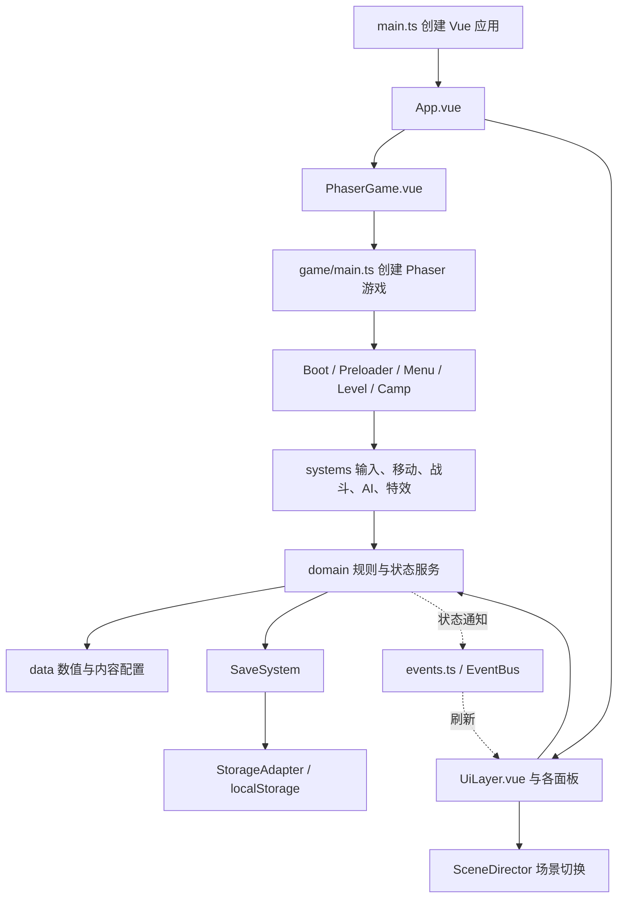

# 《深渊回响》代码导读

本文按 2026-10-29 已提交源码 `88e750d22a1c8af918613de1bfeb380f5778f795` 梳理。目标是说明每个业务文件负责什么、主要方法做什么，以及一次操作如何跨文件完成。它不是逐行语法翻译，也不把旧注释中的计划当成已实现行为。

本次已纳入奖励与可达性、检查点续关、存档管理、自动保存静默提示、技能树选择修复，以及第三章精英回旋尾刃。附录同样从上述提交提取，行号对应该版本。

配套的 [源码符号与测试索引](源码符号与测试索引.md) 列出各源文件的声明、直接依赖和测试用例，适合边看本文边定位源码。以下路径均相对仓库根目录；正文表格里的短文件名相对对应章节目录。

## 1. 先理解整体：浏览器里同时运行两套界面

Phaser 负责画布中的角色、地图、碰撞、敌人和特效；Vue 负责覆盖在画布上的菜单、背包、商店、技能树、设置与 HUD。二者共享同一组领域服务，没有后端服务器参与战斗或保存进度。



这张图是主要调用方向，不是所有 import 的完整集合。比如领域服务之间也会直接调用，系统层也会读取表现配置。具体依赖见附录。

### 这些目录为什么要分开

| 层 | 回答的问题 | 例子 |
| --- | --- | --- |
| `data` | 游戏设定是什么？ | 武器基础伤害、技能耗能、敌人生命 |
| `domain` | 根据规则，现在允许做什么，状态如何变化？ | 金币够不够、技能是否冷却、受伤后剩多少血 |
| `systems` | 怎样在 Phaser 世界中执行和表现？ | 创建弹丸、移动刚体、检测命中、播放剑光 |
| `scenes` | 这一场游戏需要哪些系统，按什么顺序运行？ | 进入关卡后建立玩家、敌人、相机与拾取系统 |
| `adapters` | 怎样调用浏览器能力并处理失败？ | 本地存储、音频解锁、全屏 |
| `ui` | 玩家怎样看见状态和发出操作？ | 背包按钮、技能介绍、血条 |

例如“释放治疗技能”涉及三个职责：`skills.ts` 定义治疗量；`skillService.ts` 检查解锁、SP 和冷却；`LevelScene.tryCastSlot()` 执行治疗并触发特效。文件变多的一个原因是把这三类职责分开了。

### 阅读时经常遇见的写法

- `interface`、`type`：约定数据形状，本身不会在游戏中创建实体。
- `class`：可创建的对象模板；`new PlayerController()` 才得到本关玩家控制器。
- `export const resourceSystem = new ResourceSystem()`：全局单例。关卡与面板读写的是同一个资源服务。
- `Result`：成功返回 `{ ok: true, value }`，可预期失败返回 `{ ok: false, code, message }`。调用方应分支处理，不是每个失败都抛异常。
- `snapshot`：用于读取或保存的状态投影；读到快照不等于可以直接修改内部状态。
- `dt`：通常是秒；`deltaMs` 通常是毫秒。相同的 `update` 名字不代表参数单位相同。
- 回调，如 `onEnemyKilled`：把“发生这件事后要干什么”接入系统；与全局事件总线不是同一个机制。
- `FR/NFR/DR/AT/ARCH/IF/EX`：需求、非功能需求、数据约束、验收、架构、接口、异常编号，主要用于追溯文档，不是运行指令。

## 2. 从打开网页到进入游戏

```text
index.html
  → src/main.ts
  → App.vue
      ├─ PhaserGame.vue → game/main.ts → BootScene
      │                                  → PreloaderScene → MenuScene
      └─ UiLayer.vue ← 等待 AppBoot.ready、场景就绪通知
```

| 文件 | 具体作用与联系 |
| --- | --- |
| `index.html` | 提供网页根节点、游戏页面样式引用和 `src/main.ts` 模块入口。它是浏览器入口。 |
| `src/main.ts` | `createApp(App)` 创建 Vue 应用、挂载到 `#app`；把 Vue 未处理错误交给 `appLifecycle.reportError()`。 |
| `src/App.vue` | 同时挂载 `PhaserGame` 与 `UiLayer`，并引入 UI 样式令牌。本身不实现游戏规则。 |
| `src/PhaserGame.vue` | 挂载时调用 `StartGame('game-container')`；监听当前场景就绪并保存引用；卸载时销毁 Phaser 实例。开发模式安装游戏、领域、音频和场景调度探针，方便浏览器验证。 |
| `src/game/main.ts` | 构造 Phaser 配置并导出 `StartGame()`。设定最小逻辑视野 1024×768、`Scale.EXPAND`、Arcade Physics 和五个场景；世界重力读取 `PLAYER_DEFAULTS.gravity`，`tileBias` 为 32。 |
| `src/game/scenes/BootScene.ts` | 加载基础背景；向 `sceneDirector` 注册游戏实例，安装浏览器生命周期适配，然后启动 Preloader。 |
| `src/game/scenes/PreloaderScene.ts` | `init()` 建立加载画面；`preload()` 先校验配置，再登记图片、角色帧、敌人美术、区域背景、音频；`create()` 注册纹理动画、装配存档、读档或建立初始背包和武器，最后完成 `AppBoot` 并进入菜单。配置或资源失败时提供画布错误页和重试。 |
| `src/game/scenes/MenuScene.ts` | 显示 Phaser 菜单背景、淡入并发出场景就绪通知。可点击的主菜单由 Vue 的 `MainMenuView` 显示。 |
| `src/game/domain/appBoot.ts` | 保存启动完成的 Promise。Preloader 调用 `resolve/reject`，`UiLayer` 等待 `ready`，防止界面在配置和存档尚未准备好时展示可操作内容。 |

注意：Preloader 顶部仍残留“P3 才接入存档”的阶段说明，实际 `create()` 已调用 `bootstrapSave()` 和 `saveSystem.load(0)`。

## 3. 配置层：`src/game/data/`

这些文件主要保存数据，不负责每帧驱动角色。修改数据后仍要经过配置校验，涉及地图可达性或玩法的修改还需要相应验证。

| 文件 | 保存什么 | 谁使用、怎样影响游戏 |
| --- | --- | --- |
| `playerDefaults.ts` | 初始玩家属性、重力、跳跃、速度、受击参数，以及 HP/SP、金币和 SKP 总量相关常量；死亡损失常量保留但均为 0。 | 游戏入口、玩家控制、资源与经济服务等读取。运动参数还由地图审计读取；当前 `jumpVelocity` 为 560，不能照搬旧注释的 480。 |
| `weapons.ts` | 六把武器定义、初始拥有武器和主副手装备。 | `WeaponService` 读取等级与装备定义，`CombatResolver` 读取攻击方式、攻击盒、弹速和射程。 |
| `enemies.ts` | 四类普通/精英敌人以及三个 Boss 的基础属性；Boss 三阶段技能配置。 | `EnemyAI` 实例化实体；Boss 技能状态机读取阶段与技能参数。 |
| `normalEnemyCombat.ts` | 普通敌人的主动攻击类型、前摇、生效、后摇、冷却、追踪与俯冲参数。 | `NormalEnemyBrain` 决策。接触伤害、基础速度等仍来自敌人基础定义。 |
| `bossCombatProfiles.ts` | Boss 对不同武器的倍率、抗性提示、近远距离判断和追近参数。 | `bossDamage` 计算倍率；`enemyAI` 做距离决策；预警层显示对应提示。 |
| `skills.ts` | 三分支共 21 个技能节点，包括前置、SKP 成本、SP 消耗、冷却和效果。 | 技能树展示与 `SkillService` 规则读取，关卡执行返回的效果。9 个主动、12 个被动；全解锁成本 46，最多获得 42，存在成长取舍。 |
| `items.ts` | 药水、弹药、材料及背包武器条目。 | `InventoryStore` 处理堆叠、使用与装备；HUD 和 UI 读取名称等资料。物品定义和武器战斗定义是不同职责。 |
| `goods.ts` | 商店售卖的引用、价格、数量和解锁区域。 | `ShopService.listGoods()` 过滤商品，`buy()` 执行购买。 |
| `lootTables.ts` | 物品/材料掉落的相对权重和数量范围。 | `EconomyService.rollLoot()` 抽取。敌人金币范围另在敌人定义中，不要混为同一张表。 |
| `levels.ts` | 十二关的 ID、顺序、标题、目标时长、地图路径、Boss 与碎片配置。 | `ProgressService` 计算解锁链；`LevelLoader` 加载和核对实际 JSON 地图。它不保存完整平台坐标。 |
| `regionThemes.ts` | 森林、洞穴、神殿的资源前缀、色彩和背景变体。 | `regionBackdrop` 等表现模块读取，不决定伤害或碰撞。 |
| `campPresentation.ts` | 商人和传送门的设施坐标、交互区域与区域配色。 | `CampScene` 和 `campScenery` 共用，避免画面位置与交互区分离。 |
| `rewardDefaults.ts` | 宝箱章节金币/固定材料、首通金币基数及强敌保底材料。 | RewardService 和 LevelScene 读取；金币/材料单一配置源。 |
| `eliteTail.ts` | 第三章精英尾刃的前摇、后摇、冷却、射程、速度、伤害、攻击盒与多怪起手间隔。 | domain/eliteTail 与 EnemyAI/Fx 共用，基础生命/移速仍来自 enemies。 |
| `playerCombatArt.ts` | 六武器与各技能的表现类型和颜色。 | `PlayerCombatFx` 绘制武器、攻击、主动和被动反馈；伤害仍由战斗规则决定。 |
| `index.ts` | 配置表的集中再导出。 | 方便其他模块引用，本身不增加玩法逻辑；校验仍在 `ConfigRegistry`。 |

## 4. 领域层：`src/game/domain/`

领域层主要保存规则和可测试状态，不创建 Phaser 精灵。下面分组只是阅读方式，不代表新增子目录。

### 4.1 类型、配置与基础计算

| 文件 | 核心代码及作用 |
| --- | --- |
| `types.ts` | 定义 `WeaponDef/EnemyDef/SkillDef/ItemDef/LevelDef` 等配置契约，及资源、背包、HUD 状态形状。`BOSS_SKILL_KINDS` 还是运行时可用的技能种类列表。其他模块 import 类型并不等于运行了它们的业务。 |
| `result.ts` | 定义错误码与 `Result`，提供 `ok()`、`fail()`，统一“金币不足”“技能冷却”等返回形式。 |
| `configRegistry.ts` | `validateAll()` 校验 ID、引用、数值、技能关系与总量等；`markValidated()` 开放读取；`ConfigRegistry.weapons()/skills()/levels()` 等作为配置读取门面。未通过启动校验就读取会报程序性错误。 |
| `damageCalculator.ts` | `calcDamage()` 将基础伤害、武器等级系数、技能系数、防御倍率和随机浮动合成伤害，四舍五入且至少为 1；异常数值钳制并告警。随机源由参数注入，测试能得到固定结果。它只算数，不寻找命中目标。 |
| `bossDamage.ts` | `bossWeaponFactor()` 查询指定 Boss 对指定武器的倍率，并考虑破甲状态。由战斗结算调用，和基础伤害公式分工。 |
| `warn.ts` | `warnThrottled()` 对相同 key 的警告做一分钟节流；`resetWarnThrottle()` 清理记录，供测试等场景使用。避免错误值持续刷屏。 |

### 4.2 玩家资源、背包、武器、技能与经济

| 文件 | 核心代码及作用 | 与其他文件的联系 |
| --- | --- | --- |
| `resourceSystem.ts` | `getSnapshot()` 读取 HP/SP；`applyDamage/heal/restoreSp/spendSp` 改变资源；`notifyKill/notifyCombatEvent/tick` 处理击杀回能、战斗状态和脱战恢复；被动上限方法重算容量；`refill()` 补满。 | 战斗扣血、技能耗 SP、物品恢复、重生补满最终汇入这里，避免各模块独自维护血量。 |
| `economyService.ts` | 保存金币和材料；`addCoins/addMaterial` 增加；`spend()` 先整体核验再扣除；`upgradeCost()` 算升级费用；`applyDeathPenalty()` 当前固定返回损失 0；`rollLoot()` 权重抽物品；`onDirty()` 接保存回调。 | 商店、升级、拾取共用。实际敌人死亡时由 LevelScene 调奖励模块抽取随机掉落；普通余额变化通过 400ms 窗口合并保存。 |
| `shopService.ts` | `listGoods()` 按区域过滤商品，并组合是否拥有、是否满级、可负担及缺口视图；`buy()` 先检查金币、空间和是否已拥有，再扣款入包；`upgradeWeapon()` 委托武器服务升级。 | 连接商品配置、经济、背包和武器服务；购买在完整提交后发脏通知，触发及时保存，避免仅保存扣款或仅保存入包。 |
| `inventoryStore.ts` | 维护 20 格背包及主副手装备 ID。`addItem/hasFreeSpace` 处理空间与堆叠；`useItem` 消耗可使用物品并调用资源服务；`equip/dropItem/moveSlot/sort` 改背包；`consumeItem/countItem` 供弹药等调用；`initNewGame/restoreMissingInitialWeapons` 建立和修复初始武器条目。 | 发布 `inventory:changed`，并调用脏标记回调。弹药由攻击时的武器服务消耗，背包点击弹药不等于开火。 |
| `weaponService.ts` | `getEquippedDefs()` 将装备 ID 转成武器定义；`getLevel/getLevelFactor` 读取按武器和手位区分的等级；`levelUp` 扣金币材料并升级；`beginSwitch/toggleHand/tickSwitchLock` 管切换锁；`consumeAmmo` 委托背包扣弹药。 | 装备槽和物品数量在背包，武器等级与切换规则在这里，命中在战斗系统。三者并不是三份相同状态。 |
| `skillService.ts` | 保存已解锁技能、累计获得/消耗的 SKP、四个快捷槽与冷却。`getTreeSnapshot` 给界面节点状态；`unlock` 校验前置与 SKP；`equip/unequip` 绑定；`tryCast` 检查解锁、冷却、SP，成功即扣 SP 并启动冷却，返回 `CastDecision`；`tickCooldowns` 倒计时；`passiveBonuses` 聚合被动；`resetBuild` 扣金币洗点。 | 领域服务完成规则和扣费，关卡负责范围伤害、弹丸、冲刺和治疗的实际执行。SP 是战斗能量；SKP 是成长点数。 |

`rewardService.ts` 连接奖励、经济、背包与进度：`grantChestReward()` 只发奖，由 PickupSystem 先认领；兼容入口 `claimChestReward()` 同时认领和发奖。`enemyRewardItems()` 复用掉落表抽取，`grantRewardItem()` 将材料记入经济余额、其余入背包并返回余量。`grantEnemyLoot()` 提供保底及随机奖励组合能力，但当前 LevelScene 实际路径是直接给保底材料，再把随机结果生成世界物品，不能把组合方法当成已接入的死亡入口。

### 4.3 进度、统计、设置与 HUD

| 文件 | 核心代码及作用 |
| --- | --- |
| `progressService.ts` | `beginLevel(levelId,resume,checkpointIds)` 仅在明确续关、同关且检查点存在于真实地图时恢复，否则回出生点；`completeLevel()` 标记首通、解锁下一关并推进续关目标、清旧检查点。`collectShard` 管永久碎片，`collectChest/openChest/isChestOpened` 管永久宝箱首开；另有教学、快照恢复和 `onDirty()` 保存接线。 |
| `recordStore.ts` | `submitResult()` 更新每关最佳时间和碎片纪录；`getLastSubmit()` 供结算页显示新纪录；`addDeath/addKill/addPlayTime` 累计全局统计。进度服务回答“能进哪关”，这里回答“以前打得怎样”。 |
| `settingsStore.ts` | 保存三路音量、震屏、全屏状态和键位；`setVolume` 校验数值；`remap` 检查冲突；改动发布 `settings:changed` 并通知存档。实际进入全屏由浏览器适配器完成。 |
| `keymap.ts` | 默认动作映射与可重绑动作集合；`normalizeKey/keyCode` 规范化和转码；`effectiveKeys` 合并默认/自定义映射；`keyConflict/sanitizeKeymap` 检查冲突并清理存档键位。UI 按键提示和输入系统都读取它。 |
| `hudViewModel.ts` | 聚合资源、金币、材料、技能槽、弹药、武器等级、Boss 血条和关卡上下文。`tick()` 至多约 10Hz 发 `hud:update`；`getPerFrame()` 给 HUD 每动画帧读取连续条形和冷却数据。它是显示数据组合层，不是 HP/SP 的权威存储。 |
| `devProbe.ts` | `installDevProbe()` 在开发浏览器暴露领域服务供调试和自动化构造状态；仅开发入口动态加载。测试探针不是玩家正常操作路径。 |

### 4.4 不依赖 Phaser 的敌人和机关规则

| 文件 | 核心代码及作用 |
| --- | --- |
| `normalEnemyBrain.ts` | `NormalEnemyBrain` 保存巡逻、追击、前摇、生效、后摇、冷却、归巢状态；`tick()` 输入真实位置、玩家位置、可移动方向、可见性和存活状态，输出速度及是否开火；`snapshot` 提供警告区/攻击区；`interrupt` 中断攻击，`consumeAttack` 保证一次攻击不会持续重复命中；`syncPosition` 同步当前物理位置。 |
| `bossAbilities.ts` | `BossAbilityField.begin()` 根据技能和施放上下文生成区域/动作；`tick()` 推进生效时间、蛛卵孵化和位移等；`damageZones` 取当前伤害区；`hitEgg` 处理破卵；`slowFactor` 查询蛛网减速；`clear/stopCharge` 清理技能或终止冲撞。预警和伤害共享这些几何数据。 |
| `bossSurface.ts` | `findBossSurface()` 通过调用方传入的 `solidAt()` 扫描脚下表面及连续宽度，让 Boss 压迫技能针对实际地形。它不直接读 Phaser 地图对象。 |
| `levelDevices.ts` | `DeviceState.activate()` 校验距离、是否已激活和激活顺序；`isGateOpen()` 判断机关门条件；`advanceCrumble()` 计算易碎平台站立、破碎和恢复状态。实际碰撞体创建/启停由 `LevelDeviceSystem` 完成。 |

`eliteTail.ts` 的 `EliteTail` 是第三章精英的纯秒制状态机：`start()` 锁定起点/朝向，`tick(dt,blocked)` 推进前摇→去程→返程→后摇→冷却→idle；`snapshot` 给飞刃位置、矩形和可命中状态，`consumeHit()` 限制一次往返最多一次命中，`cancel()` 在有效施招期间转入完整后摇，不缩短已有冷却。实体重置时新建 EliteTail。墙体扫描由 EnemyAI 提供，模型不读地图。

### 4.5 存档不是把整个游戏对象直接序列化

| 文件 | 核心代码及作用 |
| --- | --- |
| `saveSchema.ts` | 定义版本 1 存档结构、七分节和正式/pending/损坏备份键名。`progress.openedChests` 为可选宝箱记录，旧健康 v1 档缺失时按空集合恢复；当前关和检查点用于续关，快捷槽、键位也属于持久化契约。 |
| `checksum.ts` | `canonicalJson()` 递归规范化键序；`fnv1a32()` 计算哈希；`computeChecksum()` 排除 checksum 字段后求校验和，用于发现保存内容变化或损坏。它不是加密或服务器防作弊。 |
| `saveBootstrap.ts` | 将七个存档分节注册给 SaveSystem，其中 player 组合资源、经济和 SKP；设置、技能、进度、武器及商店走及时排队，普通背包和经济变化走 400ms 合并窗口。`syncSkpFromProgress()` 根据碎片与 Boss 首通数恢复累计获得 SKP。 |
| `saveSystem.ts` | `register/aggregate` 聚合参与者；`markDirty/queueWrite(delayMs)` 合并微任务或延迟写入，重要写入可提前兑现已有延迟；`flushPending()` 在隐藏/退出时同步兑现。`write()` 保持 pending→正式→清 pending，失败通知并标记内存运行模式；`load()` 解析、版本/迁移/校验和检查、备份异常并恢复。`getSummary()` 给最近成功保存/读取摘要；`inspectJson/importJson` 校验导入、先写盘后恢复；`retryWrite/exportJson` 重试与导出当前最新领域快照。 |

`saveValidation.ts` 的 `validPortableSave()` 校验外部导入文件：七分节、数值范围、物品/武器/关卡引用、背包槽、技能前置、进度唯一性及 SKP 获得减消耗与余额一致；它不负责写盘。`inspectJson()` 另检查大小、版本、JSON 和 checksum，二者都通过才能预览和替换。

当前迁移表仍为空，schema 仍为 1；旧健康档缺 openedChests 可正常恢复。加载会丢弃残留 pending，并非拿它自动恢复最新档。正常启动 load 的检查和导入 inspectJson 的严格内容校验不是同一条路径；导入的版本要求也比 load 的迁移框架更明确，不能混为同一功能。

## 5. 场景层：主要组装点

### `LevelScene.ts`：把系统接成一局游戏

这个文件较长，是理解项目时最值得先读的文件。它同时承担系统装配、回调接线、帧次序、死亡/重生、结算和技能执行，因此关联的文件多。

| 方法/回调 | 实际做什么 |
| --- | --- |
| `init(data)` | 选择关卡 ID 和 `resume` 意图，重置本局 earnedCoins、ready、检查点、Boss 唤醒与救援计数；恢复检查点在 create 中读取真实地图后决定。 |
| `preload()` | 按关懒加载 `public/assets/levels/<id>.json`。公共角色和音频已由 Preloader 加载。 |
| `create()` | 用 LevelLoader 建立地图上下文，调用 `progressService.beginLevel()` 验证续关位置并传送；续关或 HP≤0 时补满资源。创建背景、输入、机关、相机、边界、敌人、弹丸、战斗、特效与拾取，接好奖励、死亡、音频和教学，登记事件并开放 ready。 |
| `onOverlay` | 收到 UI 面板开关后暂停/恢复活动玩法场景，防止背包打开时游戏仍在后台战斗。 |
| `onPlayerDamaged` | 播放受击音效、闪白和震屏；扣 HP 已在战斗/资源服务完成。 |
| `onEnemyKilled` | 计击杀与击杀回能，生成带面额金币；按 ENEMY_MATERIAL_COUNTS 直接给精英/Boss 保底材料；调用 enemyRewardItems 抽取随机物品并通过 spawnItemDrop 留在世界供拾取。 |
| `tryCastSlot()` | 查快捷槽与远程武器条件，调用 `skillService.tryCast()`；成功后按效果分支排队范围伤害、发射弹丸、开始冲刺或恢复 HP，同时播放表现。 |
| `onSkillUnlocked` | 为被动技能解锁播放提示。HP/SP 上限重算等规则在技能服务中。 |
| `onPlayerDeath()` | 防重复死亡，清理技能表现/Boss 技能、计死亡，调用玩家死亡逻辑；等待 800ms 后重生并排队存档。 |
| `respawnPoint()` | 优先返回有效的 activeCheckpoint 坐标，否则返回地图出生点；activeCheckpoint 可由本关触碰激活，也可由明确续关时恢复。 |
| `respawn()` | 补满 HP/SP，释放 Boss 边界，重置敌人、Boss 技能、弹丸、机关、危险区和相机，再把玩家放回重生点。不会清空已经永久收集的碎片。 |
| `ex11Rescue()` | 掉出地图底部之外时将玩家送回重生点，带淡入淡出与重复异常告警；这是异常救援分支，和触碰地图即死区不同。 |
| `onGoalReached()` | 检查玩家存活及配置 Boss 确已死亡；推进解锁与纪录，发放章节首通金币和首次 Boss SKP；通知中分开本局所得、首通金币、死亡损失 0、当前钱包，随后排队写档并切菜单背景，Vue 显示结算面板。 |
| `bossWakeCheck()` | Boss 真正入场交战后切换紧张音乐。 |
| `mark/stageReport()` | 开发模式记录 update 各段耗时并节流告警，帮助定位帧预算问题。 |
| `shutdown()` | 关闭 ready、解绑领域通知、清除活动场景引用，销毁战斗/Boss/弹丸/机关/边界/敌人/特效/拾取等系统。 |

### `update()` 的真实顺序

```text
音频时钟 → 面板/ready 守卫
  → 输入采样 → 普攻与技能请求
  → Boss 对玩家的预处理 → 玩家移动 → 机关 → 教学/Boss 唤醒
  → 弹丸生命周期
  → Boss 独立技能推进 → 战斗判定
  → 敌人 AI → 普通敌人预警 → Boss 边界/血条
  → 掉图救援、即死区和通用 Boss 危险区
  → 金币、碎片、检查点、宝箱、终点和教学触发
  → 资源恢复、冷却、武器切换锁、各类表现
  → 相机 → HUD、关卡时间和游玩统计
  → 暂停/背包/技能树请求
```

这些是 Scene 主动调用的顺序；Arcade 的内部物理更新由 Phaser 自己调度，不等于碰撞引擎的全部过程都写在这条列表里。文件头的阶段编号跳过 4，是历史架构编号，不能据此认定漏执行了一个步骤。

### `CampScene.ts`：营地

`init()` 选择区域；`create()` 创建区域背景、营地布景、商人和传送门交互区、资源提示和输入。`createFacility()` 建立设施交互，`refreshInstructions/refreshResources/refreshFocus()` 更新提示与焦点；`activate()` 把营地操作转成打开商店或选关请求。`update()` 轮询键盘并更新焦点/布景；`shutdown()` 清理事件和对象。它没有调用关卡完整战斗管线。

## 6. 运行系统层：`src/game/systems/`

### 6.1 输入、玩家和地图

| 文件 | 主要方法、职责与联系 |
| --- | --- |
| `inputGateway.ts` | `poll()` 每帧只采样一次动作，保存按住/刚按下/刚松开的快照；`isDown/justPressed/justReleased` 供多个系统读取，避免重复读取 Phaser JustDown 把输入吃掉。支持自定义键位、鼠标攻击、清键和输入禁用，`destroy` 解绑。 |
| `playerController.ts` | 构造玩家精灵和刚体；`update(deltaMs)` 实现加减速、空中移动、土狼时间、跳跃缓冲、松键截断跳高、下穿单向平台与动作状态；`beginAttack/canAttack` 管攻击硬直；`startDash` 管冲刺；`teleportTo` 重置位置与运动状态；`die` 管死亡动作和通知，仍调用死亡损失接口但当前损失为 0。它不遍历敌人计算命中。 |
| `levelLoader.ts` | `load()` 读已缓存 Tiled 地图，校验地图尺寸、图层、出生点、检查点、碎片、终点、敌人和 Boss 战场等；创建图层并返回 `LevelContext`，其中包含实体坐标、碰撞层、机关等。`onewayProcess()` 委托单向分离规则。失败返回 Result 并中止进关。 |
| `onewaySeparation.ts` | `shouldSeparateOneway()` 根据下落速度、当前与上一帧脚底位置判断是否应站上平台。利用扫掠跨越关系避免高速下落穿透；是否主动下穿则先由玩家控制器决定。 |
| `levelDeviceSystem.ts` | 创建易碎平台、开关、门和标牌等 Phaser 对象；`update()` 处理站立/触发及机关规则，启停碰撞和提示；`reset/destroy` 用于重生及退出。纯规则来自 `domain/levelDevices.ts`。 |
| `cameraRig.ts` | `update()` 平滑跟随、朝向前瞻和地图边界限制；`onLanded()` 产生落地沉降；`lockTo()` 切 Boss 战场取景并适配缩放；`shake()` 先检查震屏设置。相机锁定不负责阻挡玩家。 |
| `viewportLayout.ts` | `bindViewportLayout()` 根据扩展后视口布局并在场景关闭时解绑；`centerDesignCamera()` 对齐设计坐标；`createViewportBackground()` 布置背景。菜单、营地、标题等共用，避免各写一套窗口比例计算。 |

### 6.2 战斗、敌人和 Boss

| 文件 | 主要方法、职责与联系 |
| --- | --- |
| `combatResolver.ts` | `tryAttack()` 先检查切换锁、动作和弹药，再启动攻击；`beginMelee()` 建立短时攻击盒和命中集合；`spawnProjectile()` 保存武器来源与等级系数；`queueAreaDamage()` 让技能伤害在战斗阶段结算。`update()` 处理敌弹、敌人主动攻击/接触伤害、玩家死亡守卫、范围伤害、挥击与玩家弹丸；`hitEnemy/hitPlayer` 组合公式、抗性、无敌帧、击退和通知。`destructibleTargets` 接入蛛卵等可破坏对象。 |
| `projectilePool.ts` | `spawn()` 从 32 个槽位复用弹丸，池满复用最老者；`update()` 处理射程等生命周期，瓦片碰撞回收；`getActive()` 给战斗判定；`release/clear/destroy` 回收。弹丸移动/存活管理在这里，是否打到敌人及最终伤害在 CombatResolver。 |
| `enemyAI.ts` | `EnemyEntity` 管单个敌人 HP、受击、动画和行为；普通敌人委托 NormalEnemyBrain，第三章精英启用 EliteTail，早期精英/特殊召唤物/Boss 保留分支。`updateEliteTail` 检查视线、地面与前方墙体，把飞刃快照接到普通主动攻击接口。`EnemyAI` 管实体集合、更新预算、召唤、重置与销毁，并用共享起手闸让第三章精英至少错开 1.15 秒施法。 |
| `bossAttack.ts` | `beginBossAttack()` 建立某招状态，`tickBossAttack()` 推进前摇→生效→后摇，并返回 fire/finished 信号。它不自己创建完整技能场。 |
| `bossAbilitySystem.ts` | 将敌人的施招接给领域 `BossAbilityField`：采集玩家、Boss、战场和真实地形上下文；`preparePlayer()` 应用/恢复减速；`update()` 推进技能、应用脚本位移、伤害、孵化和撞墙等；把可破坏蛛卵接给 CombatResolver；`render()` 调表现；`reset/destroy` 还原脚本状态。 |
| `bossArena.ts` | `activate()` 保存并限制相关刚体边界；`enforce()` 对玩家和敌人维持战场约束；`release()` 恢复原边界；`destroy()` 清理。它负责物理封锁，CameraRig 负责看到哪里，两者由场景配合启停。 |
| `bossSkillPresentation.ts` | 共用弹幕角度、召唤落点、弹丸纹理选择和 Boss 配色/名称。执行与预览共用角度/落点，减少预警和实际攻击不一致。 |

理解 Boss 时需要区分三个层次：`EnemyEntity.updateBoss()` 选择“何时用哪招”；`BossAttack` 表示该招前摇/生效/后摇；独立技能的区域与运动由 `BossAbilityField` 计算，再由 `BossAbilitySystem` 接入真实世界。通用弹幕、召唤和危险区仍有原来的执行分支，不能假设所有招式都只走一个文件。

### 6.3 表现与场景公共能力

| 文件 | 具体作用与读取来源 |
| --- | --- |
| `enemyVisuals.ts` | `loadEnemyArt/registerEnemyAnimations` 加载并注册敌人资源；`enemyTexture` 选择初始贴图；`EnemyVisual.face/windup/skill/update/reset` 将 AI 状态翻译为朝向、前摇、攻击、受击和死亡表现。 |
| `normalEnemyArt.ts` | 普通敌人的帧网格、动画和显示参数；不存生命与伤害。 |
| `normalEnemyFx.ts` | `render()` 读取普通攻击状态与第三章精英尾刃快照，绘制前摇金线、绿色去程、橙色返程、蓝色后摇圈等；几何与伤害同源，不独立计算扣血。 |
| `bossAbilityFx.ts` | 依据 Boss 技能领域快照绘制锤击、震波、冲撞、俯袭、剑舞、换位、蛛网、蛛卵及残影。`clear/destroy` 清理图形和文字。 |
| `bossDangerFx.ts` | 通用 Boss 危险区、弹幕/召唤等预览与状态提示；`summonBurst()` 呈现召唤反馈。与独立技能 Fx 的职责存在分工，需要沿施招类型找入口。 |
| `playerCombatFx.ts` | `setEquipped()` 设置持握武器；`weapon()` 接攻击盒绘制挥击/后坐；`skill/passive` 添加反馈；`update()` 绘制并推进寿命；`clear/destroy` 清理。依据实际执行结果触发表现，不决定技能是否成功。 |
| `playerProjectileArt.ts` | 选择弩箭、飞镖、火球等纹理和技能着色，注册程序绘制纹理；由弹丸池使用。 |
| `worldFxLayer.ts` | 共用浮动伤害数字、消息、受击闪白、拾取与检查点反馈；文本池控制对象数量，`tick()` 推进自身时钟。 |
| `pickupVisuals.ts` | 注册并集中命名圆形金币、棱角技能碎片、闭合/开启宝箱及随机掉落纹理，供场景和拾取系统使用。 |
| `regionBackdrop.ts` | 注册三大区域地形/背景资源，`createRegionBackdrop()` 建立远中近视差背景并适配尺寸、变体和关闭清理。 |
| `levelScenery.ts` | 根据区域与地图上下文绘制装饰性树木、遗迹、矿井或符文等场景元素；实际可站立地形以加载器和地图碰撞层为准。 |
| `campScenery.ts` | 创建区域营地地面、商店、传送门等表现，返回 `update/destroy`；设施尺寸和配色读共享配置。 |
| `campInteraction.ts` | 不依赖 Phaser 的营地焦点模型；`navigate/point` 合并键盘选择与鼠标悬停，`setEnabled` 控制可操作，`activate` 返回 shop 或 levelSelect 意图。由 CampScene 接成事件。 |
| `audioDirector.ts` | `attach()` 连接游戏音频；`playSfx()` 合并短时间重复同音效；`playBgm/tick()` 推进音乐交叉淡化；`setBossPhase()` 切紧张变体；设置变化重算三路音量；解锁后冲刷挂起播放。`safeVolume` 避免访问已销毁声音。 |
| `tutorialDirector.ts` | 仅符合条件的 1-1 启动教学；`onHintEnter` 入队，`update` 检查动作/超时，`promote/complete/consume` 串行展示与消费提示；通过动作回调判断完成，最终记录教学完成。 |
| `sceneDirector.ts` | 保存 Phaser 游戏和活动玩法场景引用；`gotoLevel(levelId,resume=false)` 将续关意图传给关卡，`gotoMenu/gotoCamp` 为其他切换命令；内部 `request/fadeTo/awaitTarget` 控制淡出、启动目标、等待 active 和淡入。切换中保留最后一个 pending 意图。DOM 定时器不随源场景暂停而丢失。 |
| `pickupSystem.ts` | 悬浮金币对象带 value 面额，每次最多 8 个可见实体，池满把金额合并至已有实体；磁吸/拾取按面额入账。`spawnItemDrop()` 建立随机物品拾取，满包保留余量并重试。宝箱有可见外观、E 提示与永久开启态，先认领再回调发奖；检查点、碎片、终点和教学触发保持去重，`destroy()` 清理金币、物品与宝箱表现。 |

## 7. 浏览器适配层：`src/game/adapters/`

| 文件 | 作用及失败处理 |
| --- | --- |
| `storageAdapter.ts` | 包装 localStorage，限制本游戏键前缀；`read/writeAtomic/remove/rename/probe` 提供读、写、删、备份与可用性探测；将配额和不可用错误转为 Result；`exportAsDownload` 通过浏览器下载 JSON。双键顺序在 SaveSystem，这里的单次写入只是其中一步。 |
| `audioAdapter.ts` | `unlock()` 在用户手势内尝试恢复音频上下文；记录 unlocked/blocked，通知音频调度器；`onVisibility()` 处理页面可见性引起的音频挂起/恢复。受浏览器限制时允许静音继续。 |
| `fullscreenAdapter.ts` | `install()` 监听真实全屏状态；`toggle()` 请求进入或退出，捕获拒绝并同步设置。设置中的布尔值不是浏览器全屏 API。 |
| `appLifecycle.ts` | `install()` 处理失焦、可见性、WebGL 上下文及全局异常，装配全屏；隐藏页面和 pagehide 调 `saveSystem.flushPending()` 兑现合并窗口内的修改。`reportError()` 记录异常、节流显示横幅并回菜单；`compatMode` 给菜单 Canvas 提示。 |

## 8. Vue 界面层：`src/ui/`

Vue 单文件组件一般有三部分：`script setup` 读状态和处理操作；`template` 定义显示结构及按钮事件；`style` 决定布局与视觉。读功能先看 script，再找 template 中调用它的按钮，最后看样式。

| 文件 | 主要代码与依赖 |
| --- | --- |
| `UiLayer.vue` | UI 总调度：`open/close/goto` 与面板历史栈；`enterLevel(levelId,resume)` 区分续关和重玩，`continueGame()` 选择当前关/最后解锁关/最终通关后的第三营地；`requestedGameplay` 防旧菜单 ready 覆盖排队玩法意图。接存档管理、保存退出和失败重试/导出；自动成功仅刷新摘要和清失败，手动操作成功显示四秒确认。保留启动等待、Esc 消费和手势音频解锁；HUD 仅 Level 无面板时显示。 |
| `useDomainStore.ts` | `read()` 获取初始快照，`subscribe(refresh)` 监听变化，用 `shallowRef` 整体替换状态；作用域销毁时取消订阅。它不是另一套业务状态仓库，也没有使用 Pinia。 |
| `MainMenuView.vue` | 展示开始、继续、选关、设置、帮助、记录与存档管理入口；按 hasSave 控制继续，读取兼容模式；组件事件交给 UiLayer，继续由 continueGame() 处理。 |
| `LevelSelectView.vue` | 读取 ProgressService 的关卡视图，按三区域展示解锁/通关/碎片，发出 enter/camp/back 操作。 |
| `PauseOverlay.vue` | 展示继续、帮助、设置、放弃、保存并退出及存档管理。`saveAndQuit()` 在 UiLayer 中先调用 write，失败保留当前界面，成功才回主菜单并显示手动保存确认。 |
| `ResultView.vue` | 显示关卡时间、击杀、碎片、新纪录，并区分本关实际所得、首通奖励、死亡损失（0）及当前金币；提供下一关、重试、选关，结算重试默认从起点。 |
| `InventoryPanel.vue` | 订阅背包快照；`leftClick()` 选择武器或使用物品，`rightClick()` 装备指定手位，`drop()` 丢弃；展示名称、说明、弹药指引和图标。业务改动调用 InventoryStore。 |
| `ShopPanel.vue` | 组合商店商品、金币、武器视图；`buy/upgrade` 调服务并播放结果音效，按变化通知刷新。UI 判断可购买状态用于显示，事务校验仍由服务执行。 |
| `SkillTreePanel.vue` | 展示三分支、中文介绍、前置、SKP 与快捷槽；节点仅点击切换选择，悬停或焦点变化不再改变学习/绑定对象。`learn/equip/unequip` 调服务并显示失败反馈。 |
| `SettingsPanel.vue` | 订阅设置快照；`setVol/remap/toggleFullscreen` 分别调用设置服务和全屏适配器，反馈冲突与拒绝。 |
| `RecordsView.vue` | 根据配置关卡清单读取每关最佳成绩和全局统计，按区域展示。本地记录不依赖服务器榜单。 |
| `HelpView.vue` | 根据实际键位生成操作表，从配置生成补给说明；帮助提示会跟随自定义键位变化。 |
| `HudOverlay.vue` | `hud:update` 刷新文字资源；单一 rAF 读取 `getPerFrame` 更新条形/冷却/Boss 血条并锚定 canvas；显示技能点、材料、主副手、弹药和补给提示。卸载时停 rAF、解绑通知。 |
| `TutorialHints.vue` | 订阅 `tutorial:hint` 展示当前提示，收到 done 后隐藏；从进度读取教学完成状态。 |
| `SaveManagerPanel.vue` | 原生 dialog 展示存档关卡/检查点/时间/游玩摘要；selectFile 异步读取 JSON 并用选择序号防旧读取覆盖新选择，inspectJson 通过才显示候选预览；replaceSave 再调用 importJson，成功后同步 SKP。主菜单允许导入，暂停只查看/导出；导出、重试和关闭经组件事件交 UiLayer。 |
| `CombatIcon.vue` | 按传入 ID 通过 `combatIconUrl()` 显示对应图标，是面板/HUD 共用的小组件。 |
| `combatIcons.ts` | 列出可用武器/技能图标 ID，将合法 ID 映射成本地 SVG 路径，未知 ID 返回 null。 |
| `skillPresentation.ts` | `describeSkill()` 根据技能效果字段生成中文效果描述，避免界面只显示内部 ID。 |
| `ammoPresentation.ts` | `ammoWeaponNames()` 找使用某弹药的武器，`ammoGuide()` 根据装备与真实键位说明如何换装和开火。 |
| `i18n.ts` | 集中保存 UI 文案 `UI_TEXT`。目前仍有场景/表现内直接写的文案，不能理解为所有中文都已集中于此。 |
| `tokens.css` | 共享颜色、字体和控件等设计令牌；各 Vue 文件还保留局部样式。 |

### Vue 为什么不会自动知道领域状态变了

服务里的普通字段不是 Vue 响应式对象。背包的典型刷新是：

```text
InventoryPanel 点击
  → inventoryStore.useItem/equip
  → 内部状态改变
  → inventory:changed
  → useDomainStore 的 refresh()
  → snapshot.value = read()
  → Vue 更新模板
```

HUD 另有连续画面通道。不是所有状态都发独立通知，有些面板组合已有事件后整体重新读取；因此排查“数据已改但面板没刷新”时，要同时看服务写入和该面板订阅了什么。

## 9. 事件总线与直接调用怎样配合

`src/game/EventBus.ts` 实际实现的是 `MiniEmitter`，有 `on/off/once/emit/listenerCount/removeAllListeners`。发事件时复制监听器数组并按注册序调用，允许监听器在回调中解绑。

`src/game/events.ts` 在它外面加 `EventPayloads` 类型表以及 `emitEvent/onEvent/offEvent` 泛型门面，编译时检查事件名对应的 payload。

| 通知 | 主要用途 |
| --- | --- |
| `hud:update` | 推送资源文字快照 |
| `player:damaged` | 已经受伤，触发音效/闪白/震屏 |
| `player:died` | 死亡及金币损失信息；当前 lostCoins 为 0 |
| `enemy:killed` | 击杀后计数、回能、金币世界掉落、保底材料与随机物品 |
| `level:cleared` | 完成数据交给结算页，含可选 earnedCoins/firstClearCoins/lostCoins 区分收益和钱包 |
| `inventory:changed` | 背包和装备变更刷新 |
| `skill:unlocked` | 技能解锁刷新及被动提示 |
| `settings:changed` | 输入、音量、显示提示同步 |
| `save:written / save:failed` | UiLayer 刷新存档摘要、处理失败提醒与重试/导出；自动成功不弹确认 |
| `ui:overlay` | UI 面板开关驱动场景暂停/恢复 |
| `tutorial:hint / load:progress` | 教学和加载进度桥接 |
| `game:requestPause`、`game:requestInventory`、`game:requestShop`、`game:requestLevelSelect`、`game:requestSkillTree` | 玩法场景请求 UI 根处理暂停、背包、商店、选关和技能树导航 |
| `current-scene-ready` | 模板保留的场景实例通知，直接经 EventBus 传递，不在 EventPayloads 内 |

例如购买是 `shopService.buy()` 直接调用；成功后的界面刷新再使用通知。场景内紧密协作也常用直接回调，例如 `combat.onWeaponVisual` 接到玩家武器表现，避免所有事情都广播。

事件文件头“只有十二事件”和“EventBus 本体是 Phaser EventEmitter”的注释已不符合全部实现：目前还有明确列出的 UI 桥接通知，本体也已自定义。阅读时以类型表和实际实现为准。

## 10. 用完整操作串起代码

### 10.1 按 J 发起一次近战

```text
keymap 默认/自定义键位
  → InputGateway.poll() 记录 attackMain 刚按下
  → LevelScene.update() 调 combat.tryAttack('main')
  → WeaponService 获取装备，PlayerController 检查并进入攻击状态
  → CombatResolver.beginMelee() 创建朝向侧攻击矩形
      ├─ onAttackBegan → 音效/教学
      └─ onWeaponVisual → PlayerCombatFx 挥击画面
  → CombatResolver.update() 与 EnemyEntity 受击盒相交
  → calcDamage + 技能被动系数 + Boss 抗性/防御检查
  → EnemyEntity.applyHit() 改 HP、受击或死亡
      ├─ WorldFxLayer / EnemyVisual 显示反馈
      └─ 死亡通知 → LevelScene 计击杀、ResourceSystem 回能、PickupSystem 掉金币
```

攻击画面和攻击判定分开；同一次挥击通过集合记住已命中的实体，避免每帧重复扣血。武器攻击盒尺寸来自当前武器定义，不能把文件头示例的 40×36 当成所有武器固定尺寸。

### 10.2 用远程武器开火

与近战共享 `tryAttack` 入口；远程先由 `WeaponService.consumeAmmo()` 调背包扣弹药，成功才进攻击动作并创建弹丸。ProjectilePool 管位置、射程和回收；CombatResolver 做弹丸对目标的命中结算，弹丸保留武器来源供等级和 Boss 抗性使用。普通攻击与技能散射的调用路径不同，不能假设每次 `spawnProjectile()` 都在内部扣弹药。

### 10.3 学习并释放技能

```text
拾取回响碎片 → ProgressService 记收集 → SkillService 获得 SKP
  → Y 打开技能树 → unlock() 检查前置和点数
  → equip() 绑定到 1~4，变更排队存档
  → 关闭面板恢复关卡 → 按快捷键
  → LevelScene.tryCastSlot() 做装备前提检查
  → SkillService.tryCast() 检查解锁/冷却/SP，成功扣能并起冷却
  → LevelScene 根据 effect 执行范围伤害/弹丸/冲刺/治疗
  → 表现与 HUD 更新
```

范围技能先入 `pendingAreas`，等战斗阶段处理。这样同帧敌人致命攻击可以先让玩家死亡，再清掉尚未结算的玩家攻击，落实代码中的 K7 规则。

### 10.4 一招 Boss 技能

```text
EnemyEntity.updateBoss() 判断入场、血量阶段、距离与队列
  → beginBossAttack() 开始前摇
  → onBossAttackBegan → BossAbilitySystem.begin()
  → BossAbilityField 建立技能几何/时序
      ├─ BossAbilityFx 读取同一快照画预警
      └─ update 推进后，生效区交给 CombatResolver.damagePlayer()
  → 收招/阶段切换/死亡/重生时重置技能场
```

Boss 锁镜头是 `CameraRig.lockTo()`，锁物理边界是 `BossArena.activate/enforce()`；少一个都可能出现画面与可走范围不一致。

### 10.5 死亡、检查点与通关

普通受击由战斗服务检查无敌帧并交资源服务扣血；致死通过回调进入 `onPlayerDeath()`。即死区则由场景直接进入死亡流程。死亡等待后重置本次尝试的战斗对象，保留金币、永久成长、已收碎片及宝箱首开记录，并写档。明确“继续”时经 `UiLayer.enterLevel(id,true) → SceneDirector.gotoLevel(id,true) → LevelScene.create() → ProgressService.beginLevel()`，只恢复同关且真实地图仍存在的检查点；选关及结算重试默认 resume=false，从起点开始。旧档缺字段或检查点无效回出生点；最终通关后继续回第三营地。

触碰终点后，PickupSystem 调用 `onGoalReached()`；Boss 关额外要求配置中的 Boss 确已死亡。成功才标记终点已触发，避免拒绝后永远无法再次检测。普通关首通按章节给 30/60/90 金币，Boss 首通给 100/200/300；重复通关不再给首通奖励。结算页是 Vue 面板，后台 Phaser 已请求返回菜单背景。

### 10.6 买一件商品并保存

```text
CampScene.activate() → game:requestShop
  → UiLayer 打开 ShopPanel → ui:overlay 暂停营地
  → ShopPanel.buy() → ShopService.buy()
  → 校验商品、金币、背包空间、是否已拥有
  → EconomyService 扣款 + InventoryStore 添加物品
  → 通知与快照刷新 → 面板显示新金币/库存
  → 交易完成脏标记 → queueWrite() 及时合并请求（提前兑现余额/背包的 400ms 窗口）
  → 微任务中聚合七分节 → checksum → pending → 正式键 → 清 pending
```

金币和物品任一不满足时应在提交前拒绝；正常交易不会通过 UI 直接改 `coins` 字段。

### 10.7 打开与关闭背包

关卡输入发 `game:requestInventory`，UiLayer 将状态改为 inventory 并发 `ui:overlay(open:true)`，活动玩法场景暂停。关闭时从历史栈返回上一面板；只有最后一层关闭才恢复游戏。DOM 先消费关闭用的键，直到 keyup 才放行，防止恢复后的 Phaser 把同一次按键当成重新打开。

### 10.8 开箱与随机物品如何进入账户

```text
靠近宝箱按 E → PickupSystem 读永久开启状态
  → ProgressService.openChest() 首次认领，防止重生/重进刷取
  → LevelScene.onChest → grantChestReward()
  → 章节 40/60/80 金币和 1/2/3 强化残片直接入账 → 本关 earnedCoins

enemy:killed → LevelScene 保底材料直接入账
  → enemyRewardItems() 随机抽取 → spawnItemDrop() 生成世界物品
  → 接近后 grantRewardItem() → 材料入经济，其他物品入背包
  → 满包余量继续留在世界，腾出空间后再试
```

敌人金币另走 `spawnCoinBurst()`，显示对象数量与金额分离；每次最多八个对象，每个 value 可大于一，池满合并金额，避免大额收益被显示池截断。`grantChestReward()` 本身不检查首开，调用方的认领与发奖顺序不可省略。

### 10.9 自动保存、手动保存和 JSON 导入

普通余额/背包变化通过 400ms 窗口合并；进度、技能、武器、商店和设置变化走及时排队；隐藏页面或 pagehide 则 flush。保存成功通知一直存在，UiLayer 自动成功只更新摘要和清失败，不弹成功提示；用户手动重试、保存退出和导入成功显示四秒确认，自动写入不会延长它。

```text
主菜单 → 存档管理 → 选择 JSON
  → 文件字节大小限制 + inspectJson 文本长度/JSON/版本/checksum
  → validPortableSave 内容与 SKP 收支检查
  → 展示候选摘要，当前状态不变
  → 用户点击替换 → importJson 再验证
  → pending → 正式键 → 清 pending → 恢复参与者 → 同步 SKP → 刷新摘要
```

导入校验或写盘失败不替换当前领域状态；存档管理提供失败原因、重试与最新状态导出。存档管理是 UiLayer 的独立 dialog 状态，不增加新的 UiState；暂停中不能导入。

### 10.10 第三章精英回旋尾刃

```text
EnemyAI 创建第三章精英 → 启用 EliteTail
  → 同高度、视线通、190px 内且落地 → 共享起手闸放行
  → 0.75 秒固定朝向前摇
  → 360px/s 去程，最远 260px → 原路返程
  → NormalEnemyFx 读同一快照显示预警/颜色
  → CombatResolver 读 getNormalAttack() 的飞刃矩形，以基础伤害 16 进入既有伤害流程
  → consumeNormalAttack() 消费命中，本次往返最多一次
  → 回收后安全后摇 1 秒 → 冷却 3 秒
```

前摇、飞行和后摇期间关闭本体接触伤害；受击打断飞刃进入完整后摇，死亡取消，重试重置模型和共享起手闸；不同精英起手至少相隔 1.15 秒。EnemyAI 扫描飞行路径并把 blocked 传入领域模型，去程撞墙提前返、回程撞墙收回，飞行另有 2.2 秒上限。第一、二章精英仍用原行为。

## 11. 地图与资源不是 TypeScript 文件，但参与完整运行

`public/assets/levels/*.json` 保存十二张地图的瓦片与对象层。地图平台、出生点、检查点、碎片、敌人、Boss 场地、机关和终点由 LevelLoader 解析，它们不是全部写在 Scene 里的常量。

`public/assets/art/` 是运行时角色/敌人素材，`audio/` 是双格式音频，`gen/` 有生成地形等资源，区域背景和 SVG 图标也通过本地资源路径使用。`public/style.css` 处理网页/画布容器等基础样式，与 Vue 的样式令牌不是同一个层次。

`tools/source-packs/` 等原始素材及第三方示例文件属于制作来源，不是本游戏运行入口。源包自带的 Demo 代码不应当算作本项目业务逻辑，许可约束见 `docs/素材许可清单.md`。

### 制作和审计脚本：`tools/`

| 文件 | 用途及上下游 |
| --- | --- |
| `gen_levels.py` | 定向生成入口，转给布局模块。执行前先检查目标地图是否有手工修改。 |
| `level_layouts.py` | 十二关布局定义和命令入口；1-1 以 `tools/maps/1-1-authored.json` 手工基线为基础。 |
| `level_model.py` | 公共 Tiled 地图构造模型、瓦片常量和对象生成工具，供布局模块复用。 |
| `audit_reach.py` | 直接读实际 JSON 和运动配置，建立站立区及跳跃/落体连接；除终点、碎片、检查点、开关外，逐枚金币及宝箱也生成路线。奖励路线检查关闭门体积、开关顺序和前置条件；易碎计时、战斗及主路线机关时序仍需浏览器实测。 |
| `test_audit_reach.py` | 用临时地图验证审计器行为，防止审计规则自身退化。 |
| `build_assets.py` | 把基础像素资源按约定最近邻放大，生成运行纹理。 |
| `extract_art.py` | 从基础素材中抽取角色/物件帧到游戏美术目录。 |
| `prepare_enemy_art.py` | 从守卫者来源包处理运行时敌人帧；源包不放入公开资源目录。 |
| `prepare_remaining_boss_art.py` | 从蛛后和回响之影来源包整理 Boss 帧。 |
| `prepare_normal_enemy_art.py` | 整理普通敌人的负鼠、鹰和鳄龙图像。 |
| `prepare_region_art.py` | 生成三大区域地形和背景，保持图集 GID 约定。 |
| `check_enemy_art.py` | 检查发布的精灵表格、帧数与透明通道，捕捉空白/不可见帧。 |

### 浏览器检查脚本

这些脚本是开发验证，不是游戏加载时自动执行的逻辑。部分导出检查函数、由 Playwright 工具传入浏览器对象调用，不能一概当成 `node 文件` 即可运行。默认 URL 和历史端口只适用于当时环境，使用前检查函数签名和实际服务地址。

| 文件 | 检查重点 |
| --- | --- |
| `player_attack.check.mjs` | J/K/鼠标真实攻击输入及失败攻击行为 |
| `player_combat_art.check.mjs` | 六武器、九主动技能及界面图标 |
| `enemy_art.check.mjs` | 敌人美术接入 |
| `remaining_boss_art.check.mjs` | 后续两个 Boss 动画、技能时序与清理 |
| `normal_enemy_art.check.mjs` | 普通敌人显示、朝向和死亡表现 |
| `normal_enemy_combat.check.mjs` | 普通敌人追踪、攻击状态和真实物理行为 |
| `boss_arena.check.mjs` | 锁场镜头、边界、解除和重试 |
| `boss_goal.check.mjs` | Boss 死亡条件与终点门禁 |
| `boss_identities.check.mjs` | 三 Boss 独立技能、几何、暂停和同帧死亡优先 |
| `boss_ranged_balance.check.mjs` | Boss 武器抗性、防御姿态、远程应对和战斗流程 |
| `guardian_charge.check.mjs` | 守卫冲撞前摇和预警时静止 |
| `contact_damage.check.mjs` | 接触伤害、无敌帧和击退位移 |
| `controls_and_pickups.check.mjs` | 技能绑定、弹药装备、单向平台和悬浮金币 |
| `jump_coin.check.mjs` | 跳跃轨迹与掉落金币拾取 |
| `resources_hud.check.mjs` | 资源区分、真实库存、弹药不误耗和补给 |
| `keymap.check.mjs` | 改键后的真实输入与提示 |
| `shop.check.mjs` | 购买、升级事务和界面刷新 |
| `overlay_pause.check.mjs` | 面板暂停、恢复和返回关系 |
| `scene_lifecycle.check.mjs` | 场景切换、重入和生命周期清理 |
| `respawn.check.mjs` | 出生点/检查点重生、连续死亡、切关、掉图救援 |
| `gameplay_fixes.check.mjs` | 已有玩法修复的组合回归 |
| `world_routes.check.mjs` | 在真实 Phaser/Arcade 中按审计路线逐帧移动，另有 Boss 流程选项；几何路线中的测试辅助不等于真人难度通过 |
| `economy_save.check.mjs` | 隔离浏览器验证奖励、强化、检查点续关、存档管理、导入导出、失败恢复与保存竞态 |
| `rewards.check.mjs` | 从出生点按审计报告执行金币/宝箱路线，使用真实键盘与 Arcade，测试给予伤害无敌 |
| `reward_interactions.check.mjs` | 真实 E 交互的奖励单点验证，传送只构造夹具，路线由 rewards 脚本另测 |
| `save_notice.check.mjs` | 自动保存静默、失败提醒、恢复与手动成功提示计时 |
| `skill_selection.check.mjs` | 技能树点击选择保持稳定，悬停/焦点不串改学习和绑定对象 |
| `world_interactions.check.mjs` | 营地、机关和 Boss 单点交互；允许用传送/直接伤害构造测试状态 |

## 12. 测试文件和构建配置

所有 `src/**/*.test.ts` 都是测试代码。多数与同名模块相邻，验证规则输出、边界与回归；还包括 `levelAssets` 地图资产、`bossArenaLoader` 战场对象加载、`normalEnemyConfig` 配置、`playerAttack` 攻击入口、`normalEnemyFacing` 朝向、`bossSkills` 技能配置等跨文件专题测试。附录逐个列出文件及其用例标题，避免把测试当成运行功能。

| 文件 | 作用 |
| --- | --- |
| `package.json` | 依赖声明和 npm 命令；当前 Phaser 精确为 4.0.0、Vue 为 3.5.13。包描述仍留有 Phaser 3 模板字样，应以依赖和源码为准。 |
| `package-lock.json` | 锁定实际依赖解析版本，保证安装一致，不是玩法配置。 |
| `vite/config.dev.mjs` | Vue 插件、`@` 路径别名、相对 base 和开发端口配置；默认端口 8086 不保证当前可用。 |
| `vite/config.prod.mjs` | 生产打包、Phaser 分块、terser 压缩和构建提示。 |
| `vitest.config.ts` | Node 环境运行 `src/**/*.test.ts`；覆盖率统计配置指向领域/适配层。真实 Phaser 运行仍需要浏览器检查。 |
| `tsconfig.json / tsconfig.node.json` | 应用配置启用 strict、无未使用变量等检查；node 配置仍包含模板路径 `vite.config.ts`，实际 Vite 命令使用 `vite/` 下两个 mjs。配置文件存在不等于其 include 已覆盖实际工具脚本。 |
| `env.d.ts / src/vite-env.d.ts` | 两者当前均引用 `vite/client`，提供 Vite 环境类型支持，不负责启动游戏。 |
| `.editorconfig` | 4 空格、UTF-8、CRLF 等编辑约定。 |
| `log.js` | 模板遥测脚本，默认 dev/build 会引用；日常使用 `dev-nolog/build-nolog` 避开。 |
| `README.md / Phaser-README.md` | 项目说明与模板原始说明；当前行为仍需结合源码核实。 |
| `PROJECT_CONTEXT.md / AGENTS.md` | 开发索引与协作约束，不是游戏运行代码。 |

常用验证命令是 `npx.cmd --no-install vitest run`、`npx.cmd --no-install vue-tsc --noEmit` 和 `npm.cmd run build-nolog`。纯文档导读不需要运行整套游戏验证；本文不把历史测试通过数作为本次结果。

## 13. 为什么会觉得复杂，以及怎样读才不绕

目前复杂度主要有四个来源：

1. 同一个功能跨配置、规则、执行和显示。例如一把武器至少关联武器定义、背包、武器服务、战斗判定和表现文件。
2. 状态生命周期不同。全局服务跨关保留，关卡系统每次重建；技能冷却、检查点、Boss 临时技能和永久碎片不能一律清空或一律保存。
3. 战斗必须协调时间。输入、前摇、生效、受伤无敌、死亡优先、暂停、销毁之间存在明确顺序。
4. 历史演进痕迹仍在。Boss 通用技能和独立技能并存，某些头注释落后；LevelScene 的装配职责也比较集中。这些会增加阅读成本，但本文未据此擅自重构。

建议按以下顺序阅读源码，每一轮只跟一条完整流程：

1. `src/main.ts → App.vue → PhaserGame.vue → game/main.ts`：理解应用如何启动。
2. `BootScene → PreloaderScene → appBoot → UiLayer`：理解资源、存档和菜单准备顺序。
3. `LevelScene.create/update/shutdown`：先记住系统清单和帧次序。
4. `keymap → InputGateway → PlayerController`：跟一次移动/跳跃。
5. `weapons → WeaponService → CombatResolver → damageCalculator → EnemyEntity`：跟一次攻击。
6. `skills → SkillService → LevelScene.tryCastSlot → PlayerCombatFx`：跟一次技能。
7. `InventoryPanel/ShopPanel → 服务 → useDomainStore`：跟一次菜单操作与刷新。
8. `saveBootstrap → saveSystem → checksum → storageAdapter`：最后理解持久化。
9. 再看普通敌人、Boss 和表现细节；对照附录跳到具体方法及相关测试。

查问题时先问三件事：**状态由谁持有，谁有权修改，谁负责把修改显示出来。** 这三个答案通常就能把相关文件缩小到少数几个。
