# 《深渊回响》软件设计文档

> 2026-10-28 用户确认经济与续关调整：死亡不扣金币；宝箱永久首开直入金币和保底强化材料，敌随机物品走世界掉落；有面额金币保证收益与显示池容量解耦。ProgressService.beginLevel明确区分续关和重玩；自动存档统一接线，普通余额400ms合并、购买强化即时写，页面隐藏/退出flush。单槽新增管理、导出和确认后导入，外部文件先验证结构与SKP收支。旧v1的openedChests为可选字段，不清空存档。具体接口、数值、兼容与本次验证见《金币经济与检查点存档调整》；与下文旧死亡扣币/仅四写入点描述冲突时以本调整为准。


| 项目 | 内容 |
|---|---|
| 项目名称 | 《深渊回响》（Echoes of the Abyss），仓库代号 SEAPP |
| 文档类型 | 软件设计文档（SDD，含概要设计与关键详细设计） |
| 文档版本 | v1.0 |
| 编写日期 | 2026-10-12 |
| 需求基线 | `docs/需求分析文档.md` v1.0（2026-09-28，下称 **SRS**），全部沿用、零改动（见第 2 章） |
| 适用阶段 | 设计；作为编码实现、测试用例细化与代码评审的直接依据 |
| 读者对象 | 项目开发者（本人）、课程评审教师、后续接手实现或测试的协作者 |

---

## 1. 引言

### 1.1 编写目的

本文档在 SRS v1.0 定义的需求基线之上，给出《深渊回响》——运行于桌面浏览器的单人 2D 横版平台跳跃动作游戏（Phaser 4.0.0 + Vue 3.5.13 + TypeScript 5.7.3 + Vite 6.3.2，纯前端、无服务端）——的完整软件设计，包括：架构分层与部署运行视图、模块划分与关键模块详细设计、主要业务场景的流程/时序设计、内部与外部接口设计、数据设计、界面与交互设计要点、非功能设计应对、异常与故障处理设计、关键设计决策与权衡、需求追溯矩阵以及测试与验证考虑。

本文档回答"如何构建"，不重复回答"构建什么"。凡 SRS 已定义的需求内容（数值基线、验收标准、故障场景表），本文档一律**引用编号而不复制正文**；仅在引用不足以指导实现时补充设计层细化，且细化内容不得与 SRS 冲突（一致性自查见 12.4）。

### 1.2 设计范围与输入

**输入**：

| 编号 | 输入物 | 用途 |
|---|---|---|
| I1 | `docs/需求分析文档.md` v1.0 | 唯一需求基线：FR-01~19、NFR-01~10、DR-01~05、EX-01~12、AT-01~75、约束 C1~C7、假设 A1~A4、依赖 D1~D4、附录 A/B |
| I2 | 仓库现状（Phaser 官方 `template-vue-ts` v1.3.0） | 架构起点：`src/game/main.ts`（GameConfig，1024×768，`type: AUTO`）、`src/game/EventBus.ts`（Phaser ↔ Vue 事件总线）、五个模板场景骨架、`vite/config.prod.mjs`（Phaser 独立分包、`base: './'`）、`dev-nolog`/`build-nolog` 脚本 |
| I3 | Phaser 4.0.0 随包 skills（`node_modules/phaser/skills/`：`physics-arcade`、`tilemaps`、`scale-and-responsive`、`input-keyboard-mouse-touch`、`audio-and-sound`） | API 能力边界依据，保证接口设计不虚构引擎能力（SRS R3 已核实） |

**范围**：覆盖 SRS 8.1"范围内"全部功能的软件设计。SRS 8.2 排除项（多人联机、云存档、移动端触控、手柄、关卡编辑器、内购广告、在线排行榜、Mod 系统、配音、小地图）不产生任何设计元素。设计深度分级：关键模块（4.3 节）细化到内部结构与算法约定，可直接编码；次要模块（4.4 节）给出职责、接口摘要与依赖，实现细节留待编码期在本文档约定内自行决定。

### 1.3 术语与缩略语

沿用 SRS 1.3 全部术语（HP/SP/SKP/i-frame/hitbox/hurtbox/土狼时间/跳跃缓冲/可变跳高/Tilemap/检查点/掉落表/存档槽/HUD/Boss 阶段/回响碎片/CC0，以及 **SP 与 SKP 严格区分**的二义性消除约定），不再重复。本文档新增设计术语：

| 术语 | 含义 |
|---|---|
| 领域层（Domain Layer） | 与游戏引擎无关的纯 TypeScript 业务逻辑层：伤害公式、资源、经济、技能、进度、存档编解码等。可脱离 Phaser 在 Node 环境单元测试 |
| 呈现层（Presentation Layer） | 依赖 Phaser 的渲染、物理、输入与场景管理层，以及依赖 Vue 的 DOM 界面层 |
| 平台适配层（Adapter Layer） | 对浏览器 API（localStorage、WebAudio、Fullscreen、visibility 等，即 DR-05）的薄封装，向上提供统一错误约定 |
| Result 模式 | 可预期失败不抛异常，返回 `{ ok: true, value }` 或 `{ ok: false, code, message }` 的判别联合类型；不可恢复的程序错误才抛异常（见 6.1.2 错误约定） |
| 命令 / 通知 | 命令 = UI 或场景对领域模块的**直接方法调用**（同步、带返回值）；通知 = 领域模块或场景经 EventBus 广播的**只读事件**（DR-04），订阅方不得反向修改载荷 |
| ViewModel | 为某个 Vue 视图聚合、整形领域数据的只读投影对象（如 HudViewModel 聚合出 `hud:update` 载荷） |
| update 管线 | 每一帧内各系统固定的执行顺序（见 3.4.2），是输入延迟（NFR-02）与帧耗时（NFR-01）指标的结构性保证 |
| 对象池 | 预先创建、循环复用实体（弹丸、金币、浮动文本）以消除运行时分配的设计模式，服务 NFR-04 |
| 双键写入 | 先写 `*.pending` 临时键、成功后覆盖正式键并删除临时键的存档写入策略（SRS FR-13 处理规则 4），设计细化见 7.3.3 |
| 快照 / Snapshot | 某一时刻全部可持久化状态的纯 JSON 可序列化聚合对象，即 DR-02 存档结构的内存形态 |

### 1.4 参考资料

| 编号 | 资料 | 用途 |
|---|---|---|
| R1 | `docs/需求分析文档.md` v1.0（SRS） | 需求基线，本文档所有 FR/NFR/DR/EX/AT/C/A/D 编号均指向该文档 |
| R2 | `docs/AI协作记录.md`、`docs/人工核实说明.md` | SRS 配套记录；本文档继承其核实结论（如 Arcade Physics 可用、`tilemapTiledJSON` 可用、构建期遥测为 Node 脚本） |
| R3 | GB/T 8567-2006《计算机软件文档编制规范》 | 概要设计/详细设计章节组织习惯 |
| R4 | IEEE Std 1016-2009《软件设计描述推荐实践》 | 设计视图划分（架构、接口、数据、流程）参考 |
| R5 | Phaser 4.0.0 随包 skills 目录（见 I3） | 引擎 API 依据 |
| R6 | 仓库 `template-vue-ts` v1.3.0 源码 | EventBus、GameConfig、构建配置现状 |
| R7 | 课程实验 2 任务要求与评分标准（架构与模块 20 / 接口 15 / 数据 20 / 流程与异常 15 / 非功能 10 / 完备性与可追溯 15 / 可验证性与规范性 5） | 文档要素覆盖依据，覆盖对照见附录 C |

### 1.5 文档约定

**设计元素编号规则**（本文档自有编号，与 SRS 需求编号并存、互不复用）：

| 前缀 | 含义 | 定义章节 |
|---|---|---|
| ARCH-n | 架构元素（层、原则、视图约定） | 第 3 章 |
| MOD-nn | 模块 | 第 4 章 |
| FLOW-xn | 关键流程（x = 场景类别，n = 序号） | 第 5 章 |
| IF-Xnn | 接口（X = 分组：M 内部模块 / E 事件 / X 外部适配） | 第 6 章 |
| DD-nn | 数据设计元素 | 第 7 章 |
| UI-nn | 界面与交互设计元素 | 第 8 章 |
| NF-nn | 非功能设计应对 | 第 9 章 |
| EXD-n | 设计层新增故障模式（区别于 SRS 的 EX-nn） | 第 10 章 |
| DEC-n | 设计决策 | 第 11 章 |
| TT-nn | 测试与验证设计 | 第 13 章 |

编号一经分配不复用；引用 SRS 条目时直接写其编号（如"FR-01 处理规则 4"指 SRS 3.2 节 FR-01 表格中处理规则第 4 条）。措辞沿用 SRS 1.5 的"必须（shall）/ 应当（should）/ 可以（may）"三级助动词。所有物理数值（尺寸、速度、时长、阈值）默认引自 SRS 正文或附录 A，本文档不新造游戏数值；因设计需要新增的技术性参数（如对象池容量）在各处显式标注"设计参数"并给出理由。

**设计要素与章节映射**（任务书 12 项设计要素的落位）：

| # | 设计要素 | 本文档章节 |
|---|---|---|
| 1 | 架构设计 | 第 3 章 |
| 2 | 模块设计 | 第 4 章 |
| 3 | 关键流程设计 | 第 5 章 |
| 4 | 接口设计 | 第 6 章 |
| 5 | 数据设计 | 第 7 章 |
| 6 | 界面与交互设计要点 | 第 8 章 |
| 7 | 非功能设计 | 第 9 章 |
| 8 | 异常与故障处理设计 | 第 10 章 |
| 9 | 设计决策与权衡 | 第 11 章 |
| 10 | 需求追溯矩阵 | 第 12 章 |
| 11 | 测试与验证考虑 | 第 13 章 |
| 12 | 需求来源与变更说明 | 第 2 章 |

---

## 2. 需求基线与变更说明

> 本章回应设计要素 12「需求来源与变更说明」。

### 2.1 需求基线来源

本设计文档的需求基线**完全沿用实验 1 产物** `docs/需求分析文档.md` v1.0（2026-09-28），不在本文档内重列需求清单。该 SRS 满足任务书对基线的全部要求：核心问题与目标用户（SRS 1.2、2.3）、功能需求 FR-01~FR-19（SRS 第 3 章，每条含描述/输入/处理规则/输出/异常边界/验收标准/来源七字段）、非功能需求 NFR-01~NFR-10（SRS 第 4 章，全部量化并给出测量方法）、数据需求 DR-01~DR-05（SRS 第 5 章）、异常故障模式 EX-01~EX-12（SRS 第 6 章）、验收用例 AT-01~AT-75（SRS 第 7 章）。

### 2.2 编号体系对照

本文档引用 SRS 编号的规则如下表，全文一致：

| SRS 编号族 | 含义 | 在本文档中的引用方式 | 设计侧对应元素 |
|---|---|---|---|
| FR-01 ~ FR-19 | 功能需求 | 原编号直接引用 | MOD / FLOW / IF / UI，经第 12 章矩阵定位 |
| NFR-01 ~ NFR-10 | 非功能需求 | 原编号直接引用 | NF-01 ~ NF-10（第 9 章逐条应对） |
| DR-01 ~ DR-05 | 数据需求与接口 | 原编号直接引用 | DD 系列（第 7 章）与 IF-E / IF-X 系列（第 6 章） |
| EX-01 ~ EX-12 | 异常与故障模式 | 原编号直接引用 | 第 10 章逐条给出设计级处理路径 |
| AT-01 ~ AT-75 | 验收用例 | 原编号直接引用 | 第 13 章给出用例 ↔ 模块/接缝对照 |
| C1~C7 / A1~A4 / D1~D4 | 约束 / 假设 / 依赖 | 原编号直接引用 | 9.3 逐条说明设计的遵守与消解方式 |
| S1 ~ S8 | 使用场景（SRS 2.4） | 原编号直接引用 | FLOW-S1 ~ FLOW-S8（第 5 章逐场景时序） |
| U1 / U2 / U3 | 用户类型（SRS 2.3） | 原编号直接引用 | 第 8 章界面差异化要点 |
| 附录 A / 附录 B | 数值基线 / 关卡列表 | "SRS 附录 A"形式引用 | 第 7 章配置表设计的取值来源 |

SRS 9.2 节已给出"需求 ↔ 验收 ↔ 设计模块（建议命名）"映射，本文档第 4 章的模块命名**采纳该建议命名**并按 4.1 的规则扩充（这是 SRS 预留的设计接口，不构成需求变更）。

### 2.3 需求变更说明：零改动声明

**本文档对 SRS v1.0 的全部需求条目零改动**：未新增、未删除、未修改任何 FR/NFR/DR/EX/AT 条目，未调整任何优先级与数值基线。因此按任务书要求不需要提交需求变更说明的逐项清单。设计过程中对 SRS 的处理仅有以下三类，均不构成需求变更：

1. **设计细化**：在 SRS 允许的范围内补充实现机制（如 DR-02 已规定双键写入策略，本文档 7.3.3 给出其状态机设计）。细化内容以 SRS 为上限，不扩大、不缩小需求语义。
2. **命名落实**：SRS 9.2 的"建议命名"落实为正式模块名，并新增 SRS 未点名但设计必需的支撑模块（ConfigRegistry、HudViewModel、平台适配器、GlobalErrorBoundary 等）。每个新增模块在第 12 章反向追溯表中回溯到需求编号或明确的技术原因。
3. **参数补充**：新增纯技术性设计参数（对象池容量、事件节流实现方式等），不触碰 SRS 附录 A 的游戏数值。

**实现期数值调优约定**：SRS 附录 A 规定全部数值为基线，实现期可在 ±20% 范围内调整（超出须走 SRS 9.3 变更流程）。本设计文档把附录 A 数值定义为配置表（DR-01）的默认值，±20% 调优仅修改配置数据、不修改任何设计与代码结构，因此该调优机制天然被本设计吸收，同样不构成需求变更。

### 2.4 基线有效性核对

编写本设计文档时对 SRS 基线做了一致性核对，确认不存在阻断设计的缺陷：

| 核对项 | 结论 |
|---|---|
| FR 编号连续且无重复（19 条） | 通过 |
| 每条高优先级 FR 均有 ≥1 条 AT 用例 | 通过（SRS 9.2 映射完整） |
| DR-04 事件契约覆盖 FR-14/15 所需的全部 UI 同步点 | 通过；本设计未修改、未新增任何 DR-04 事件；唯一未被事件覆盖的同步时机（启动完成）由领域层 `AppBoot.ready` Promise 承担（Vue→领域层直接依赖，符合 ARCH-3，见 6.2.4） |
| 附录 A 数值与 FR 正文数值一致（抽查：短剑伤害 12、i-frame 0.8 s、升级成本公式 `round(60 × n^1.5)`、SKP 收支 46/42） | 通过，无矛盾 |
| SRS 附录 C4 数据模型与 DR-02 存档结构一致 | 通过；第 7 章 ER 图在其基础上仅补充运行时实体，不修改持久化模型 |

---

## 3. 架构设计

> 本章回应设计要素 1「架构设计」与评分项「架构与模块设计（20 分）」。

### 3.1 架构总览

**ARCH-1 分层结构**。系统为纯前端单页应用，自上而下分五层，外加一个贯穿性的平台适配层：

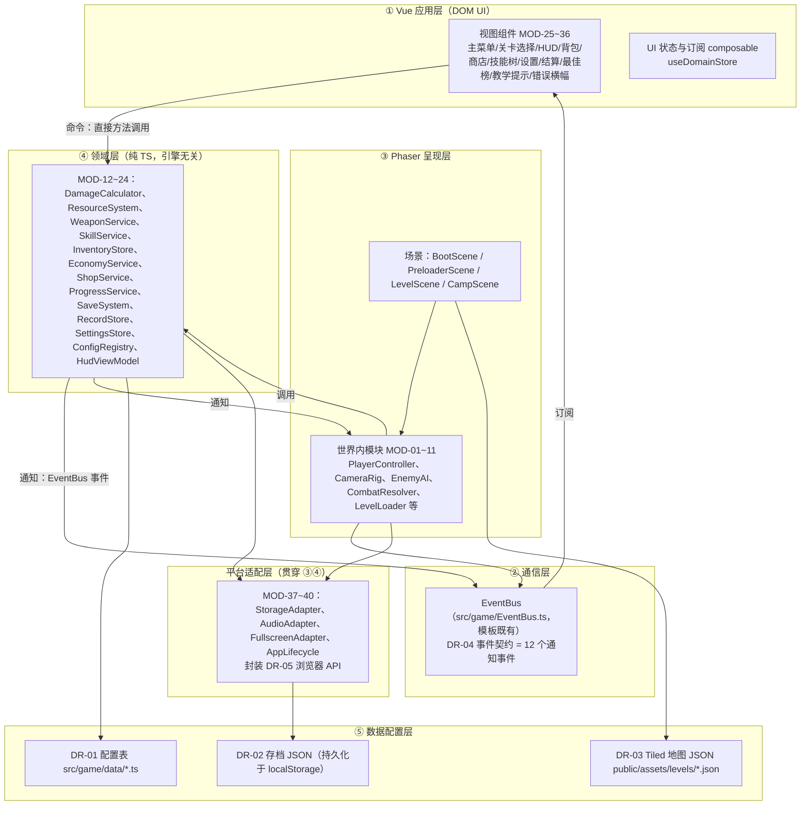

**ARCH-2 各层职责**：

| 层 | 职责 | 明确不负责 |
|---|---|---|
| ① Vue 应用层 | 全部 DOM 界面（菜单、HUD、面板、提示、错误横幅）的渲染与交互采集；键盘导航与焦点管理（FR-15 处理规则 7）；将用户操作转换为对领域层的命令调用；订阅 DR-04 事件刷新视图 | 不含任何游戏规则与数值计算；不直接操作 Phaser 对象；不直接调用浏览器存储/音频 API |
| ② 通信层 | 承载 DR-04 的 12 个通知事件，实现 Phaser ↔ Vue、领域层 ↔ 两侧的事件广播 | 不承载命令（命令走直接调用）；不做数据缓存；事件载荷只读 |
| ③ Phaser 呈现层 | 场景生命周期管理；瓦片地图渲染与 Arcade 物理（C3）；玩家/敌人/弹丸/拾取物的帧更新与动画；hitbox/hurtbox 重叠检测；相机；世界内视觉反馈（浮动文本、粒子、震屏）；键盘鼠标输入采集 | 不实现伤害公式、掉落概率、经济规则、存档格式（全部委托领域层）；不渲染 DOM 界面 |
| ④ 领域层 | 全部游戏规则与数值：伤害公式（FR-04 处理规则 3）、资源回复（FR-06）、武器等级与升级成本（FR-05/FR-10）、技能树规则（FR-07）、背包槽位与堆叠（FR-08）、掉落表（FR-09）、关卡解锁（FR-12）、存档编解码/校验/迁移（FR-13/DR-02）、最佳榜（FR-19）、设置（FR-18）、配置表校验（DR-01）、HUD 数据聚合（FR-14） | 不 import 任何 `phaser` 模块（可测试性约束，见 ARCH-7）；不直接操作 DOM；不直接调用浏览器 API（经适配层） |
| ⑤ 数据配置层 | 静态配置（TS 常量表）与关卡地图（Tiled JSON）；存档 JSON 为运行时产生的持久化数据 | 配置不含逻辑代码；地图数据不含数值参数（数值一律在 DR-01 配置表，地图只放引用 id 与坐标，见 7.2.2） |
| 平台适配层 | 封装 DR-05 全部 7 项浏览器接口，向上提供 Result 模式的统一错误约定（EX-01/04/05/07/08 的检测点） | 不含业务规则；可被 mock 替换（第 13 章测试接缝） |

**ARCH-3 依赖规则**。依赖只允许沿下表方向发生，任何反向依赖（如下层 import 上层）视为架构违规，由代码评审与 `vue-tsc` 项目引用边界（13.2 TT-05）拦截：

| 依赖方 → 被依赖方 | 允许 | 方式 |
|---|---|---|
| Vue 应用层 → 领域层 | 是 | 直接 import 领域单例，调用命令方法 |
| Vue 应用层 → EventBus | 是 | 订阅 DR-04 事件 |
| Vue 应用层 → Phaser 呈现层 | **否**（唯一例外：App.vue 持有 `PhaserGame.vue` 暴露的 game 实例用于启动/销毁，模板既有行为） | — |
| Phaser 呈现层 → 领域层 | 是 | 直接 import，帧内调用 |
| Phaser 呈现层 → EventBus | 是 | 发布/订阅 |
| 领域层 → Vue / Phaser | **否** | 领域层经构造函数注入的回调或 EventBus 发布通知，不感知订阅方 |
| 领域层 / 呈现层 → 平台适配层 | 是 | 仅经适配器接口调用浏览器能力 |
| 全部层 → 数据配置层 | 是 | 只读；写入仅 SaveSystem → StorageAdapter → localStorage |

**ARCH-4 命令与通知的分工**（与 1.3 术语对应）：

- **命令（同步调用）**：UI/场景 → 领域层。例：`InventoryPanel` 点击"使用"→ `InventoryStore.useItem(slot)` 返回 `Result`，失败码由 UI 呈现为提示（EX-10 等）。命令必须有返回值，调用方必须处理失败分支。
- **通知（EventBus 事件）**：领域层/场景 → 全体订阅方。例：`InventoryStore` 变更后发布 `inventory:changed`，HUD 与背包面板同时刷新。通知是广播，发布方不知道也不关心订阅方是谁——这是 FR-08（背包）、FR-14（HUD）、FR-05（武器图标）三处界面需要同步同一份数据而不互相耦合的关键机制。

**ARCH-5 状态归属**。每份可变状态有且只有一个所有者模块（单一数据源，详见 DD-14）：

| 状态 | 所有者 | 只读消费方 |
|---|---|---|
| HP/SP 当前值 | ResourceSystem（MOD-13） | HudViewModel、PlayerController（动画状态） |
| 金币/材料持有量 | EconomyService（MOD-17） | HudViewModel、ShopPanel |
| 背包槽位与装备 | InventoryStore（MOD-16） | HudViewModel（武器图标）、InventoryPanel |
| 武器等级 | WeaponService（MOD-14） | DamageCalculator（经调用入参）、商店界面 |
| SKP 与已解锁技能 | SkillService（MOD-15） | SkillTreePanel、HudViewModel（技能栏） |
| 关卡解锁/通关/碎片 | ProgressService（MOD-19） | LevelSelectView、RecordStore |
| 最佳成绩与全局统计 | RecordStore（MOD-21） | RecordsView、ResultView |
| 设置项 | SettingsStore（MOD-22） | AudioDirector、CameraRig（震屏开关）、Vue 各面板 |
| 玩家物理位置/速度 | PlayerController（MOD-01，Phaser 侧） | CameraRig、SaveSystem（经快照采集） |
| 敌人运行时状态 | EnemyAI（MOD-03，Phaser 侧） | CombatResolver；**不入存档**（SRS FR-11 处理规则 7：死亡后敌人重置） |

**ARCH-6 UI 反应式桥接**。领域层是纯 TS 单例（非 Vue 响应式对象），Vue 侧经统一的 composable `useDomainStore(store)` 订阅：内部用 `shallowRef` 持有 store 快照，store 每次变更后调用订阅回调触发 `shallowRef` 替换（整体替换而非深层修改），Vue 组件按快照只读渲染。该机制不引入 Pinia（决策 DEC-5），保证：领域层可在 Node 环境单测（NFR-08）、UI 永远读到一致快照（不会出现半个字段更新）、事件风暴下渲染合并（Vue 自身的批量更新）。

### 3.2 架构原则

| 编号 | 原则 | 内容 | 服务的需求 |
|---|---|---|---|
| ARCH-7 | 领域引擎无关 | 领域层禁止 `import 'phaser'`。全部游戏规则以纯函数/纯类实现，引擎侧仅做"采集输入 → 调用领域层 → 呈现结果" | NFR-08（核心数值模块覆盖率 ≥80% 的前提）、AT-73 |
| ARCH-8 | 配置表驱动 | 武器/敌人/技能/物品/关卡/商品/掉落表全部来自 DR-01 配置表，由 ConfigRegistry 启动时校验；新增内容 = 新增配置项，不改逻辑代码 | NFR-08（新增武器改动 ≤2 文件）、FR-05 处理规则 7 |
| ARCH-9 | 单一数据源 | 状态归属表（ARCH-5）之外不得存在第二份权威副本；UI 只读投影，禁止 UI 组件私改数值后回写 | 数据一致性（DD-14）、EX-09 减少触发面 |
| ARCH-10 | 事件单向流 | EventBus 只传 DR-04 定义的 12 个通知事件，载荷为只读纯 JSON 对象；禁止用事件发起命令或跨层反向调用 | DR-04、可维护性（NFR-08） |
| ARCH-11 | 适配器兜底 | 全部浏览器 API 经适配层调用，适配层负责把浏览器异常翻译为 Result 错误码；上层代码不允许出现裸 `localStorage.` / `new AudioContext()` 调用 | EX-01/04/05/07/08 的检测点统一、TT 可 mock |
| ARCH-12 | 帧预算内工作 | 每帧固定管线（3.4.2）之外的重活（存档序列化、地图解析、成绩统计）必须在场景切换、暂停等非战斗时机执行 | NFR-01（P95 ≤16.7 ms）、NFR-02 |

### 3.3 运行视图

#### 3.3.1 启动时序

**FLOW-R1 冷启动与资源加载**：

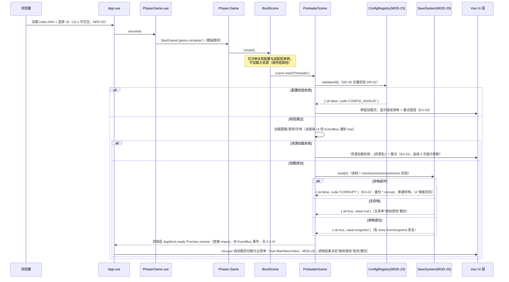

要点：(1) 存档读取发生在 Preloader 而非主菜单点击时，使"继续游戏"按钮的可用/置灰状态（FR-13 处理规则 7）在主菜单出现前就已确定；(2) 音频**不在**启动时解锁，遵循浏览器自动播放策略，首次点击"开始游戏"时由 AudioAdapter 解锁（NFR-10、EX-08，见 FLOW-S1）；(3) 配置校验先于资源加载，避免加载 30 MB 资源后才发现配置非法。

#### 3.3.2 帧 update 管线

**ARCH-13 帧内执行顺序**（LevelScene 内，Phaser 场景 update 与系统回调的固定次序）。该顺序是 NFR-02"按键到视觉反馈 ≤2 帧"的结构性保证：输入在第 N 帧管线最前端采集，同帧内完成角色状态迁移与动画切换，第 N 帧末渲染即出现反馈（延迟 <1 帧 < 33 ms）：

| 次序 | 阶段 | 内容 | 归属模块 |
|---|---|---|---|
| 1 | 输入采集 | Phaser Input 插件读取键盘/鼠标当前状态与按下事件；失焦清零（EX-07） | InputGateway（MOD-01 内部子件） |
| 2 | 玩家更新 | 状态机迁移、土狼时间/跳跃缓冲计时、加速度应用 | PlayerController |
| 3 | 技能与投射物更新 | 冲刺位移、弹丸飞行与射程检查 | SkillService 执行器（Phaser 侧）、ProjectilePool |
| 4 | 物理求解 | Arcade Physics 碰撞与分离（瓦片层、实体间） | Phaser 物理系统（C3） |
| 5 | 战斗判定 | hitbox/hurtbox 重叠检测 → 调 DamageCalculator → 应用结果 → 发布事件 | CombatResolver |
| 6 | 敌人更新 | AI 状态机（巡逻/追击/俯冲/Boss 阶段）；同屏 >24 时最远敌人冻结 AI 仅保留渲染（FR-03 边界） | EnemyAI |
| 7 | 拾取与触发区 | 金币磁吸三段计时、检查点/碎片/宝箱/传送门重叠检测 | PickupSystem |
| 8 | 资源结算 | SP 脱战回复计时、i-frame/冷却/硬直计时器推进 | ResourceSystem、各计时持有者 |
| 9 | 相机 | 插值跟随、边界钳制、落地沉降、震屏衰减 | CameraRig |
| 10 | HUD 聚合与节流 | HudViewModel 聚合快照；数值文本 ≤10 Hz 经 `hud:update` 发布，条形长度逐帧直更（FR-14 处理规则 8） | HudViewModel |
| 11 | 渲染 | Phaser 渲染 WebGL/Canvas；DOM HUD 由 Vue 异步批量更新 | 引擎 |

管线外（暂停/非战斗时机）执行：存档序列化与写入、地图解析、结算统计、场景切换过渡（ARCH-12）。

### 3.4 部署视图

**ARCH-14 部署形态**：单静态站点，无服务端（C2、NFR-09、SRS DR-05"明确不存在的外部接口"）。

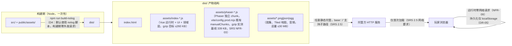

**ARCH-15 运行时进程视图**：单个浏览器标签页内一个 JS 主线程 + 一个 WebGL/Canvas 渲染上下文。无 Worker（Phaser 4 主循环单线程即可满足 NFR-01，见 DEC-9 否决记录）、无 Service Worker（离线运行依赖浏览器 HTTP 缓存，SRS 2.5 允许"加载完成后可离线"；不追加 PWA 需求以避免超出基线）、无 IndexedDB（DEC-4）。

**ARCH-16 浏览器兼容与降级**：`type: AUTO` 由 Phaser 决定 WebGL 或 Canvas 2D 渲染器；WebGL 上下文丢失/不可用走 EX-04（Canvas 回退 + 30 FPS 目标提示）。`Scale.FIT` 等比缩放由 ScaleManager 承担，resize 走 EX-06（9.2 NF-06）。

### 3.5 场景组织设计

**ARCH-17 Phaser 场景清单**（对模板五场景的处置——模板骨架的复用与替换属于设计决策 DEC-10）：

| 场景 key | 来源 | 职责 | 备注 |
|---|---|---|---|
| `BootScene` | 复用模板 `Boot` | 初始化适配层单例、注册全局配置，立即转 Preloader | 不含游戏逻辑 |
| `PreloaderScene` | 复用模板 `Preloader` | 配置校验、资源加载（进度条）、存档读取（FLOW-R1） | 加载失败停留本场景（EX-03） |
| `LevelScene` | 由模板 `Game` 改造 | 承载 12 个关卡（FR-11）：瓦片地图、玩家、敌人、拾取物、战斗、相机、世界内特效与浮动文本；含 Boss 战（相机锁定，FR-02 处理规则 5） | 每次进关以 `scene.start('Level', { levelId })` 携带关卡 id 重启，天然完成上一关资源清理（NFR-04） |
| `CampScene` | 新增 | 3 个营地场景（FR-10）：商人 NPC 交互、传送门（去关卡选择） | 营地无敌人无战斗；商人交互打开 Vue ShopPanel |
| 模板 `MainMenu` / `GameOver` | **移除** | 主菜单与结算/游戏结束界面全部由 Vue 视图承担（DEC-1/DEC-10） | `main.ts` 场景注册表相应更新；Phaser 画布在菜单态显示背景层 |

场景切换统一由 `SceneDirector`（MOD-11 的子件）执行：0.4 s 淡出淡入（FR-12 处理规则 5）、切换期间禁用输入（FR-12 处理规则 6）、切换前触发存档写入点（SRS FR-13 处理规则 2 的"离开营地"等时机）。

### 3.6 架构与选题规模匹配性说明

评分标准要求"架构与选题规模相匹配，不为炫技过度设计"。本架构的规模匹配论证：

| 维度 | 本项目实际 | 架构应对 | 明确不采用（及理由） |
|---|---|---|---|
| 团队 | 1 人 | 五层结构以"目录 + import 规则"落地，无跨进程/跨包边界 | 微前端、monorepo 多包（单人维护成本 > 收益） |
| 运行时 | 单浏览器标签页、纯本地 | 单线程事件循环 + 一个 EventBus | Web Worker 池、Service Worker、WASM（NFR-01 指标在单线程下可达，见 NF-01） |
| 状态 | 一份单机存档 | 领域单例 store + 快照序列化 | Pinia/Vuex（DEC-5）、RxJS 响应式流（学习成本与调试成本不匹配 19 条 FR 的规模） |
| 数据 | 配置表 + localStorage | TS 常量表 + JSON 快照 | IndexedDB/SQLite-WASM（DEC-4）、服务端同步（C2 禁止） |
| 扩展 | 新增武器/敌人/关卡 = 加配置 | ConfigRegistry 校验 + 表驱动（ARCH-8） | 插件系统/Mod API（SRS 8.2 明确排除） |

---

## 4. 模块设计

> 本章回应设计要素 2「模块设计」与评分项「架构与模块设计（20 分）」。模块命名采纳 SRS 9.2 建议命名，编号规则见 1.5。

### 4.1 模块清单

**命名与划分规则**：一个模块 = 一个 TS 文件（类/单例）或一个 Vue 单文件组件（复杂面板可加子组件目录）；模块职责单一起源于"ARCH-5 状态归属表中的一个状态域"或"一类连续的呈现职责"；模块间只经公开接口（第 6 章）与 EventBus 交互，禁止访问他模块私有成员。

| 编号 | 模块 | 层 | 职责一句话 | 追溯 | 设计深度 |
|---|---|---|---|---|---|
| MOD-01 | PlayerController | Phaser | 玩家移动/跳跃/状态机/输入网关，含土狼时间与跳跃缓冲 | FR-01、SRS C2 | 详细（4.3.1） |
| MOD-02 | CameraRig | Phaser | 相机插值跟随、边界钳制、落地沉降、Boss 锁定、震屏 | FR-02、FR-16 | 简述（4.4） |
| MOD-03 | EnemyAI | Phaser | 四类敌人 + Boss 三阶段行为状态机、同屏冻结 | FR-03 | 详细（4.3.2） |
| MOD-04 | CombatResolver | Phaser | hitbox/hurtbox 重叠判定编排、i-frame/硬直管理、浮动数字触发 | FR-04 | 详细（4.3.3） |
| MOD-05 | LevelLoader | Phaser | Tiled 地图解析、图层→GameObject 映射、进关校验 | FR-11、DR-03 | 详细（4.3.4） |
| MOD-06 | ProjectilePool | Phaser | 弹丸与投掷物对象池、射程/碰撞销毁 | FR-04/05 | 简述 |
| MOD-07 | PickupSystem | Phaser | 金币三段拾取（不可拾取期/静止期/磁吸）、碎片/宝箱/检查点/传送门触发区 | FR-09、FR-11 | 简述 |
| MOD-08 | AudioDirector | Phaser | BGM 切换与交叉淡化、音效合并去重（50 ms）、三路音量 | FR-16、NFR-10 | 简述 |
| MOD-09 | TutorialDirector | Phaser | 1-1 五个提示触发区的进入检测与完成判定 | FR-17 | 简述 |
| MOD-10 | WorldFxLayer | Phaser | 世界内浮动文本、命中特效、粒子、掉落物动画（非 DOM 的一切视觉反馈） | FR-04/09/16 | 简述 |
| MOD-11 | SceneDirector | Phaser | 场景切换编排：淡入淡出、输入禁用、切换前存档触发点 | FR-12/15、ARCH-17 | 简述 |
| MOD-12 | DamageCalculator | 领域 | 伤害公式纯函数（FR-04 处理规则 3）+ 数值钳制（EX-09） | FR-04 | 详细（4.3.3） |
| MOD-13 | ResourceSystem | 领域 | HP/SP 上下限、脱战回复计时、击杀回复、低血警示标志 | FR-06 | 简述 |
| MOD-14 | WeaponService | 领域 | 武器实例等级、升级成本核算、主副手装备关系、弹药计数 | FR-05、FR-10 | 简述 |
| MOD-15 | SkillService | 领域 | 技能树拓扑、前置校验、SKP 收支、loadout 装备、冷却计时 | FR-07 | 详细（4.3.5） |
| MOD-16 | InventoryStore | 领域 | 20 格槽位、堆叠合并、使用/装备/丢弃/整理 | FR-08 | 详细（4.3.6） |
| MOD-17 | EconomyService | 领域 | 金币/材料持有量、掉落表掷点、死亡损失、上限钳制 | FR-09、FR-11、附录 A | 简述 |
| MOD-18 | ShopService | 领域 | 商品表过滤（按场景解锁）、购买/升级事务 | FR-10 | 简述 |
| MOD-19 | ProgressService | 领域 | 关卡解锁链、通关/碎片记录、连续前缀校验 | FR-12 | 详细（4.3.7） |
| MOD-20 | SaveSystem | 领域 | 快照聚合、checksum、双键写入、迁移链、导出降级 | FR-13、DR-02、NFR-05 | 详细（4.3.8） |
| MOD-21 | RecordStore | 领域 | 每关最佳用时/碎片、全局统计、新纪录判定 | FR-19 | 简述 |
| MOD-22 | SettingsStore | 领域 | 设置项读写、变更即存档、按键重映射（低优先级子项） | FR-18 | 简述 |
| MOD-23 | ConfigRegistry | 领域 | DR-01 全部配置表的加载与全量校验、只读访问门面 | DR-01、NFR-08 | 详细（4.3.9） |
| MOD-24 | HudViewModel | 领域 | 聚合 HUD 所需快照、10 Hz 节流、`hud:update` 发布 | FR-14 | 详细（4.3.10） |
| MOD-25 | HudOverlay | Vue | DOM HUD：血条/能量条/金币/材料/技能栏/武器栏/Boss 血条/关卡信息 | FR-14 | 第 8 章 UI-03 |
| MOD-26 | MainMenuView | Vue | 主菜单六入口与"继续游戏"置灰逻辑 | FR-15 | UI-01 |
| MOD-27 | LevelSelectView | Vue | 12 关节点分页、锁定/最佳成绩展示 | FR-12/15 | UI-02 |
| MOD-28 | PauseOverlay | Vue | 暂停五入口 | FR-15 | UI-04 |
| MOD-29 | ResultView | Vue | 结算/死亡浮层/游戏结束/通关画面 | FR-15、S3/S8 | UI-05 |
| MOD-30 | InventoryPanel | Vue | 5×4 网格、悬停/右键/拖拽/整理 | FR-08 | UI-06 |
| MOD-31 | ShopPanel | Vue | 商品列表、置灰与缺口显示、武器升级 | FR-10 | UI-07 |
| MOD-32 | SkillTreePanel | Vue | 三分支节点图、解锁交互 | FR-07 | UI-08 |
| MOD-33 | SettingsPanel | Vue | 三音量滑块/全屏/震屏/重映射 | FR-18 | UI-09 |
| MOD-34 | RecordsView | Vue | 最佳榜分组展示与占位文本 | FR-19 | UI-10 |
| MOD-35 | TutorialHints | Vue | 屏幕下方教学提示层 | FR-17 | UI-11 |
| MOD-36 | GlobalErrorBoundary | Vue | 全局错误横幅（存档不可用/损坏告知）、Vue 渲染异常兜底 | EX-01/02、EXD-1 | 第 10 章 |
| MOD-37 | StorageAdapter | 适配 | localStorage 封装：双键原子写、配额异常翻译、导出下载 | DR-02/05、EX-01 | 详细（6.3.1） |
| MOD-38 | AudioAdapter | 适配 | AudioContext 生命周期、解锁、失焦暂停 | DR-05、EX-08、NFR-10 | 简述（6.3.2） |
| MOD-39 | FullscreenAdapter | 适配 | Fullscreen API 封装与拒绝回退 | DR-05、FR-18 | 简述（6.3.3） |
| MOD-40 | AppLifecycle | 适配 | visibilitychange/失焦/resize/全局 onerror 统一接入 | EX-05/06/07、EXD-4 | 简述（6.3.4） |

共 40 个模块：Phaser 侧 11、领域侧 13、Vue 侧 12、适配层 4。每个模块在第 12 章反向表中可回溯到上表"追溯"列的需求编号。

### 4.2 模块依赖图

```mermaid
graph TD
    subgraph VUE["Vue 应用层"]
        UI_PANELS["面板类 MOD-30/31/32/33<br/>InventoryPanel·ShopPanel·SkillTreePanel·SettingsPanel"]
        UI_VIEWS["视图类 MOD-26/27/28/29/34/35<br/>MainMenu·LevelSelect·Pause·Result·Records·TutorialHints"]
        UI_HUD["MOD-25 HudOverlay"]
        UI_ERR["MOD-36 GlobalErrorBoundary"]
    end
    subgraph DOMAIN["领域层"]
        INV["MOD-16 InventoryStore"]
        WPN["MOD-14 WeaponService"]
        SKL["MOD-15 SkillService"]
        RES["MOD-13 ResourceSystem"]
        ECO["MOD-17 EconomyService"]
        SHOP["MOD-18 ShopService"]
        PROG["MOD-19 ProgressService"]
        REC["MOD-21 RecordStore"]
        SET["MOD-22 SettingsStore"]
        DMG["MOD-12 DamageCalculator"]
        HVM["MOD-24 HudViewModel"]
        SAVE["MOD-20 SaveSystem"]
        CFG["MOD-23 ConfigRegistry"]
    end
    subgraph PHASER["Phaser 呈现层"]
        PLR["MOD-01 PlayerController"]
        ENM["MOD-03 EnemyAI"]
        CBT["MOD-04 CombatResolver"]
        LVL["MOD-05 LevelLoader"]
        PICK["MOD-07 PickupSystem"]
        PROJ["MOD-06 ProjectilePool"]
        CAM["MOD-02 CameraRig"]
        AUD["MOD-08 AudioDirector"]
        TUT["MOD-09 TutorialDirector"]
        FX["MOD-10 WorldFxLayer"]
        SD["MOD-11 SceneDirector"]
    end
    subgraph ADAPTER["平台适配层"]
        ST["MOD-37 StorageAdapter"]
        AA["MOD-38 AudioAdapter"]
        FS["MOD-39 FullscreenAdapter"]
        LC["MOD-40 AppLifecycle"]
    end
    UI_PANELS --> INV & WPN & SKL & SHOP & SET
    UI_VIEWS --> PROG & REC & SET & SAVE
    UI_HUD -.订阅 hud:update.-> HVM
    PLR --> RES
    CBT --> DMG
    CBT --> RES & ECO
    ENM --> CBT
    PICK --> ECO & INV & PROG
    PROJ --> CBT
    LVL --> CFG
    SKL --> RES
    SHOP --> ECO & INV & WPN
    WPN --> CFG
    SKL --> CFG
    DMG --> CFG
    ECO --> CFG
    LVL --> PROG
    SAVE --> ST
    SAVE --> INV & WPN & SKL & RES & ECO & PROG & REC & SET
    HVM --> RES & ECO & INV & WPN & SKL
    AUD --> AA & SET
    CAM --> SET
    UI_ERR -.订阅 save:failed 等.-> SAVE
    FS --> SET
    LC -.EX-05/06/07 通知.-> PLR & AUD
```

依赖图与 ARCH-3 依赖规则一致：无 Vue→Phaser 边（除模板既有的 game 实例持有）、无领域层→呈现层边（领域层经 EventBus 通知，图中以虚线订阅表示）、适配层不依赖任何上层。SaveSystem 对八 store 的依赖是**快照采集**方向（调用各 store 的 `toSnapshot()`），store 不感知 SaveSystem（见 4.3.8 注册机制）。

### 4.3 关键模块详细设计

以下 10 个模块承载高优先级需求的复杂逻辑，细化到内部结构与算法约定。统一格式：职责 / 内部结构 / 关键算法与状态 / 发布与订阅 / 依赖 / 追溯。

#### 4.3.1 MOD-01 PlayerController（Phaser）

**职责**：玩家实体的帧更新与状态机执行，把输入意图转换为物理运动，并实现 SRS FR-01 全部容错机制。是 ARCH-13 管线第 1、2 阶段的执行者。

**内部结构**：

| 子件 | 内容 |
|---|---|
| `InputGateway` | 对 Phaser Input 插件的只读封装：`isDown(action)`、`justPressed(action)`、`justReleased(action)`；action 为语义动作（moveLeft/moveRight/jump/attackMain/attackSub/skill1~4/interact），到物理按键的映射读自 SettingsStore（FR-18 重映射子项的接缝）；订阅 AppLifecycle 的失焦事件并清零全部按键状态（EX-07） |
| `PlayerStateMachine` | 实现级状态机，见下表；状态迁移在管线第 2 阶段一次性完成，同一帧只迁移一次（防止一帧内 Attack→Hurt→Dead 连锁跳变导致动画错乱，Hurt/Dead 例外：可打断 Attack） |
| `MotionModel` | 加减速与跳跃物理参数（全部取自 SRS 附录 A，经 ConfigRegistry 读取）：行走 210 px/s、加速 0.12 s、减速 0.10 s、空中操控 0.85、跳初速 480 px/s、重力 1300 px/s²、可变跳高截断 -180 px/s |
| `JumpForgiveness` | 土狼时间计时器（100 ms）与跳跃缓冲计时器（120 ms）：离地时启动土狼计时，缓冲命中或土狼窗口内起跳则消费；两计时器均为帧内递减（`scene.time` 增量），不依赖 `Date.now()`（暂停时自动停止，天然满足 EX-05"失焦暂停计时"） |
| `PlayerCollider` | 22×44 px AABB（FR-01 处理规则 8），与 collision/oneway 图层的碰撞回调注册于 LevelLoader 完成后 |

**实现级玩家状态机**（细化 SRS 附录 C2，补充进入/退出动作；迁移条件全部为帧内同步判定）：

| 状态 | 进入动作 | 迁移 → 条件 | 退出动作 |
|---|---|---|---|
| Idle | 播放 idle 动画；速度 x 归零计时开始 | → Run：任一水平键按住；→ Jump：跳跃键且（在地面 ∨ 土狼窗口内）；→ Attack：攻击键；→ Hurt：受击且不在 i-frame；→ Dash：冲刺技能激活 | — |
| Run | 播放 run 动画 | → Idle：水平键全松（含左右同按，FR-01 边界）；→ Jump / Attack / Hurt / Dash：同 Idle | — |
| Jump | 播放起跳动画 + 起跳音效（FR-16）；设 vy = -480 | → Fall：vy ≥ 0 ∨ 跳跃键松开触发截断（vy < -180 时置 vy = -180，FR-01 处理规则 6）；→ Hurt / Dash | 清空跳跃缓冲 |
| Fall | 播放 fall 动画 | → Idle：落地且无水平输入 + 落地音效 + 相机沉降事件（FR-02 处理规则 4）；→ Run：落地且有水平输入；→ Jump：落地当帧缓冲命中（FR-01 处理规则 5）；→ Hurt；→ Dead：接触即死区（FR-11 处理规则 6） | 启动土狼计时（若离地非跳跃所致） |
| Attack | 按武器攻速生成 hitbox（委托 CombatResolver，持续 0.10 s）；播放挥击动画 | → Idle/Run：硬直（0.12 s）结束；→ Hurt：可被打断 | 销毁 hitbox |
| Hurt | 播放受击动画；触发反向击退（配置强度 60，初速度 180 px/s，实际位移受移动减速影响）（FR-04 处理规则 7）；进入 i-frame 0.8 s + 8 Hz 闪烁 | → Idle：击退结束；→ Dead：HP ≤0 | — |
| Dash | 位移 180 px、无敌 0.2 s（SRS 附录 A 回响冲刺） | → Fall：位移结束 | — |
| Dead | 死亡动画 6 帧 + 0.8 s 停顿（FR-16 处理规则 3）；发布 `player:died` | →（场景重启，重生由 LevelScene 编排，见 FLOW-S3） | — |

**发布**：`player:died`（DR-04）；落地/起跳/受击等音效请求经 EventBus 或直调 AudioDirector（同一场景内直调，减少事件量——设计约定：**场景内部**模块间允许直接方法调用，跨层/跨场景必须走事件，见 6.2.3）。**订阅**：`settings:changed`（重映射更新 InputGateway）。**依赖**：ResourceSystem（读 HP 判死亡）、SettingsStore、ConfigRegistry。**追溯**：FR-01、FR-02（沉降事件源）、FR-16（音效触发源）、EX-07、EX-11（卡墙检测由物理回调触发，处理见 10.2）。

#### 4.3.2 MOD-03 EnemyAI（Phaser）

**职责**：全部敌人（巡逻/追击/飞行/Boss）的行为状态机与运动执行；同屏预算控制。

**内部结构**：`EnemyEntity` 管实体生命、动画和刚体；三个普通敌人使用 Node 可测的 `domain/normalEnemyBrain.ts`，输入实际刚体中心、视线、地面与墙体探测，输出移动、施招状态与攻击几何。基础配置读 `enemies.ts`，主动攻击配置集中在 `data/normalEnemyCombat.ts`，启动时由 ConfigRegistry 校验。精英与 Boss/特殊召唤物沿用各自现有分支。

> 2026-10-29 FR-03 精英补充：仅第三章 enm_elite 使用 EliteTail 纯领域状态机，配置来自 data/eliteTail.ts；EnemyAI 负责视线、落地与扫墙检测、共享起手闸，CombatResolver 复用单次消费与玩家无敌帧；NormalEnemyFx 读取同一快照绘制去返颜色和后摇。具体契约与验证见 `docs/第三章精英回旋尾刃.md`。

**行为要点**（2026-10-28 用户确认调整，对应 FR-03 / AT-08～10）：巡逻型变为慢速远程，追击型变为快速近战；紫鹰先跟随上方位置，前摇末段锁定后直线俯冲，以时间、距离、碰撞或越过目标保证结束，后摇停留并关闭接触伤害，随后升空或归巢。追踪丢失后保留最后可见位置 2.5 s，归巢期间不重新被拉走。伤害由 CombatResolver 在玩家攻击前结算，复用 i-frame 与 K7；同次攻击命中后消费。NormalEnemyFx 每帧读取同一快照绘制预警/实际攻击盒和后摇提示；LevelScene 组装和销毁，无独立计时器或事件监听。具体参数及验证见 `docs/普通敌人行为差异化调整.md`。

**同屏预算**（FR-03 边界）：每帧管线第 6 阶段开头执行 `budgetPass()`：统计激活敌人数，>24 时按与玩家距离排序，最远者 `brain.sleep()`（跳过 AI 更新，保留物理体与渲染）。sleep/wake 无状态残留（brain 计时器挂起而非清零，唤醒后行为连续）。

**发布**：`enemy:killed`（DR-04，由 CombatResolver 在击杀确认后发布，EnemyAI 订阅后播放消失动画并通知 EconomyService 掷掉落表——掉落物实体生成属 PickupSystem）。**追溯**：FR-03、FR-09（掉落触发链）、NFR-01（预算机制）。

#### 4.3.3 MOD-04 CombatResolver + MOD-12 DamageCalculator（Phaser + 领域）

**职责分工**（本对模块是 ARCH-7 分层的典型样例）：

- **MOD-12 DamageCalculator（领域，纯函数）**：实现 FR-04 处理规则 3 公式 `实际伤害 = round(基础伤害 × 武器等级系数 × 技能加成系数 × 随机(0.95~1.05))`，最小 1；输入为结构化 `DamageRequest`（基础伤害、等级系数、技能系数、随机源），输出 `DamageResult`；对 NaN/Infinity/负值钳制并记录（EX-09）。**随机源以参数注入**（`rng: () => number`），单测可注入确定性序列（TT-01 的接缝）。武器等级系数 `1 + 0.15×(等级-1)` 由 WeaponService 计算后传入，公式模块不读配置（职责单一）。
- **MOD-04 CombatResolver（Phaser）**：判定编排器。管理攻击方 hitbox 生命周期（近战 40×36 px、0.10 s，同一次挥击对同一目标至多 1 次——以 `hitSet: Set<gameObjectID>` 在挥击开始时清空实现，FR-04 处理规则 1/验收 AT-15）；重叠检测用 Arcade `overlap`；命中后组装 `DamageRequest` 调 DamageCalculator，将结果应用到受击方，触发受击闪白 0.08 s、浮动数字（委托 WorldFxLayer）、i-frame/硬直计时；玩家受击路径：校验 i-frame → 扣 HP（ResourceSystem）→ 击退 → `player:damaged` 事件。**玩家与敌人同帧互杀**：以玩家死亡为准（FR-04 边界），实现为管线第 5 阶段先结算"敌对玩家"的伤害、后结算"玩家对敌"的伤害，且玩家死亡标志一旦置位立即跳过后续攻击结算。

**追溯**：FR-04（全部处理规则）、FR-05（hitbox 参数来源）、NFR-08（公式单测边界）、EX-09。

#### 4.3.4 MOD-05 LevelLoader（Phaser）

**职责**：把 DR-03 地图 JSON 转换为可游玩场景内容，并执行进关校验（DR-03"加载校验"）。

**内部结构与流程**：`load(levelId)` → Phaser `tilemapTiledJSON` 解析 → 按 7.2.2 图层映射表逐层构建 → `validate()` → 返回 `Result<LevelContext, LevelLoadError>`。`LevelContext` 含出生点、检查点列表、碎片列表、敌人生成清单、危险区矩形、终点区域、碰撞组引用，供 LevelScene 装配其余模块。

**校验清单**（全部来自 DR-03，任一失败即中止进关，错误信息含关卡 id 与缺失项，EX-03）：`player_spawn` 恰好 1 个；`goal` 恰好 1 个；`checkpoints` 常规关 ≥2 / Boss 关 ≥1；`shards` 恰好 3 个且 id 关卡内唯一；enemies 图层每个对象名在 EnemyDef 表中存在；tilewidth/tileheight = 32、orientation = orthogonal、瓦片编码为 CSV。

**追溯**：FR-11、DR-03、EX-03、AT-37~40。

#### 4.3.5 MOD-15 SkillService（领域）

**职责**：技能树全部规则（FR-07）：21 节点三分支拓扑、前置校验、SKP 收支、主动技能 loadout（≤4）、冷却计时、洗点（低优先级子项）。

**内部结构**：树数据来自 ConfigRegistry 的 SkillDef 表（`prerequisiteId` 构成森林，加载时校验无环、前置同分支——DD-02 校验项）；`unlocked: Set<skillId>`、`skpBalance: number`、`loadout: (skillId|null)[4]` 为持久化状态（入存档快照）；`cooldowns: Map<skillId, number>` 为运行时状态（不入存档，关卡内由帧增量递减，暂停自动停止——用游戏时钟而非墙钟，EX-05 一致性）。

**关键命令**：`unlock(skillId): Result<void, 'SKP_INSUFFICIENT'|'PREREQ_LOCKED'|'ALREADY_UNLOCKED'>`（AT-25）；`equip(skillId, slot): Result`（技能栏满须先替换，替换不退 SKP，FR-07 边界）；`tryCast(skillId, ctx): CastDecision`——**决策与执行分离**：领域层只判定 SP/冷却并产出 `CastDecision`（消耗量、效果参数），Phaser 侧执行器（SkillExecutor，MOD-01 子件）负责位移/弹丸/范围伤害的实际呈现，命中结算回到 CombatResolver。该分离使技能规则可单测（NFR-08）而特效不被领域层污染（ARCH-7）。

**发布**：`skill:unlocked`（DR-04）。**追溯**：FR-07、FR-06（SP 消耗联动）、AT-24~26。

#### 4.3.6 MOD-16 InventoryStore（领域）

**职责**：FR-08 全部规则：20 格槽位、三类物品、堆叠合并、使用/装备/丢弃/整理。

**内部结构**：`slots: (SlotEntry|null)[20]`，`SlotEntry = { itemId, count, sourceLevel? }`（武器不堆叠 count 恒 1，携带自身等级引用键——等级数据归 WeaponService，槽位只存 itemId + 实例键，避免双源，ARCH-9）；`equipped: { main: string|null, sub: string|null }`。

**关键算法**：
- `addItem(itemId, count): AddResult`——先遍历可堆叠同类未满槽合并，再占空格；无空间返回 `{ ok:false, code:'FULL' }`（EX-10 的判定点；调用方 PickupSystem 据此保留地面掉落物 10 s 倒计时，ShopService 据此不扣款）。
- `equip(itemId, hand)`——原槽位武器返回**其来源格子**（FR-08 处理规则 6 / S5 异常分支：装备第三把武器时原主手武器回原格，不丢失，AT-29）；实现为 SlotEntry 记录来源格索引，回退时若原格已被占用则找最近空格并在返回值中声明（设计参数：不产生丢失为硬约束，格子选择为软约束）。
- `sort()`——武器→消耗品→材料稳定排序 + 同类堆叠合并（AT-30）。
- 任何变更后：重算快照 → 发布 `inventory:changed`（DR-04）→ 触发存档脏标记（4.3.8）。

**追溯**：FR-08、FR-05（装备联动 WeaponService）、EX-10、AT-27~30。

#### 4.3.7 MOD-19 ProgressService（领域）

**职责**：FR-12 解锁链与进度记录：`unlockedLevels`、`clearedLevels`、`collectedShards`、`tutorialDone`（DR-02 progress 分节的所有者）。

**关键规则**：关卡顺序表为 ConfigRegistry 中的 12 元素常量数组（附录 B 顺序）；`completeLevel(levelId)` 按 SRS FR-12 处理规则 1/2 推进解锁（通关第 n 关解锁 n+1；场景内第 3 常规关解锁 Boss 关；Boss 关解锁下一场景营地与首关）；首通奖励（金币/碎片 SKP 兑换）只在 `clearedLevels` 首次加入时发放（AT-44 重复通关不再给首通奖励，最佳用时仍可刷新——用时刷新归 RecordStore）。**读档校验**：`fromSnapshot` 时对 `unlockedLevels` 执行连续前缀校验（SRS FR-12 边界/DR-02 校验规则），非法时截断到最长合法前缀并记录警告（篡改存档的宽容恢复，不整档作废——作废路径只属于 checksum 失败，EX-02）。

**发布**：`level:cleared` 由 LevelScene 终点触发器发布（DR-04 定义的发送方），ProgressService 订阅后落账。**追溯**：FR-11/12、DR-02、AT-41~44。

#### 4.3.8 MOD-20 SaveSystem（领域）

**职责**：FR-13/DR-02/NFR-05 的全部存档机制：快照聚合、序列化、FNV-1a 校验和、双键写入、版本迁移链、损坏处置、导出降级。

**内部结构**：
- `ParticipantRegistry`——八个持久化 store（Inventory/Weapon/Skill/Resource/Economy/Progress/Record/Settings）在初始化时各自注册 `{ key, toSnapshot(), fromSnapshot(data) }`（接口 IF-M16，7.3.2 映射表列出 key 与字段归属）。SaveSystem 不 import 具体 store 类型，只遍历注册表——新增持久化域不改 SaveSystem 代码。
- `ChecksumFnv1a32`——按 DR-02 校验和算法：移除 `checksum` 字段 → 键字典序规范化 → FNV-1a 32 位 → 8 位小写十六进制。纯函数，单测覆盖（TT-01）。
- `MigrationChain`——`migrations: Record<number, (old: unknown) => unknown>`，按版本号升序执行（1→2→3…）；任一迁移抛错或存档版本高于当前 → 判损坏（DR-02 版本迁移规则）。当前 `CURRENT_SCHEMA_VERSION = 1`，链为空，机制先行（面向 SRS 9.3 变更管理的可扩展性）。
- `WritePolicy`——双键写入状态机（7.3.3）与写入点白名单：仅 SRS FR-13 处理规则 2 的四个时机（关卡结算完成、离开营地、设置项变更、退出到主菜单）+ 死亡重生后（S3 流程需要记录检查点进度，属"关卡内进度点"，SRS FR-11 处理规则 7 已隐含）允许触发写入；帧内禁止写入（ARCH-12），写入在管线外异步排队，同帧多次脏标记合并为一次写入。

**关键命令**：`load(slot): Result<Snapshot|null, LoadErrorCode>`（EX-02 路径：损坏 → 重命名 `*.corrupt.<时间戳>` → 返回错误码，UI 弹窗告知，见 FLOW-S7）；`write(slot): Result<void, 'QUOTA'|'UNAVAILABLE'>`（失败 → 发布 `save:failed` → EX-01 降级：暂停自动存档、内存模式、UI 横幅 + 导出按钮）；`exportJson(): void`（生成 Blob 下载，降级路径的用户动作）；`markDirty()`（各 store 变更后调用）。

**性能预算**：写入耗时 ≤50 ms（NFR-05）。快照体积估算：DR-02 示例 JSON <2 KB，序列化 + FNV-1a + 两次 `setItem` 在现代浏览器远低于预算；超预算风险点在 `JSON.stringify` 大对象，故快照保持扁平（DD-08）。

**追溯**：FR-13、DR-02、NFR-05、EX-01/02/12、AT-45~47、AT-70。

#### 4.3.9 MOD-23 ConfigRegistry（领域）

**职责**：DR-01 全部八类配置表（PlayerState 默认值、WeaponDef、EnemyDef、SkillDef、ItemDef、LevelDef、ShopGoodsDef、LootTableDef）的唯一只读访问门面 + 启动时全量校验（DD-02 校验清单）。校验失败 → Preloader 停留加载页并报"含关卡 id 与缺失项"的错误（EX-03 语义扩展到配置域）。

**校验项举例**（完整清单见 DD-02）：id 唯一性与前缀（`wpn_`/`enm_`/`sk_`/`itm_`）；数值在 SRS 5.1 取值范围内；引用完整性（`ammoItemId`、`prerequisiteId`、`lootTableId`、`ShopGoodsDef.refId`、`LevelDef.bossId` 必须指向存在的表项）；技能前置无环；LevelDef 恰好 12 条且 id 符合 `场景-序号`；每关 `shardIds` 长度 3。**校验通过前 Registry 拒绝一切读取**（fail-fast，避免运行中半配置状态）。

**追溯**：DR-01、NFR-08（表驱动机制核心）、EX-03/09、AT-73（新增武器 ≤2 文件）。

#### 4.3.10 MOD-24 HudViewModel（领域）

**职责**：FR-14 的数据侧：从 ResourceSystem/EconomyService/InventoryStore/WeaponService/SkillService 聚合出 `HudSnapshot`（IF-E02 载荷），执行 10 Hz 节流后发布 `hud:update`；条形长度类数据（HP/SP 比例、冷却扇形角度）标记为 `perFrame` 字段，由 HudOverlay 通过独立高频通道读取（见下）。

**节流实现**：以游戏时钟累计（帧增量求和 ≥100 ms 才发布文本类快照），标签页失焦时钟停止（EX-05 自动一致）。**高频通道**：HP/SP 条与技能冷却遮罩属"条形长度可逐帧更新"（FR-14 处理规则 8），若走 DOM 属性逐帧更新会引发每帧样式重算；设计为 HudOverlay 内部持有对四个 CSS 变量的 `requestAnimationFrame` 直写（`--hp-ratio` 等，transform/scaleX 合成器路径，不触发布局），数据源仍是 HudViewModel 的只读 getter——文本 10 Hz、条形 rAF 直写的双通道满足 FR-14 处理规则 8 与 NFR-01 帧预算（DEC-1 的性能应对，详见 8.3 UI-03）。

**追溯**：FR-14、NFR-01、DR-04（`hud:update`）。

### 4.4 次要模块简述

| 模块 | 设计要点 | 追溯 |
|---|---|---|
| MOD-02 CameraRig | `startFollow(player, { lerpX: 1-e^(-Δt/0.12), lerpY: …/0.18 })` 等效插值（时间常数 0.12 s/0.18 s，FR-02 处理规则 1，帧率无关化）；偏移 (96×facing, 48)；`setBounds` 地图钳制、小图居中；落地沉降 6 px/0.10 s 回弹（订阅 PlayerController 落地事件）；Boss 战 `setBounds(bossArenaRect)`（订阅 BossBrain 阶段事件）；震屏 4 px/0.12 s、上限 8 px/0.3 s、SettingsStore.screenShake=false 时旁路（FR-16/FR-18） | FR-02、FR-16、AT-05~07 |
| MOD-06 ProjectilePool | 弹丸池容量 32（设计参数：多重射击 3 发 × 4 技能栏 + 敌弹余量，超出时复用最老弹丸）；弹速 520 px/s、射程 480 px 以累计位移判定（非时间判定，暂停精确）；命中瓦片/超程 → 回池 | FR-04 处理规则 2、AT-14、NFR-04 |
| MOD-07 PickupSystem | 金币实体三阶段计时（0.4 s 不可拾取 → 3.0 s 静止 → 96 px 磁吸 300 px/s，FR-09 处理规则 2/3）；金币池容量 64（设计参数：单关最大同屏掉落 + 预置金币堆激活窗口）；碎片/宝箱/检查点/传送门为重叠触发区，检查点激活状态存于关卡运行时（本次尝试内保持，FR-11 处理规则 4），碎片采集即写 ProgressService（跨死亡保持，FR-11 处理规则 7）；掉入即死区销毁（FR-09 边界）；背包满时地面保留 10 s 倒计时（EX-10） | FR-09、FR-11、EX-10、AT-31~33 |
| MOD-08 AudioDirector | ≥18 音效 + 2 BGM 资源清单（DD-11）；同音效 50 ms 合并（Map<key, lastPlayTime>，游戏时钟）；BGM 交叉淡化 0.8 s（双 Sound 实例音量互补 tween）；Boss 战切紧张变体（订阅 BossBrain）；三路音量实时应用（订阅 `settings:changed`）；缺资源静默跳过 + console.warn（FR-16 边界）；AudioContext 解锁委托 AudioAdapter | FR-16、NFR-10、EX-08、AT-56~58 |
| MOD-09 TutorialDirector | 仅 1-1 激活；5 个触发区（移动/跳跃/攻击/拾取/交互）按地图对象层 tutorial 区读取（DR-03 扩展对象组，见 DD-05 说明——地图对象新增 tutorial 组属数据格式细化，不改 SRS 语义：SRS FR-17 处理规则 1 已定义触发区，DR-03 图层表未列，设计将其并入对象图层 `hints`，见 7.2.2 表注）；完成判定 = 对应动作事件（InputGateway/CombatResolver/PickupSystem）到达；8 s 超时淡出、全局一次、状态写 SettingsStore 侧的 tutorialDone（入存档，FR-17 处理规则 4） | FR-17、AT-59~60 |
| MOD-10 WorldFxLayer | 浮动伤害数字（0.6 s 上浮 24 px 淡出，文本对象池容量 16）、命中闪白（tint 0.08 s）、拾取缩放淡出 0.25 s、检查点粒子 0.6 s；全部效果注册进场景清理清单（NF-04） | FR-04/09/16 |
| MOD-11 SceneDirector | 场景切换编排：0.4 s 淡出淡入（FR-12）、切换期间输入禁用（InputGateway 全局闸）、切换前执行存档触发点判定、切换后发布 `current-scene-ready`（模板既有事件，DR-04） | FR-12/15、ARCH-17 |
| MOD-13 ResourceSystem | HP/SP 当前值与上限（技能被动提升上限：hpMax ≤200、spMax ≤150）；脱战判定 3 s 双条件计时（未造成且未受到伤害，任一事件重置计时）→ 4 点/s 回复（帧增量累计，暂停自动停）；击杀 +6 SP（订阅 `enemy:killed`）；HP ≤30% 警示标志（HudViewModel 读取，2 Hz 闪烁在 UI 侧）；钳制 [0, max]，NaN 走 EX-09 | FR-06、AT-20~23 |
| MOD-14 WeaponService | 6 把 WeaponDef 实例状态：等级 1~5、等级系数计算；主副手装备镜像（与 InventoryStore.equipped 单一数据源：装备槽归 InventoryStore，等级归 WeaponService，以 itemId 关联）；弹药计数（消耗品类物品数量即弹药，经 InventoryStore 扣减，FR-05 处理规则 6：弹药 0 不可射击 + 提示）；切换 0.20 s 锁攻击计时（FR-05 处理规则 5）；升级成本核算 `round(60×n^1.5)` + n 遗迹残片（公式实现于 EconomyService，WeaponService 提供等级上下文） | FR-05、FR-10、AT-16~19 |
| MOD-17 EconomyService | 金币持有（上限 99999，达上限拒拾取 + 提示）；材料持有（遗迹残片等）；掉落表掷点（LootTableDef 权重随机，rng 注入可测）；死亡损失 `min(floor(coins×0.2), 200, coins)`（FR-11 处理规则 7 + S3 异常分支：不足按实际持有扣，不为负）；升级成本公式单一实现 | FR-09/10/11、附录 A、AT-34~36、AT-40 |
| MOD-18 ShopService | 商品表按 `unlockScene` 过滤（FR-10 处理规则 5）；购买事务：校验金币 → 校验背包空间（InventoryStore.addItem 预检）→ 扣款 → 入包，任一步失败整体不生效（不扣款，EX-10）；武器升级事务：校验金币 + 材料 → 扣两项 → WeaponService.levelUp；已拥有武器标记"已拥有"、满级标记"已满级"（FR-10 边界） | FR-10、EX-10、AT-34~36 |
| MOD-21 RecordStore | `bestTimeSec[levelId]`、`bestShards[levelId]`、全局统计（totalDeaths/totalKills/totalPlaySec）；`submitResult(levelId, timeSec, shards)` 返回是否新纪录（FR-19 处理规则 3）；用时 ≤0 丢弃（EX-09/FR-19 边界）；旧存档缺字段以空记录初始化（FR-19 边界） | FR-19、AT-64~65 |
| MOD-22 SettingsStore | 四必需项 + 重映射子项（SRS FR-18）；变更即 `markDirty` + 发布 `settings:changed`（DR-04）；全屏拒绝回退（EX 路径经 FullscreenAdapter 返回码 → UI 提示"请按 F11"并恢复开关）；音量 0 不卸载资源（FR-18 边界） | FR-18、AT-61~63 |
| MOD-25~36 | Vue 组件，见第 8 章 UI 编号与 4.5 |  |
| MOD-37~40 | 适配器，接口定义见 6.3 |  |

### 4.5 Vue 应用层设计

**组件树**（App.vue 为根；全部面板挂载于单一 `<UiLayer>`，以 `activeOverlay` 状态机控制显隐——同一时刻至多一个全屏面板，HUD 常驻）：

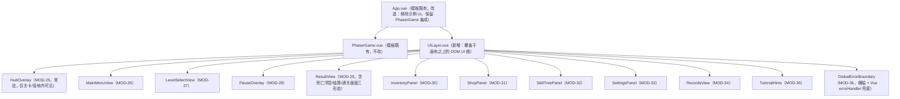

**UiShell 状态机**（FR-15 界面流程的 UI 侧实现）：`UiState = 'none' | 'mainMenu' | 'levelSelect' | 'paused' | 'result' | 'inventory' | 'shop' | 'skillTree' | 'settings' | 'records'`；迁移由用户操作与 DR-04 事件（`ui:overlay`、`level:cleared`、`player:died`）驱动；进入任一 overlay 态时发布 `ui:overlay { name, open: true }`（DR-04），LevelScene/CampScene 订阅后 `scene.pause()`（FR-15 处理规则 8：界面打开时游戏逻辑暂停）；Esc 返回上一层的栈式导航（`uiHistory: UiState[]`）；0.3 s 淡入淡出以 Vue `<Transition>` 实现；防连点：按钮组件统一封装"同帧单次点击"（FR-15 边界，实现为 click 处理内 `rAF` 标志复位）。

**键盘导航**（FR-15 处理规则 7 / AT-55）：全部面板使用原生 `<button>` + `tabindex` 管理，方向键移动焦点、Enter 确认、Esc 返回；焦点高亮为 2 px 外描边（对比度 ≥3:1，NFR-07）；面板打开时焦点陷阱（focus trap）限制在面板内。

**与领域层的连接**：每个面板经 `useDomainStore(store)`（ARCH-6）获取只读快照，命令直接调用 store 方法并处理 Result 失败码（错误码 → 文案映射表集中在 `ui/errorMessages.ts`，满足 C7 文本集中管理）。面板不订阅原始 EventBus 事件（由 composable 层统一桥接），保证组件内无字符串事件名散落（可维护性）。

### 4.6 模块公共约定

1. **生命周期清理注册**（NFR-04 的结构性保证）：Phaser 侧模块创建的一切计时器（`scene.time.addEvent`）、事件订阅（EventBus.on）、Tween 必须在构造时登记到场景级 `DisposalRegistry`，`LevelScene.shutdown` 时统一反注册；领域层单例常驻不随场景销毁，但其帧驱动计时（冷却、脱战）由 LevelScene 的 update 显式推进——场景停止则计时停止，无游离定时器。
2. **Result 优先**：可预期失败（空间不足、资源不足、校验失败、存储异常）一律 Result 返回；程序性错误（配置未加载即读取、空引用）抛异常并进入 EXD-4 全局兜底。
3. **事件发布责任表**：DR-04 的 12 个事件各有唯一发布方模块（6.2 表），禁止第二处发布同一事件（防止重复触发，AT-58 类问题的结构性规避）。
4. **只读快照对外**：store 对外暴露 `getSnapshot(): Readonly<T>`，内部状态私有；变更只经命令方法（ARCH-9 单一数据源的代码级落实）。
---

## 5. 关键流程设计

> 本章回应设计要素 3「关键流程设计」与评分项「关键流程与异常处理设计（15 分）」。覆盖 SRS 2.4 全部使用场景 S1~S8，另补两条设计必需流程（关卡加载 FLOW-L1、Boss 阶段切换 FLOW-B1）。每幅时序图标注参与模块（MOD 编号）、EventBus 事件（DR-04 原名）与数据读写（配置表/存档/运行时状态）；图后附「正常路径 / 分支 / 异常路径」说明表，异常路径显式引用 SRS EX 编号。
>
> 帧内执行顺序统一遵循 ARCH-13 update 管线，各图不再重复说明管线次序；所有流程中出现的调用与事件在第 6 章均有签名定义，事件名与 DR-04 逐字一致。

### 5.0 流程索引

| 流程编号 | 名称 | 对应 SRS 场景 | 时序图 |
|---|---|---|---|
| FLOW-R1 | 冷启动与资源加载 | S1 前半 | 3.3.1（已给出） |
| FLOW-S1 | 首次进入与教学 | S1 后半 | 5.1（表驱动描述） |
| FLOW-S2 | 单局闯关主循环（含战斗判定） | S2 | 5.2 |
| FLOW-S3 | 死亡与检查点重生 | S3 | 5.3 |
| FLOW-S4 | 营地商店购物 | S4 | 5.4 |
| FLOW-S5 | 背包整理与装备切换 | S5 | 5.5（表驱动描述） |
| FLOW-S6 | 技能加点 | S6 | 5.6 |
| FLOW-S7 | 存档写入与读档（含中断与损坏恢复） | S7 | 5.7 |
| FLOW-S8 | 通关结算与刷新最佳成绩 | S8 | 5.8 |
| FLOW-L1 | 关卡加载与校验 | S2 前置 | 5.9 |
| FLOW-B1 | Boss 阶段切换与击杀 | S2/S8 子流程 | 5.10 |

### 5.1 FLOW-S1 首次进入与教学（S1 后半）

前置：FLOW-R1 已完成（无存档 → 主菜单"继续游戏"置灰，FR-13 处理规则 7）。本流程为表驱动描述（交互密集但逻辑线性，表格比时序图更精确）：

| 步骤 | 触发 | 参与模块 | 动作与数据 | 失败/分支 |
|---|---|---|---|---|
| 1 | 玩家点击"开始游戏" | MainMenuView(MOD-26)、AudioAdapter(MOD-38) | ①首次用户手势内调用 `AudioAdapter.unlock()`（NFR-10：AudioContext 在用户手势回调中 resume，冷启动无自动播放报错）；②无存档时直接进入关卡选择，有存档时弹二次确认"覆盖进度？"（FR-15 处理规则 1） | unlock 被拒 → EX-08：静音运行，主菜单静音图标，不阻塞 |
| 2 | 选择 1-1 | LevelSelectView(MOD-27)、SceneDirector(MOD-11) | 0.4 s 淡出 → `scene.start('Level', { levelId: '1-1' })`，切换期输入禁用（FR-12 处理规则 5/6） | — |
| 3 | 进入关卡 | 走 FLOW-L1 | 见 5.9 | 资源/地图失败 → EX-03 |
| 4 | 教学提示 1~5 | TutorialDirector(MOD-09)、TutorialHints(MOD-35) | 玩家进入 `hints` 对象组触发区（DD-04 图层映射）→ TutorialDirector 经 EventBus 通知 TutorialHints 在屏幕下方 96 px 区域显示"图标+文字"（FR-17 处理规则 2）；完成对应操作（InputGateway/CombatResolver/PickupSystem 的动作事件到达）后 0.5 s 淡出；单条最长 8 s 超时淡出且不重复 | 已完成教学（tutorialDone=true）→ 整关不显示（FR-17 边界） |
| 5 | 抵达终点旗帜 | PickupSystem(传送门触发区)、→ FLOW-S8 | 结算页显示用时与收集数 → 自动存档 → 解锁 1-2 | 见 FLOW-S8 |

### 5.2 FLOW-S2 单局闯关主循环（含 hitbox 判定时序）

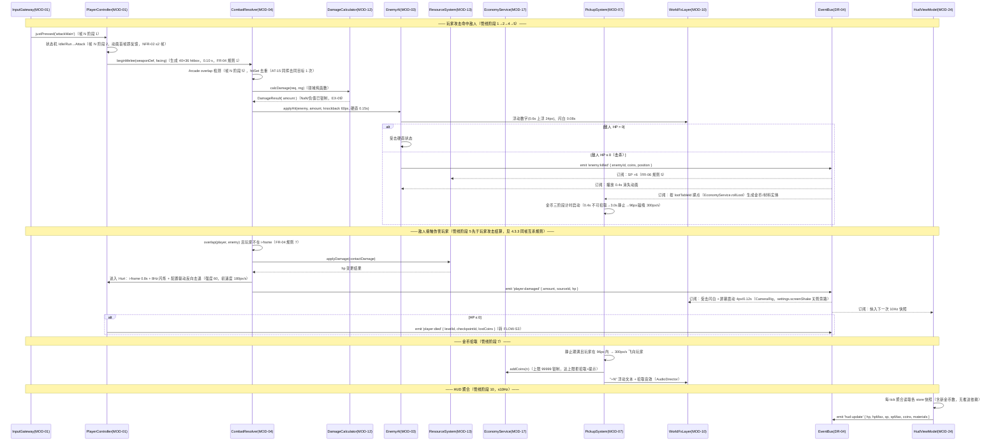

| 路径类型 | 描述 | 引用 |
|---|---|---|
| 正常 | 攻击→判定→伤害→击杀→掉落→拾取；受击→i-frame→击退 | FR-01/03/04/06/09 |
| 分支 1 | 远程攻击：`attackSub` → ProjectilePool 生成弹丸（弹速 520、射程 480，超程/中瓦片销毁），弹药 0 时不生成弹丸 + "弹药不足"提示 + 空仓音效 | FR-04 规则 2、FR-05 规则 6 |
| 分支 2 | 同屏敌人 >24：最远敌人 `brain.sleep()` 冻结 AI 保留渲染 | FR-03 边界 |
| 分支 3 | i-frame 期间接触敌人：跳过伤害结算（不叠加受击） | FR-04 边界、AT-13 |
| 异常 1 | 伤害计算出现 NaN/负值：DamageCalculator 钳制为最小 1 并记录（1 分钟内同一警告去重） | EX-09 |
| 异常 2 | 拾取时背包满：`addItem` 返回 `FULL`，掉落物保留地面 10 s 倒计时 + "背包已满"提示（金币不受背包容量限制，直入 EconomyService） | EX-10 |
| 异常 3 | 玩家卡进几何体/掉出地图：物理回调或 `position.y > deathPlaneY + 512` 检测 → 传送最近检查点（不判死亡、不扣金币） | EX-11 |
| 异常 4 | 按键卡键（Alt+Tab 丢 keyup）：AppLifecycle 失焦事件 → InputGateway 清零 | EX-07 |

### 5.3 FLOW-S3 死亡与检查点重生

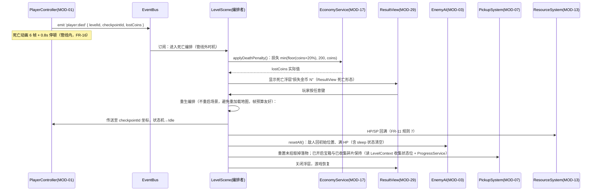

| 路径类型 | 描述 | 引用 |
|---|---|---|
| 正常 | 死亡动画 → 浮层 → 任意键 → 检查点重生，HP/SP 满，敌人重置，收集保持 | SRS S3、FR-11 规则 7 |
| 分支 1 | 金币不足 20% 损失额：按实际持有量扣除，不为负（`min` 第三参数） | SRS S3 异常分支 |
| 分支 2 | 即死区（深渊/熔岩）：不扣 HP 直接触发本流程（Fall→Dead 迁移） | FR-11 规则 6 |
| 分支 3 | 玩家选择"放弃本关"：返回关卡选择，不写存档 | FR-15 处理规则 3 |
| 异常 1 | 重生点本身被几何体覆盖（地图数据缺陷）：LevelLoader 校验无法完全排除 → 落地后仍卡住则触发 EX-11 传送链，同关连续 3 次记录警告日志 | EX-11 |
| 异常 2 | 死亡瞬间存档触发（"死亡重生后"写入点）：写入失败走 EX-01，重生流程不受阻塞（存档失败不阻断游戏，仅横幅提示） | EX-01、NFR-05 |

### 5.4 FLOW-S4 营地商店购物

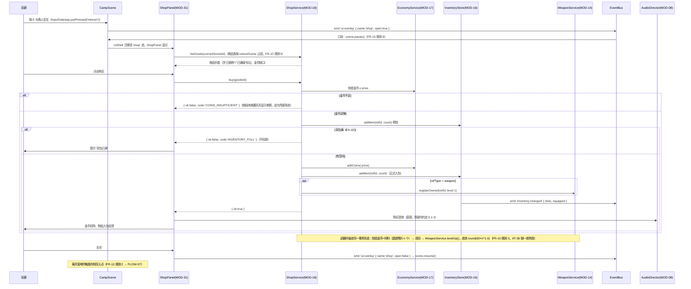

| 路径类型 | 描述 | 引用 |
|---|---|---|
| 正常 | 交互 → 面板 → 购买 → 扣款入包 → 音效反馈 | SRS S4、FR-10 |
| 分支 1 | 金币不足：按钮置灰 + 显示差额（渲染期判定），点击竞态由 buy 返回码兜底 | FR-10 边界、AT-35 |
| 分支 2 | 商品表随场景推进解锁（场景二中级药水、场景三高级药水与最后两把武器） | FR-10 规则 5 |
| 异常 1 | 背包满：不扣款 + 提示 | EX-10、FR-10 边界 |
| 异常 2 | 已拥有武器：列表显示"已拥有"且不可重复购买 | FR-10 边界 |

### 5.5 FLOW-S5 背包整理与装备切换（表驱动描述）

前置：任意非战斗暂停状态（关卡内按 Tab 同样触发 `ui:overlay` → scene.pause()，FR-08 边界"战斗中可打开背包，打开时游戏暂停"）。

| 步骤 | 触发 | 命令（接口） | 正常结果 | 异常/分支 |
|---|---|---|---|---|
| 打开 | Tab | UiShell → 'inventory'；`ui:overlay{name:'inventory',open:true}` | 5×4 网格渲染快照（图标/数量/稀有度边框），移动攻击输入禁用（FR-08 边界） | — |
| 悬停 | 鼠标 move | 纯 UI 本地状态 | 浮层显示名称/类别/效果/数量/售价（IF-M06 `getTooltip(slot)`） | — |
| 使用消耗品 | 左键 | `InventoryStore.useItem(slot)` | 药水回 HP/SP（ResourceSystem.heal/restoreSp）+ count-1 + `inventory:changed`；投掷物关闭背包后进入投掷模式（FR-08 规则 5） | HP 已满仍可使用（溢出丢弃，FR-06 边界）；count 0 → 槽位清空 |
| 装备武器 | 右键菜单 | `InventoryStore.equip(itemId, 'main'|'sub')` | 原槽位武器返回来源格子（4.3.6 算法），HUD 武器图标经 `inventory:changed` 同步，0.20 s 切换锁定由 WeaponService 计时（AT-16） | 主副手同一把武器 → 两份独立实例各自等级（FR-05 边界） |
| 拖拽排序 | 鼠标拖拽（低优先级子项） | `InventoryStore.moveSlot(from, to)` | 槽位交换 | 裁剪时该交互整体移除，不影响其余功能（SRS 3.1 裁剪顺序） |
| 丢弃 | 右键菜单 | `InventoryStore.dropItem(slot)` → 二次确认对话框 | 物品移除，（关卡内）生成地面掉落物 | 取消 → 无操作（FR-08 规则 7） |
| 整理 | 按钮 | `InventoryStore.sort()` | 武器→消耗品→材料排序 + 堆叠合并（AT-30） | — |
| 关闭 | Tab/Esc | `ui:overlay{open:false}` → scene.resume() | 装备结果已即时生效 | — |

### 5.6 FLOW-S6 技能加点

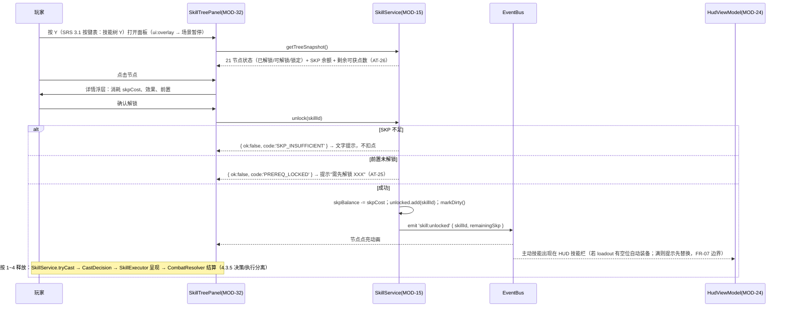

| 路径类型 | 描述 | 引用 |
|---|---|---|
| 正常 | 打开 → 选节点 → 确认 → 扣点点亮 → HUD 技能栏更新 | SRS S6、FR-07 |
| 分支 1 | 技能栏满时解锁主动技能：须先在面板替换 loadout 槽位，替换不退 SKP | FR-07 边界 |
| 分支 2 | 战斗中释放：SP 不足或冷却中 → 拒绝 + 视觉听觉反馈，不消耗资源 | FR-06 规则 7、FR-07 边界、AT-23 |
| 分支 3 | 洗点（低优先级子项）：200 金币返还全部 SKP；裁剪时入口隐藏 | FR-07 规则 8、附录 A |
| 异常 1 | 存档中技能 id 在当前配置表不存在（手动篡改/版本回退）：该条目丢弃 + console.warn（DR-02 校验规则） | EX-02 前置的宽容校验 |

### 5.7 FLOW-S7 存档写入与读档

**写入路径**（触发点：关卡结算完成 / 离开营地 / 设置项变更 / 退出到主菜单 / 死亡重生后，见 4.3.8 WritePolicy）：

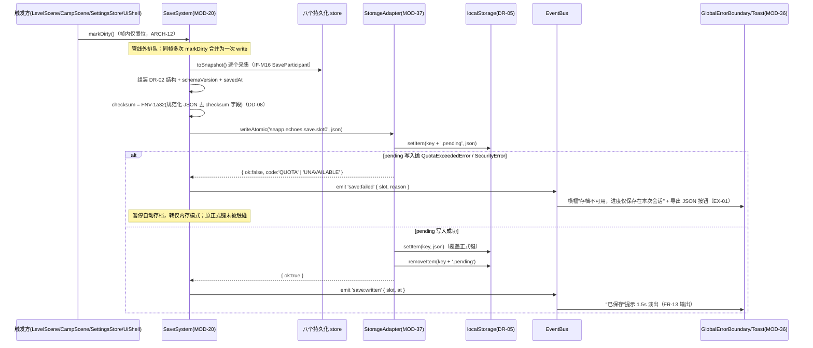

**读档路径**（FLOW-R1 步骤展开）：

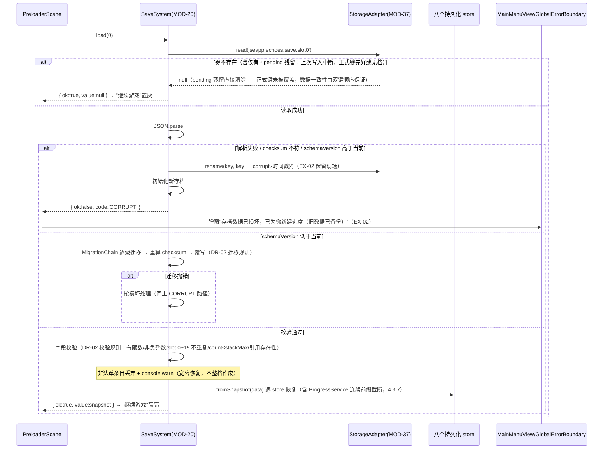

| 路径类型 | 描述 | 引用 |
|---|---|---|
| 正常 | 双键写入 + `save:written` 提示；启动读档校验 + 恢复 | FR-13、DR-02、AT-45 |
| 分支 1 | 写入耗时预算 ≤50 ms，在管线外执行不占帧预算 | NFR-05 |
| 异常 1 | localStorage 不可用/配额满：EX-01 降级（内存模式 + 导出 JSON） | EX-01、AT-70 |
| 异常 2 | 存档损坏：EX-02（`.corrupt.<时间戳>` 备份 + 新档 + 弹窗，不白屏） | EX-02、AT-46/70 |
| 异常 3 | 写入中断（pending 残留）：下次读档忽略并清除 pending，正式键完好 | FR-13 规则 4 的设计意图、AT-47 |
| 异常 4 | Boss 战中刷新/关闭页面：Boss 进度不在写入点白名单内 → 天然不落档；重进 Boss 关从 Boss 房入口检查点开始，Boss 满 HP | EX-12 |
| 异常 5 | 关卡内未按触发点刷新页面：进度丢失（SRS 定义为可接受行为），UI 无补救承诺；设计上以"死亡重生后"写入点缩小丢失窗口 | EX-12、FR-13 规则 2 |

### 5.8 FLOW-S8 通关结算与刷新最佳成绩

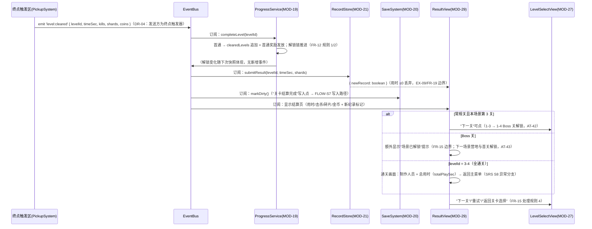

| 路径类型 | 描述 | 引用 |
|---|---|---|
| 正常 | 结算页四要素 + 自动存档 + 解锁推进 + 新纪录标记 | SRS S8、FR-15/19 |
| 分支 1 | 重复通关：不发首通奖励，可刷新最佳用时 | FR-12 规则 4、AT-44 |
| 分支 2 | 结算页"重试"：重进当前关（敌人/掉落重置，收集保持规则同 FLOW-S3） | FR-15 规则 4 |
| 异常 1 | 结算时存档写入失败：EX-01 横幅，但结算页与解锁状态在本会话内仍有效（内存态） | EX-01 |
| 异常 2 | 结算事件重复触发（玩家反复穿过传送门）：终点触发区在首次触发后立即禁用（设计约定：触发区单次熔断），`level:cleared` 每关每次尝试至多一次 | AT-54 计时一致性、4.6 约定 3 |

### 5.9 FLOW-L1 关卡加载与校验

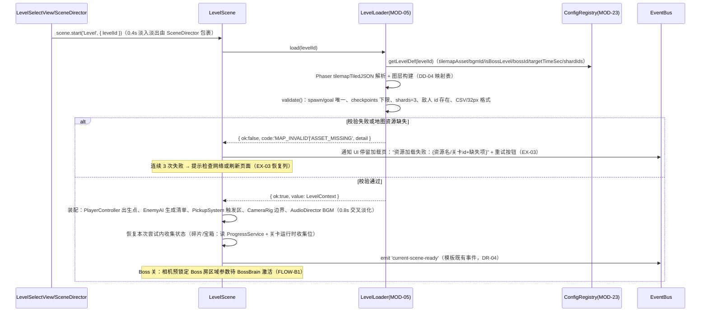

### 5.10 FLOW-B1 Boss 阶段切换与击杀

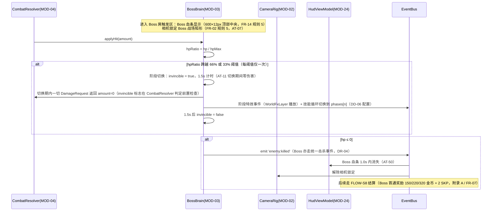

| 路径类型 | 描述 | 引用 |
|---|---|---|
| 正常 | 三阶段循环（100%/66%/33%），每阶段 2~3 技能（配置驱动），击杀 → 结算 | FR-03 规则 4、AT-11 |
| 分支 1 | 2-4 深渊蛛后：召唤小怪（受同屏 24 预算约束）、蛛网减速区；3-4 回响之影：复用玩家技能脚本 | 附录 B |
| 异常 1 | Boss 战中途放弃/刷新：进度不落档，重进满 HP 从 Boss 房入口开始，已消耗药水金币不返还（暂停菜单退出前提示） | EX-12 |
| 异常 2 | Boss 被击退卡入墙体：Boss 不设击退（设计参数：Boss 质量无穷大，仅小怪受 60 px 击退），从根上规避 EX-11 在 Boss 战的高发面 | EX-11 预防性设计 |

### 5.11 流程 ↔ 模块 ↔ 接口 ↔ 数据对应总表

| 流程 | 判断/状态变化 | 数据读写 | 接口（第 6 章） |
|---|---|---|---|
| FLOW-S2 | i-frame/硬直/冷却计时；hitSet 去重 | 读 DR-01（WeaponDef/EnemyDef）；写运行时 HP/SP/金币 | IF-M02/03/07、IF-E03/05 |
| FLOW-S3 | 死亡标志、重生编排 | 写金币（死亡损失）、运行时重置；触发存档写入点 | IF-M07、IF-M16、IF-E04 |
| FLOW-S4 | 购买/升级事务校验链 | 读 ShopGoodsDef；写金币/材料/背包/武器等级 | IF-M06/07/08、IF-E07/12 |
| FLOW-S5 | 槽位/装备/堆叠状态 | 写背包 slots/equipped；触发脏标记 | IF-M06、IF-E07/12 |
| FLOW-S6 | 前置/余额校验、loadout | 读 SkillDef；写 SKP/unlocked/loadout | IF-M05、IF-E08 |
| FLOW-S7 | 双键写入状态机、迁移链、校验结果 | 读写 DR-02 存档（唯一写入方 SaveSystem→StorageAdapter） | IF-M16、IF-X01、IF-E10/11 |
| FLOW-S8 | 首通判定、新纪录判定、解锁链 | 写 progress/records；触发写入点 | IF-M09/10、IF-E06 |
| FLOW-L1 | 地图校验清单 | 读 DR-03 地图 + LevelDef | IF-M14、IF-M12 |
| FLOW-B1 | 阶段阈值、无敌标志 | 读 BossDef.phases | IF-M15、DD-06 |

---

## 6. 接口设计

> 本章回应设计要素 4「接口设计」与评分项「接口设计（15 分）」。分三部分：内部模块接口（IF-M）、EventBus 事件契约（IF-E）、外部系统接口（IF-X，即 DR-05 浏览器 API 的适配封装）。全部内部接口以 TypeScript 签名定义（约束 C1/C5：技术栈锁定 + `strict: true`），与第 5 章流程、第 7 章数据模型一一对应。

### 6.1 内部模块接口（IF-M）

#### 6.1.1 IF-M01 通用类型与错误约定

```typescript
/** 统一结果类型（Result 模式，见 1.3）。可预期失败不抛异常。 */
type Result<T, C extends string = ErrorCode> =
    | { ok: true; value: T }
    | { ok: false; code: C; message: string };

/** 全局错误码登记表（新增错误码必须在此登记，禁止散落字符串字面量） */
type ErrorCode =
    | 'COINS_INSUFFICIENT' | 'MATERIAL_INSUFFICIENT' | 'INVENTORY_FULL'
    | 'SKP_INSUFFICIENT' | 'PREREQ_LOCKED' | 'ALREADY_UNLOCKED' | 'ALREADY_OWNED' | 'MAX_LEVEL'
    | 'AMMO_EMPTY' | 'ON_COOLDOWN' | 'SP_INSUFFICIENT' | 'LOADOUT_FULL'
    | 'SLOT_EMPTY' | 'NOT_USABLE' | 'ALREADY_EQUIPPED'
    | 'LEVEL_LOCKED' | 'LEVEL_NOT_FOUND'
    | 'CONFIG_INVALID' | 'MAP_INVALID' | 'ASSET_MISSING'
    | 'QUOTA' | 'UNAVAILABLE' | 'CORRUPT' | 'MIGRATION_FAILED' | 'SCHEMA_NEWER'
    | 'STORAGE_UNAVAILABLE' | 'AUDIO_BLOCKED' | 'FULLSCREEN_REJECTED'
    | 'INVALID_VALUE';   // EX-09 数值拦截
```

**错误约定**（全模块统一，ARCH-11）：

| 规则 | 内容 |
|---|---|
| E-1 | 可预期失败（上表错误码）→ Result 返回，**调用方必须处理**（`strict` 模式下判别联合强制分支）；UI 层将错误码映射为中文文案（`ui/errorMessages.ts`，C7） |
| E-2 | 程序性错误（配置未加载即读取、非法状态机迁移）→ 抛 `Error`，由 EXD-4 全局兜底捕获 |
| E-3 | 领域层接口禁止出现 Phaser/DOM 类型（ARCH-7）；Phaser 侧接口以引擎类型为参数但必须可被场景外构造（测试接缝，13.2） |
| E-4 | 全部命令方法同步返回（帧内可完成）；唯一例外 SaveSystem.write 的内部 `setItem` 为同步 DOM API 但被排队到管线外（4.3.8），对调用方仍表现为同步 Result |

#### 6.1.2 领域层接口

**IF-M02 DamageCalculator（MOD-12）** — 用途：FR-04 规则 3 伤害公式。调用限制：纯函数，仅 CombatResolver 在管线阶段 5 调用；每帧调用次数 ≤ 同屏判定对数（预算内，NF-01）。

```typescript
interface DamageRequest {
    baseDamage: number;      // 来源 WeaponDef.baseDamage 或技能 effect.damage
    weaponLevelFactor: number; // WeaponService 计算：1 + 0.15×(等级-1)
    skillFactor: number;       // 技能加成系数，无加成时 1
    defenseFactor?: number;    // 预留，v1 恒 1（DR-01 无防御字段，不虚构）
}
interface DamageResult { amount: number; clamped: boolean }  // clamped=true 表示触发过 EX-09 钳制
function calcDamage(req: DamageRequest, rng: () => number): DamageResult;
// 语义：amount = max(1, round(base × weaponLevelFactor × skillFactor × (0.95 + rng()×0.10)))
// rng 注入保证可测（TT-01）；任何 NaN/Infinity → { amount: 1, clamped: true } + 去重警告
```

**IF-M03 ResourceSystem（MOD-13）** — 用途：FR-06 HP/SP 全部规则。调用限制：`tick(dt)` 仅由 LevelScene update 管线阶段 8 调用；其余命令由 CombatResolver/SkillService/InventoryStore 调用。

```typescript
interface ResourceSnapshot { hp: number; hpMax: number; sp: number; spMax: number; lowHp: boolean; outOfCombat: boolean }
interface ResourceSystem {
    getSnapshot(): Readonly<ResourceSnapshot>;
    applyDamage(amount: number): Result<{ hp: number; died: boolean }, 'INVALID_VALUE'>;  // 钳制 [0,hpMax]
    heal(amount: number): { hp: number; overflow: number };   // 超出上限丢弃（FR-06 边界）
    restoreSp(amount: number): { sp: number; overflow: number };
    spendSp(cost: number): Result<{ sp: number }, 'SP_INSUFFICIENT'>;
    notifyKill(): void;                        // SP +6（FR-06 规则 5）
    notifyCombatEvent(): void;                 // 重置脱战计时（3s 双条件，FR-06 规则 4）
    applyPassiveMaxBonus(hpBonus: number, spBonus: number): void; // 技能被动，钳制 hpMax≤200 / spMax≤150
    tick(dt: number): void;                    // 脱战 SP 回复 4 点/s，帧增量驱动（EX-05 自动暂停）
    toSnapshot(): SaveResourceData; fromSnapshot(d: SaveResourceData): void;  // IF-M16 参与者
}
```

**IF-M04 WeaponService（MOD-14）** — 用途：FR-05 武器等级/切换/弹药规则、FR-10 升级。

```typescript
interface WeaponState { itemId: string; level: number }  // level 1~5
interface WeaponService {
    getOwned(): ReadonlyArray<WeaponState>;
    getLevelFactor(itemId: string): number;              // 1 + 0.15×(level-1)
    levelUp(itemId: string): Result<WeaponState, 'MAX_LEVEL' | 'COINS_INSUFFICIENT' | 'MATERIAL_INSUFFICIENT'>;
    // 成本核算委托 EconomyService.upgradeCost(level)：round(60×n^1.5) 金币 + n 遗迹残片（AT-36 缺一即失败）
    beginSwitch(hand: 'main' | 'sub', itemId: string): Result<void, 'ALREADY_EQUIPPED'>; // 0.20s 攻击锁（FR-05 规则 5）
    isSwitchLocked(): boolean;
    consumeAmmo(itemId: string): Result<void, 'AMMO_EMPTY'>;  // 经 InventoryStore 扣弹药物品
    getEquippedDefs(): { main: WeaponDef | null; sub: WeaponDef | null };  // 读 ConfigRegistry
}
```

**IF-M05 SkillService（MOD-15）** — 用途：FR-07 全部规则。调用限制：`tickCooldowns(dt)` 仅管线阶段 8；`tryCast` 仅管线阶段 3（SkillExecutor）。

```typescript
type SkillNodeState = 'unlocked' | 'available' | 'locked';
interface TreeSnapshot { nodes: Array<{ id: string; state: SkillNodeState }>; skpBalance: number; skpObtainableLeft: number; loadout: (string | null)[] }
interface CastDecision { skillId: string; spCost: number; effect: SkillEffect; durationMs: number }  // 领域判定产物，Phaser 执行
interface SkillService {
    getTreeSnapshot(): Readonly<TreeSnapshot>;            // skpObtainableLeft 支撑 AT-26"剩余可获点数"
    unlock(skillId: string): Result<void, 'SKP_INSUFFICIENT' | 'PREREQ_LOCKED' | 'ALREADY_UNLOCKED'>;
    equip(skillId: string, slot: 0 | 1 | 2 | 3): Result<void, 'LOADOUT_FULL' | 'PREREQ_LOCKED'>;  // 替换不退 SKP
    unequip(slot: 0 | 1 | 2 | 3): void;
    tryCast(skillId: string): Result<CastDecision, 'SP_INSUFFICIENT' | 'ON_COOLDOWN' | 'NOT_UNLOCKED'>; // 成功即扣 SP、启动冷却
    getCooldownLeft(skillId: string): number;             // 秒，1 位小数由 UI 舍入（FR-14 规则 3）
    tickCooldowns(dt: number): void;
    resetBuild(): Result<void, 'COINS_INSUFFICIENT'>;     // 洗点子项：200 金币（FR-07 规则 8）
}
```

**IF-M06 InventoryStore（MOD-16）** — 用途：FR-08 全部规则。任何成功变更后必发 `inventory:changed`（IF-E07）并 `markDirty()`。

```typescript
interface SlotEntry { itemId: string; count: number; instanceKey?: string } // 武器携带实例键关联 WeaponService 等级（4.3.6）
interface InventorySnapshot { capacity: 20; slots: (SlotEntry | null)[]; equipped: { main: string | null; sub: string | null } }
interface AddResultOk { added: number; overflowLeft: number }  // overflowLeft>0 表示部分入包（可堆叠物）
interface InventoryStore {
    getSnapshot(): Readonly<InventorySnapshot>;
    getTooltip(slot: number): ItemTooltip | null;         // 名称/类别/效果/数量/售价（FR-08 规则 4）
    addItem(itemId: string, count?: number): Result<AddResultOk, 'INVENTORY_FULL'>;  // 先并堆叠后占空格（FR-08 规则 3）
    useItem(slot: number): Result<{ hpRestored: number; spRestored: number } | { throwMode: true }, 'SLOT_EMPTY' | 'NOT_USABLE'>;
    equip(slot: number, hand: 'main' | 'sub'): Result<void, 'SLOT_EMPTY'>;  // 原武器回来源格（AT-29）
    dropItem(slot: number): Result<SlotEntry, 'SLOT_EMPTY'>;   // UI 负责二次确认（FR-08 规则 7）
    moveSlot(from: number, to: number): Result<void, 'SLOT_EMPTY'>; // 拖拽子项
    sort(): void;                                          // 武器→消耗品→材料 + 合并堆叠（AT-30）
    hasFreeSpace(itemId: string, count?: number): boolean; // ShopService 预检用
}
```

**IF-M07 EconomyService（MOD-17）** — 用途：FR-09 金币/材料、FR-11 死亡损失、掉落表。

```typescript
interface LootRoll { itemId: string; count: number }[]
interface EconomyService {
    getCoins(): number; getMaterials(): Readonly<Record<string, number>>;
    addCoins(n: number): Result<{ coins: number; rejected: boolean }, 'INVALID_VALUE'>; // 上限 99999，达上限 rejected=true（AT-33）
    addMaterial(itemId: string, n: number): void;
    spend(cost: { coins?: number; materials?: Record<string, number> }): Result<void, 'COINS_INSUFFICIENT' | 'MATERIAL_INSUFFICIENT'>; // 事务：任一不足整体不扣
    upgradeCost(currentLevel: number): { coins: number; materials: Record<string, number> }; // round(60×n^1.5) + n 残片
    applyDeathPenalty(): { lostCoins: number };            // min(floor(coins×0.2), 200, coins)（AT-40、S3 分支）
    rollLoot(lootTableId: string, rng: () => number): LootRoll;  // 权重随机，rng 注入可测
}
```

**IF-M08 ShopService（MOD-18）** — 用途：FR-10 商品过滤与购买事务。

```typescript
interface GoodsView { goodsId: string; refType: 'item' | 'weapon'; refId: string; price: number; owned: boolean; maxLevel: boolean; affordable: boolean; shortage: number }
interface ShopService {
    listGoods(sceneId: 1 | 2 | 3): GoodsView[];            // unlockScene 过滤 + 状态标记（FR-10 规则 5/边界）
    buy(goodsId: string): Result<void, 'COINS_INSUFFICIENT' | 'INVENTORY_FULL' | 'ALREADY_OWNED'>; // FLOW-S4 事务序
    upgradeWeapon(itemId: string): Result<void, 'MAX_LEVEL' | 'COINS_INSUFFICIENT' | 'MATERIAL_INSUFFICIENT'>;
}
```

**IF-M09 ProgressService（MOD-19）** — 用途：FR-12 解锁链、FR-11 碎片/宝箱进度。

```typescript
interface LevelProgressView { levelId: string; unlocked: boolean; cleared: boolean; bestTimeSec: number | null; shards: number }
interface ProgressService {
    getLevelViews(): LevelProgressView[];                  // LevelSelectView 渲染源（12 条，ConfigRegistry 顺序）
    isUnlocked(levelId: string): boolean;
    completeLevel(levelId: string): { firstClear: boolean; unlocked: string[] };  // AT-41~44
    collectShard(levelId: string, shardId: string): void;  // 幂等：重复采集无副作用
    isShardCollected(levelId: string, shardId: string): boolean;
    markTutorialDone(): void; isTutorialDone(): boolean;
}
```

**IF-M10 RecordStore（MOD-21）** — 用途：FR-19。

```typescript
interface LevelRecord { bestTimeSec: number | null; bestShards: number }
interface GlobalStats { totalDeaths: number; totalKills: number; totalPlaySec: number; shardsTotal: number } // shardsTotal /36
interface RecordStore {
    submitResult(levelId: string, timeSec: number, shards: number): { newRecord: boolean }; // timeSec ≤0 丢弃（EX-09）
    getLevelRecord(levelId: string): LevelRecord;          // 无记录返回空值而非 null（AT-65 占位文本数据源）
    getGlobalStats(): Readonly<GlobalStats>;
    addDeath(): void; addKill(): void; addPlayTime(sec: number): void;
}
```

**IF-M11 SettingsStore（MOD-22）** — 用途：FR-18。变更即 `markDirty()` + 发布 `settings:changed`（IF-E09）。

```typescript
interface Settings { masterVolume: number; musicVolume: number; sfxVolume: number; screenShake: boolean; fullscreen: boolean; keymap: Keymap | null }
type Keymap = Partial<Record<'moveLeft' | 'moveRight' | 'jump' | 'attackMain' | 'interact', string>>; // 重映射子项四组（FR-18 规则 2）
interface SettingsStore {
    getSnapshot(): Readonly<Settings>;
    setVolume(channel: 'master' | 'music' | 'sfx', v: number): Result<void, 'INVALID_VALUE'>; // 0~100 步进 5，越界拒绝
    setScreenShake(on: boolean): void;
    toggleFullscreen(): Result<void, 'FULLSCREEN_REJECTED'>;   // 经 FullscreenAdapter；拒绝时 UI 提示 F11 并恢复开关（FR-18 边界）
    remap(action: keyof Keymap, key: string): Result<void, 'KEY_CONFLICT'>; // 冲突提示并拒绝
}
```

**IF-M12 ConfigRegistry（MOD-23）** — 用途：DR-01 配置表校验与只读访问。调用限制：`validateAll()` 仅 PreloaderScene 调用一次；get 系列在校验通过前抛错（E-2）。

```typescript
type ConfigValidationError = { table: string; id: string; field: string; rule: string; actual: unknown };
interface ConfigRegistry {
    validateAll(): Result<void, 'CONFIG_INVALID'> & { errors?: ConfigValidationError[] }; // EX-03 错误页数据源
    weapons(): Readonly<Record<string, WeaponDef>>;   // 类型即 SRS 5.1 字段表（7.2.1）
    enemies(): Readonly<Record<string, EnemyDef>>;
    skills(): Readonly<Record<string, SkillDef>>;
    items(): Readonly<Record<string, ItemDef>>;
    levels(): ReadonlyArray<LevelDef>;                 // 12 条，附录 B 顺序（FR-12 顺序表）
    goods(): ReadonlyArray<ShopGoodsDef>;
    lootTables(): Readonly<Record<string, LootTableDef>>;
    playerDefaults(): Readonly<PlayerDefaults>;        // SRS 5.1 PlayerState 默认值列
}
```

**IF-M13 HudViewModel（MOD-24）** — 用途：FR-14 数据聚合与节流。调用限制：`tick(dt)` 仅管线阶段 10；高频 getter 仅 HudOverlay rAF 回调读取。

```typescript
interface HudSnapshot { hp: number; hpMax: number; sp: number; spMax: number; coins: number; materials: Record<string, number> } // = IF-E02 载荷
interface HudPerFrame { hpRatio: number; spRatio: number; lowHp: boolean; cooldowns: [number, number, number, number]; weaponIcons: { main: string | null; sub: string | null; mainLevel: number; subLevel: number; activeHand: 'main' | 'sub' }; bossBar: { name: string; ratio: number } | null; levelId: string; checkpointsActive: number }
interface HudViewModel {
    tick(dt: number): void;        // 累计 ≥100ms 时经 EventBus 发布 hud:update（≤10Hz，FR-14 规则 8）
    getPerFrame(): Readonly<HudPerFrame>;  // 条形/扇形高频通道（4.3.10 双通道设计）
}
```

**IF-M16 SaveSystem（MOD-20）与 SaveParticipant** — 用途：FR-13/DR-02/NFR-05。调用限制：`write` 仅管线外；`load` 仅 Preloader；`markDirty` 帧内安全（仅置位）。

```typescript
/** 持久化 store 实现此接口并向 SaveSystem 注册（4.3.8 ParticipantRegistry） */
interface SaveParticipant<K extends keyof SaveData> {
    readonly key: K;                       // DR-02 顶层分节名：player/progress/inventory/weapons/skills/settings/records
    toSnapshot(): SaveData[K];
    fromSnapshot(data: SaveData[K]): void; // 宽容恢复：非法条目丢弃 + warn（DR-02 校验规则）
}
type SaveData = typeof import('./saveSchema').SAVE_SHAPE; // 结构 = DR-02 JSON（7.3.2 类型化，不重复贴 JSON）
type LoadErrorCode = 'CORRUPT' | 'MIGRATION_FAILED' | 'SCHEMA_NEWER' | 'STORAGE_UNAVAILABLE';
interface SaveSystem {
    register<K extends keyof SaveData>(p: SaveParticipant<K>): void;
    load(slot: 0): Result<SaveData | null, LoadErrorCode>;  // null=无存档；CORRUPT 已含 .corrupt 备份副作用
    write(slot: 0): Result<void, 'QUOTA' | 'UNAVAILABLE'>;  // 双键原子写（7.3.3）；成功发 save:written，失败发 save:failed
    markDirty(): void;
    exportJson(): void;                    // Blob 下载（EX-01 降级用户动作）
    isMemoryOnlyMode(): boolean;           // EX-01 后状态查询（UI 横幅常显依据）
}
```

#### 6.1.3 Phaser 呈现层接口（跨模块调用面）

**IF-M14 LevelLoader（MOD-05）**：

```typescript
interface LevelContext {
    levelId: string; spawn: { x: number; y: number };
    collisionGroup: Phaser.Physics.Arcade.StaticGroup; onewayGroup: Phaser.Physics.Arcade.StaticGroup;
    checkpoints: Array<{ id: string; x: number; y: number }>;
    shards: Array<{ id: string; x: number; y: number }>;
    enemySpawns: Array<{ defId: string; x: number; y: number }>;
    hazards: Phaser.Geom.Rectangle[];       // death_plane（FR-11 规则 6）
    goal: Phaser.Geom.Rectangle; hints: Array<{ id: string; x: number; y: number; w: number; h: number }>; // DD-04 hints 组
    bossArena?: Phaser.Geom.Rectangle;      // Boss 关相机锁定区（FR-02 规则 5）
    bgmId: string;
}
interface LevelLoader { load(levelId: string): Result<LevelContext, 'MAP_INVALID' | 'ASSET_MISSING' | 'LEVEL_NOT_FOUND'> }
```

**IF-M15 CombatResolver（MOD-04）** — 供 PlayerController/EnemyAI/SkillExecutor 登记攻击：

```typescript
interface AttackHandle { cancel(): void }
interface CombatResolver {
    beginMelee(source: Combatant, def: WeaponDef | SkillEffect): AttackHandle;  // 生成 hitbox 0.10s + hitSet 去重
    spawnProjectile(source: Combatant, def: WeaponDef, angleDeg: number): void; // 委托 ProjectilePool
    applyHit(target: Combatant, amount: number, knockbackPx: number): void;     // 含受击闪白/浮动数字委托
    isInvincible(c: Combatant): boolean;   // i-frame / Boss 阶段无敌 / 冲刺无敌统一查询
}
type Combatant = { side: 'player' | 'enemy'; gameObject: Phaser.GameObjects.Sprite; getHurtbox(): Phaser.Geom.Rectangle };
```

**IF-M17 SceneDirector（MOD-11）**：`gotoLevel(levelId)` / `gotoCamp(sceneId)` / `gotoMenu()`，统一包裹 0.4 s 淡出淡入、输入闸、切换前存档触发点判定（FR-12 规则 5/6、FR-13 规则 2）。

**IF-M18 PickupSystem（MOD-07）**：`spawnCoinBurst(worldPos, rolls: LootRoll)`（`enemy:killed` 订阅入口）、`notifyInventoryFull(worldPos, entry)`（EX-10 地面保留 10 s）。

**IF-M19 PlayerController（MOD-01）公开面**：`teleportTo(checkpointId | {x,y})`（EX-11/FLOW-S3 共用）、`getMotionState()`（CameraRig/HudViewModel 读）、`setInputEnabled(b: boolean)`（SceneDirector/UiShell 输入闸）。

### 6.2 EventBus 事件契约（IF-E）

**IF-E01~E12**：完全沿用 SRS DR-04 的 12 个事件，**不修改任何既有事件的名称/载荷/方向，也不新增事件**（2.4 核对项）。载荷 TS 类型化如下（类型定义集中于 `src/game/events.ts`，单一出处）：

| 编号 | 事件名（DR-04 原名） | 载荷类型 | 唯一发布方（4.6 约定 3） | 订阅方 | 发送时机与频控 |
|---|---|---|---|---|---|
| IF-E01 | `current-scene-ready` | `Phaser.Scene` | 各 Scene（模板既有行为） | PhaserGame.vue | 场景 create 末尾 |
| IF-E02 | `hud:update` | `HudSnapshot`（IF-M13） | HudViewModel | HudOverlay | 节流 ≤10 Hz（FR-14 规则 8） |
| IF-E03 | `player:damaged` | `{ amount: number; sourceId: string; hp: number }` | CombatResolver | HudOverlay、AudioDirector、CameraRig | 每次玩家受击 |
| IF-E04 | `player:died` | `{ levelId: string; checkpointId: string; lostCoins: number }` | PlayerController | LevelScene、ResultView | HP≤0 或即死区，每次尝试至多一次 |
| IF-E05 | `enemy:killed` | `{ enemyId: string; coins: number; position: { x: number; y: number } }` | CombatResolver | EnemyAI、PickupSystem、ResourceSystem、RecordStore | 击杀确认帧 |
| IF-E06 | `level:cleared` | `{ levelId: string; timeSec: number; kills: number; shards: number; coins: number }` | 终点触发器（PickupSystem 持有，单次熔断 5.8 异常 2） | ProgressService、RecordStore、SaveSystem、ResultView | 每关每次尝试至多一次 |
| IF-E07 | `inventory:changed` | `{ slots: (SlotEntry\|null)[]; equipped: { main: string\|null; sub: string\|null } }` | InventoryStore | HudOverlay、InventoryPanel | 每次背包/装备变更 |
| IF-E08 | `skill:unlocked` | `{ skillId: string; remainingSkp: number }` | SkillService | SkillTreePanel、HudViewModel | 解锁成功 |
| IF-E09 | `settings:changed` | `Settings`（IF-M11 全量） | SettingsStore | AudioDirector、CameraRig、InputGateway、SaveSystem | 设置变更（即触发写入点） |
| IF-E10 | `save:written` | `{ slot: 0; at: string }` | SaveSystem | Toast（GlobalErrorBoundary 内） | 双键写成功 |
| IF-E11 | `save:failed` | `{ slot: 0; reason: 'QUOTA' \| 'UNAVAILABLE' }` | SaveSystem | GlobalErrorBoundary（EX-01 横幅+导出按钮） | 写入失败 |
| IF-E12 | `ui:overlay` | `{ name: UiState; open: boolean }` | UiShell（唯一） | LevelScene、CampScene、AudioDirector（暂停 BGM 与否） | overlay 态迁移（FR-15 规则 8） |

**6.2.1 载荷规则**：全部为可 JSON 序列化的纯对象（DR-04 原文要求；IF-E01 为模板既有例外，保留不变）；订阅方只读，禁止修改载荷（ARCH-10）；事件回调内禁止长任务（>1 ms 的工作转管线外，ARCH-12）。

**6.2.2 一致性声明**：以上事件名、载荷字段与 SRS DR-04 表逐字段一致（`hud:update` 的 `materials` 对应 DR-02 `player.materials`；`player:died` 的 `lostCoins` 由 EconomyService.applyDeathPenalty 结果填充）。第 5 章全部时序图中的 emit 均可在本表定位。

**6.2.3 场景内直调约定**：同一 Phaser 场景内模块间的高频协作（如 CombatResolver→WorldFxLayer 浮动数字、ShopPanel 购买音效）允许直接方法调用以减少事件开销；**跨层（Vue↔Phaser）、跨场景、一对多广播必须走 EventBus**。该约定是 DR-04"事件用于 Phaser↔Vue 通信"定位的细化，不改变事件契约。

**6.2.4 启动完成同步（非事件）**：Vue UiLayer 的"加载态 → 主菜单"迁移不依赖新事件：领域层导出 `AppBoot.ready: Promise<void>`（Preloader 完成配置校验、资源加载与读档后 resolve；失败则 reject 并由 LoadingView 呈现 EX-03 重试页）。Vue 层直接 import 该 Promise，属 ARCH-3 允许的"Vue → 领域层直接依赖"，避免扩充 DR-04。

### 6.3 外部系统接口（IF-X，DR-05 适配封装）

外部系统只有浏览器平台 API（SRS DR-05）。设计约定：**上层代码禁止直接触碰浏览器 API**（ARCH-11），一律经下列适配器；适配器是第 13 章测试的 mock 接缝。

#### 6.3.1 IF-X01 StorageAdapter（MOD-37，封装 localStorage）

| 项 | 内容 |
|---|---|
| 用途 | DR-02 存档键的读写与原子写；EX-01 检测点 |
| 接口 | `read(key: string): string \| null`；`writeAtomic(key: string, value: string): Result<void, 'QUOTA' \| 'UNAVAILABLE'>`；`remove(key: string): void`；`rename(key: string, newKey: string): Result<void, 'UNAVAILABLE'>`（EX-02 备份 `.corrupt.<时间戳>`）；`probe(): Result<void, 'STORAGE_UNAVAILABLE'>`（启动时 1 字节写读删探测隐私模式）；`exportAsDownload(filename: string, content: string): void`（Blob + a[download]，EX-01 降级） |
| 输入/输出格式 | UTF-8 字符串（JSON 文本由 SaveSystem 负责，适配器不理解内容） |
| 错误约定 | 捕获 `QuotaExceededError` → `'QUOTA'`；`SecurityError`/访问抛错（禁用站点数据、隐私模式）→ `'UNAVAILABLE'`；不抛裸异常 |
| 调用限制 | 仅 SaveSystem 调用；写入仅管线外（ARCH-12）；单次写入预算 ≤50 ms（NFR-05）；键名白名单 `seapp.echoes.*`（防止误写他键） |
| 失败语义 | `writeAtomic` 失败时保证正式键未被修改（先 pending 后覆盖，7.3.3） |

#### 6.3.2 IF-X02 AudioAdapter（MOD-38，封装 WebAudio/AudioContext，经 Phaser Sound 系统）

| 项 | 内容 |
|---|---|
| 用途 | NFR-10 音频解锁与失焦行为；EX-08 检测点 |
| 接口 | `unlock(): Result<void, 'AUDIO_BLOCKED'>`（必须在用户手势回调内调用——FLOW-S1 步骤 1）；`isUnlocked(): boolean`；`onVisibility(hidden: boolean): void`（AppLifecycle 转发：hidden 时暂停 BGM 与游戏循环，EX-05/NFR-10） |
| 错误约定 | 自动播放策略拦截 → `'AUDIO_BLOCKED'`，游戏静音运行不抛异常（EX-08）；解锁成功后自动重试挂起的播放请求 |
| 调用限制 | `unlock` 每次用户手势至多一次；音量应用走 Phaser SoundManager（三路音量由 AudioDirector 换算为 master×channel 乘积） |

#### 6.3.3 IF-X03 FullscreenAdapter（MOD-39，封装 Fullscreen API）

| 项 | 内容 |
|---|---|
| 接口 | `toggle(): Result<boolean, 'FULLSCREEN_REJECTED'>`（返回切换后状态）；`isFullscreen(): boolean`；订阅 `fullscreenchange` 同步 SettingsStore |
| 错误约定 | Promise 拒绝（浏览器策略）→ `'FULLSCREEN_REJECTED'`，UI 提示"请按 F11 手动全屏"并恢复开关状态（FR-18 边界） |
| 调用限制 | 仅 SettingsStore.toggleFullscreen 调用；必须在用户手势内发起 |

#### 6.3.4 IF-X04 输入 / 主循环 / 渲染 / 生命周期（MOD-40 AppLifecycle + Phaser 内建）

| DR-05 接口 | 封装与约定 | 失败处理 |
|---|---|---|
| Keyboard/Mouse（经 Phaser Input） | InputGateway（4.3.1）唯一读取点；语义动作→物理键映射读 SettingsStore.keymap | EX-07：AppLifecycle 监听 `blur`/`visibilitychange` → InputGateway 清零 |
| requestAnimationFrame | Phaser 主循环内建（`type: AUTO`），不自建 rAF 循环；HudOverlay 高频通道使用**单一** rAF 且随 UiLayer 卸载注销（NF-04 清理清单） | EX-05：失焦时 Phaser 自动暂停循环（引擎内建 pauseOnBlur），AppLifecycle 补充暂停 SP 回复与计时（领域 tick 不再被调用，天然暂停） |
| WebGL/Canvas 2D | Phaser `type: AUTO` 决策；AppLifecycle 监听 `webglcontextlost`，尝试 `restore`，失败 → 安全退出主菜单 | EX-04：Canvas 回退 + 30 FPS 目标 + 主菜单"兼容模式"提示 |
| 静态资源 HTTP | 仅首次加载（Preloader `this.load.*`）；失败重试 ≤3 次 | EX-03：加载页错误清单 + 重试按钮 |
| 窗口 resize | Phaser ScaleManager `Scale.FIT` + AppLifecycle `resize` 事件 → HudOverlay 重算布局锚点 | EX-06：等比重算，无黑边拉伸 |

#### 6.3.5 IF-X05 全局异常兜底（EXD-4，AppLifecycle 内）

`window.addEventListener('error')` 与 `unhandledrejection`、Vue `app.config.errorHandler`：捕获后 ①console 记录含调用栈；②若 Phaser game 实例仍健康 → GlobalErrorBoundary 显示"出现异常，已回到主菜单"并 `SceneDirector.gotoMenu()`；③若渲染上下文已不可用 → 显示纯 DOM 提示页（保证不白屏，NFR-05 精神）。同一错误 1 分钟去重（EX-09 同款节流）。

### 6.4 第三方服务接口声明

**不存在**任何服务端 API、数据库、第三方 SDK、Cookie、埋点、支付接口（SRS DR-05"明确不存在的外部接口"、NFR-09、约束 C2）。构建期遥测 `log.js` 按依赖 D4 处置：开发与构建统一使用 `dev-nolog` / `build-nolog` 脚本（ARCH-14），构建期零外发请求。本章未定义任何需要网络的能力，接口设计与该声明一致，无虚构第三方参数。

---

## 7. 数据设计

> 本章回应设计要素 5「数据设计」与评分项「数据设计（20 分）」。SRS 第 5 章已定义 DR-01~DR-05 的数据**需求**（字段、取值范围、校验规则、存档 JSON 结构、地图格式、事件契约）；本章不复制这些定义，而是给出**设计层落实**：数据的代码组织、类型化方式、生命周期、存储结构细节、一致性策略，以及"界面字段 ↔ 数据字段 ↔ 接口参数"三方对照。全部取值范围与格式约束以 SRS 5.1/5.2/5.3 为准。

### 7.1 数据分类总览（DD-01）

| 类别 | 内容 | 载体 | 生命周期 | 所有者 | 设计小节 |
|---|---|---|---|---|---|
| 静态配置 | DR-01 八类表（武器/敌人/技能/物品/关卡/商品/掉落表/玩家默认值） | `src/game/data/*.ts` TS 常量表（DEC-6） | 构建期固化，运行时只读 | ConfigRegistry | 7.2.1 |
| 关卡地图 | DR-03 Tiled JSON | `public/assets/levels/<levelId>.json` | 构建期固化，运行时按关加载 | LevelLoader | 7.2.2 |
| 持久化 | DR-02 存档 JSON | localStorage 键族（7.3.1） | 跨会话 | SaveSystem | 7.3 |
| 运行时实体 | 玩家/敌人/弹丸/掉落物/触发区状态 | 内存（Phaser GameObject + 领域 store） | 单关卡尝试内 | ARCH-5 归属表 | 7.4 |
| 资源资产 | 图集/音频/字体 | `public/assets/`（30 MB 预算，NFR-03） | 构建期固化 | Preloader | 7.4.4 |

### 7.2 静态数据设计

#### 7.2.1 DD-02 配置表代码组织与 TS 类型化（DD-03）

文件组织（ARCH-8 表驱动的物理落位；新增一把武器 = 改 `weapons.ts` + 图集帧，≤2 文件，AT-73）：

```
src/game/data/
    weapons.ts      // WeaponDef ×6（SRS 5.1 字段表 → TS interface，取值范围写入 JSDoc @range 注释供校验器对照）
    enemies.ts      // EnemyDef ×4 + BossDef ×3（phases 结构见 DD-06）
    skills.ts       // SkillDef ×21（三分支，SRS 附录 A 四个示例技能参数为默认值）
    items.ts        // ItemDef（药水/弹药/材料/投掷物；SRS 附录 A 经济表为 price/effect 默认值）
    levels.ts       // LevelDef ×12（附录 B 顺序即数组顺序 = FR-12 解锁顺序表）
    goods.ts        // ShopGoodsDef（FR-10 规则 2 商品清单 + unlockScene 1|2|3）
    lootTables.ts   // LootTableDef：{ id, entries: [{ itemId, weight, countMin, countMax }] }（FR-03/09 掉落表）
    playerDefaults.ts // SRS 5.1 PlayerState 默认值列（hp 100/sp 50/碰撞体 22×44 等）
    index.ts        // ConfigRegistry 装配与导出
```

类型定义与 SRS 5.1 字段表**逐字段一致**（字段名、类型、取值范围不改写不省略），示例（其余同构，不重复贴）：

```typescript
/** weapons.ts —— 字段与取值范围 = SRS 5.1 WeaponDef 表 */
export interface WeaponDef {
    id: string;                 // 全局唯一，wpn_ 前缀
    type: 'melee' | 'ranged';
    baseDamage: number;         // @range 5~60
    attackSpeed: number;        // @range 0.5~6.0 次/s
    range: number;              // @range 近战 20~80 / 远程 200~600 px
    projectileSpeed: number | null; // @range 远程 300~800，近战 null
    ammoItemId: string | null;  // 远程必填，引用 ItemDef.id
    hitboxSize: { w: number; h: number }; // @range 8~120
    price: number | null;       // @range 120~300，初始武器 null
}
```

**DD-06 Boss 阶段配置结构**（SRS 5.1 EnemyDef 表 `phases` 字段——"array（长度 3），Boss 专用"——的取值结构设计；FR-03 规则 4 的配置化载体，FLOW-B1 的数据源）：

```typescript
/** enemies.ts —— BossDef 扩展（仅 kind='boss' 的 EnemyDef 携带 phases） */
export interface BossPhaseDef {
    hpThreshold: number;          // 阶段触发 HP 比例：1.0 / 0.66 / 0.33（FR-03 规则 4）
    invincibleMs: number;         // 切换无敌时长 = 1500（FR-03 规则 4，固定值）
    skills: BossSkillDef[];       // 每阶段循环 2~3 个技能（FR-03 规则 4）
}
export interface BossSkillDef {
    kind: 'charge' | 'summon' | 'projectileSpread' | 'arenaHazard';  // 冲撞/召唤小怪/扇形弹/场地危险区
    damage: number;               // @range 5~30（SRS 5.1 contactDamage 同源约束，不虚构新数值域）
    cooldownSec: number;          // @range 0.5~8（设计参数域：Boss 技能节奏，实现期在域内填值）
    params: Record<string, number>;  // kind 专属参数（召唤数量、弹丸角度等），填值不得超出 SRS 附录 A 敌人基线
}
```

三个 Boss（石像守卫者/深渊蛛后/回响之影，附录 B）的具体技能脚本为实现期填入的**配置数据**，其数值域受 V2/V4 校验约束；填值属数据内容制作，不构成设计或需求变更。

**DD-02 加载校验清单**（ConfigRegistry.validateAll 执行，任一失败 → `CONFIG_INVALID` + 错误清单页，EX-03 语义）：

| # | 校验组 | 规则（依据） |
|---|---|---|
| V1 | id 规范 | 前缀正确且表内唯一（SRS 5.1 各表 id 行） |
| V2 | 取值范围 | 全部数值字段在 SRS 5.1 范围内；有限数（DR-02 校验规则同源） |
| V3 | 引用完整性 | `ammoItemId`/`prerequisiteId`/`lootTableId`/`ShopGoodsDef.refId`/`LevelDef.bossId`/`ItemDef.icon` 指向存在项（SRS 5.1/5.2） |
| V4 | 结构约束 | levels 恰 12 条且 id 匹配 `场景-序号`；每场景第 4 关 `isBossLevel=true` 且 bossId 非空；`shardIds` 长度 3；技能前置同分支且无环；BossDef.phases 长度 3（SRS 5.1、FR-03 规则 4、FR-11 规则 1/5） |
| V5 | 经济闭环 | 商品 price 在 15~300；SKP 总需 46 / 可得 42（碎片 36 + Boss 6）与 SRS 附录 A 一致（AT-26 的数据前提） |
| V6 | 枚举封闭 | 全部枚举字段值在联合类型内（TS 编译期 + 运行时双保险，防 JSON 化配置漂移） |

#### 7.2.2 DD-04 关卡地图数据（DR-03 落实）

存储：`public/assets/levels/1-1.json … 3-4.json`，Tiled 导出、`encoding: csv` 明文（DR-03、DEC-7）。图层 → 运行时对象映射表：

| DR-03 图层 | 类型 | 映射目标（LevelLoader 构建） | 物理/交互属性 |
|---|---|---|---|
| collision | 瓦片层 | `collisionGroup: StaticGroup`（`setCollisionByProperty({ solid: true })`） | 四向实体碰撞 |
| oneway | 瓦片层 | `onewayGroup: StaticGroup`，碰撞回调检查 `body.velocity.y > 0 && body.bottom <= tileTop + 容差 4px` 才分离（设计参数：容差 4 px 防高速穿透） | 仅上方碰撞 |
| decor_back / decor_front | 瓦片层 | 渲染层，depth：back < 实体 < front（DR-03：front 高于玩家） | 无碰撞 |
| spawn（对象 `player_spawn`） | 对象层 | PlayerController 初始位置（唯一性校验 V-地图） | — |
| enemies（对象名 = EnemyDef.id） | 对象层 | EnemyAI 生成清单（LevelContext.enemySpawns） | — |
| checkpoints（`cp_1..n`） | 对象层 | 重叠触发区 + 激活状态位（关卡运行时） | 触发即激活（FR-11 规则 4） |
| shards（`shard_a/b/c`） | 对象层 | 重叠触发区；采集即写 ProgressService.collectShard（跨死亡/重进保持） | 幂等采集 |
| pickups（`coin_cluster_*` / `chest_*`） | 对象层 | 金币堆 → PickupSystem 预置金币；宝箱 → 开启状态位（本次尝试内保持，FR-11 规则 7）+ 内容走掉落表 | 重叠/交互 E |
| hazards（type=`death_plane`） | 对象层 | `hazards: Rectangle[]`，接触即 `player:died`（不扣 HP，FR-11 规则 6） | 即死 |
| goal（对象 `goal`） | 对象层 | 终点触发区（单次熔断，5.8 异常 2）→ `level:cleared` | 触发 |
| **hints（新增对象组，见下注）** | 对象层 | TutorialDirector 触发区（仅 1-1 读取；其余关卡该组为空） | 进入检测 |

> **DD-05 表注（数据格式细化的合规说明）**：SRS FR-17 处理规则 1 要求 1-1 设 5 个提示触发区，但 DR-03 图层表未为其命名图层。本设计在对象层增加 `hints` 组承载触发区矩形——这是 DR-03 格式的**向后兼容扩展**（新增对象组不破坏既有图层规则，Tiled 原生支持），不改变任何 DR-03 已定义图层的语义，属设计细化而非需求变更（2.3 第 1 类）。

**地图数据与配置表的职责边界**：地图只存"id + 坐标 + 几何"，一切数值参数（敌人 HP、掉落、碎片兑换）在 DR-01 配置表——同一敌人在不同关卡参数一致由构造保证（ARCH-9），关卡差异只体现在摆放（DD-14 一致性的静态数据侧）。

### 7.3 持久化数据设计（DR-02 落实）

#### 7.3.1 DD-07 localStorage 键族布局

| 键 | 内容 | 生命周期 |
|---|---|---|
| `seapp.echoes.save.slot0` | 正式存档（DR-02 JSON 文本） | 跨会话 |
| `seapp.echoes.save.slot0.pending` | 写入中间态（7.3.3 状态机） | 写入事务内；启动时残留即清除 |
| `seapp.echoes.save.slot0.corrupt.<ISO时间戳>` | 损坏存档备份（EX-02 现场保留） | 跨会话；不参与读取；UI 不提供清理入口（v1 简化，配额占用可忽略——单档 <2 KB） |
| `seapp.echoes.probe` | 启动可用性探测（1 字节，写读删） | 瞬时 |

键名 slot 段预留多槽扩展（SRS 假设 A4）；全部键经 StorageAdapter 白名单前缀 `seapp.echoes.` 访问（6.3.1）。

#### 7.3.2 DD-08 存档类型化与字段归属映射

存档 JSON 结构**逐字段等于 SRS DR-02**（本文档不复制 JSON，差异为零——2.3 零改动声明的数据侧体现）。设计层补充：`src/game/data/saveSchema.ts` 用 TS interface 将 DR-02 结构类型化（`SaveData`），SaveSystem 与八 store 的快照接口（IF-M16）都以该类型为契约；序列化采用 `JSON.stringify` + 键序规范化仅用于 checksum 计算（DR-02 校验和算法），存储文本不要求键序。

**字段归属映射表**（哪个模块拥有 DR-02 哪些字段——ARCH-5/ARCH-9 的持久化投影，也是"数据 ↔ 模块"追溯依据）：

| DR-02 分节（SaveParticipant.key） | 字段 | 所有者 store | 运行时消费方（界面/接口） |
|---|---|---|---|
| `schemaVersion` / `checksum` / `savedAt` | — | SaveSystem 本体 | — |
| `player` | hp/hpMax/sp/spMax | ResourceSystem | HudOverlay（IF-E02/IF-M13） |
| `player` | coins/skillPoints/materials | EconomyService（coins/materials）、SkillService（skillPoints） | HudOverlay、ShopPanel、SkillTreePanel |
| `progress` | unlockedLevels/clearedLevels/collectedShards/tutorialDone | ProgressService | LevelSelectView、TutorialDirector |
| `inventory` | capacity/slots/equipped | InventoryStore | InventoryPanel、HudOverlay 武器栏 |
| `weapons` | 每武器 level | WeaponService | 商店升级入口、伤害计算（经 IF-M04） |
| `skills` | unlocked/loadout | SkillService | SkillTreePanel、HudOverlay 技能栏 |
| `settings` | 三音量/screenShake/fullscreen/keymap | SettingsStore | SettingsPanel、AudioDirector、InputGateway |
| `records` | bestTimeSec/bestShards/totalDeaths/totalKills/totalPlaySec | RecordStore | RecordsView、ResultView 新纪录标记 |

**读档时的运行时位置恢复**：DR-02 含 `position/velocity`？——SRS 5.1 PlayerState 表含 position/velocity 字段，但 DR-02 存档 JSON **未包含**位置字段（存档粒度 = 关卡 + 检查点，SRS FR-13 处理规则 6 与 S7"从该关卡最近检查点开始"）。设计遵循 DR-02：位置不入档，读档后玩家位于"当前关卡最近激活检查点"（progress 数据 + LevelContext.checkpoints 推导），SRS 内部无矛盾，本文档不新增字段。当前关卡 id 与最近检查点 id 作为 `progress` 分节的运行时伴随数据由 ProgressService 维护（`currentLevelId`/`lastCheckpointId` 两字段为 DR-02 `progress` 的**设计层补充字段**，schemaVersion=1 内新增可选字段向后兼容：旧档缺失时回退"最后解锁关卡的入口检查点"，不触发损坏判定——符合 DR-02 宽容校验精神）。

#### 7.3.3 DD-10 双键写入状态机（FR-13 规则 4 的设计落实）

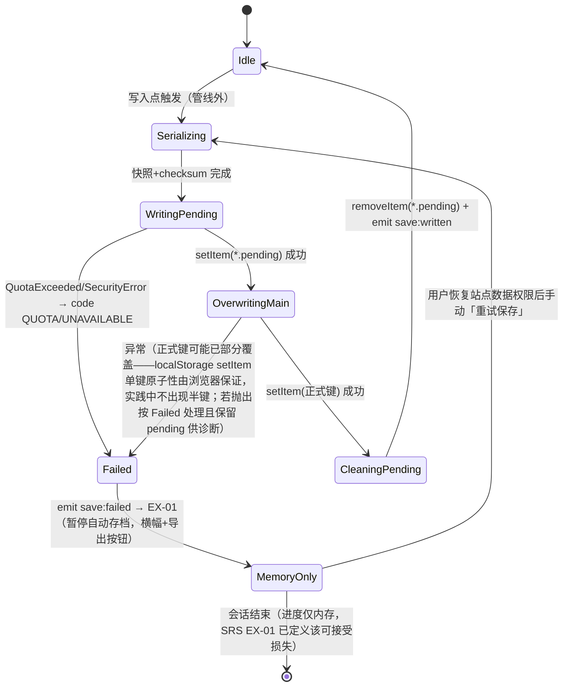

**崩溃一致性论证**（AT-47 的设计依据）：任意时刻中断——①pending 写入中断：正式键未动，旧档完好；②正式键覆盖中断：`setItem` 对单键是浏览器原子操作（成功即全量替换，失败即保留旧值），不存在半新半旧；③清理 pending 前中断：下次启动读档忽略并清除残留 pending（5.7 读档路径）。三种情形正式存档均可读，满足 FR-13 规则 4 与 EX-01"不得覆盖既有存档"。

#### 7.3.4 DD-09 校验和与迁移链实现约定

- FNV-1a 32 位：`hash = 2166136261; for byte in utf8(normalized): hash = (hash ^ byte) * 16777619 >>> 0`；`normalized` = 移除 `checksum` 字段后 `JSON.stringify` 按键字典序递归排序、无空白（DR-02 原文算法）；输出 `hash.toString(16).padStart(8,'0')`。纯函数 + 黄金样本单测（TT-01）。
- 迁移链：`const migrations: Record<number, (old: unknown) => unknown> = { /* 2: v1ToV2, 3: v2ToV3 … */ }`；`load` 时从存档版本逐级执行到 `CURRENT_SCHEMA_VERSION`；执行前深拷贝（迁移失败不污染原对象）；成功后立即重算 checksum 并覆写（DR-02 迁移规则）。当前版本 1，链为空——机制先行的理由：SRS 9.3 变更管理预期需求演进，存档兼容是长寿数据的硬约束（可维护性，NF-08）。

#### 7.3.5 DD-11 资源资产清单与许可登记（数据侧）

音频资产：≥18 音效 + 2 BGM + Boss 紧张变体（FR-16 规则 1），文件命名 `sfx_<事件名>.ogg`、`bgm_scene<n>.ogg`、`bgm_boss<n>_tense.ogg`，清单表（DD-09 引用）在 `docs/素材许可清单.md` 登记名称/来源 URL/许可证/获取日期（约束 C4、NFR-09、AT-74）。图集：每场景 1 张角色/敌人图集 + 1 张 UI 图集（TexturePacker JSON Hash，Phaser `atlasJSONHash`），减少 draw call 与 HTTP 请求数（NF-01/NF-03）。

### 7.4 运行时数据设计

#### 7.4.1 DD-12 实体运行时结构

玩家运行时状态 = SRS 5.1 PlayerState 表（字段/范围原样），宿主为 PlayerController（Phaser Sprite body）+ ResourceSystem（HP/SP 权威值）分持：**位置/速度/朝向/state 在 Phaser 侧**（每帧物理写），**hp/sp/资源在领域侧**——快照采集时（IF-M16）由 SaveSystem 向两侧分别取值拼装，避免双写（ARCH-9：每个字段仍只有一个写者）。

敌人运行时：`EnemyRuntime { defId, hp, phaseIndex?, brainState, sleepFlag, spawnPos }`，全部由 EnemyAI 持有，不入存档（SRS FR-11 规则 7 敌人重置语义）。

#### 7.4.2 DD-13 对象池规格（NFR-04 内存策略）

| 池 | 容量（设计参数） | 容量依据 | 复用时重置项 |
|---|---|---|---|
| 弹丸 ProjectilePool | 32 | 多重射击 3 发 × 4 技能栏 + 敌弹余量（4.4） | 位置/速度/伤害源/射程累计 |
| 金币 PickupSystem | 64 | 单波最大掉落（Boss 320 金币分簇）+ 预置金币堆同屏激活窗口 | 三阶段计时/速度/簇归属 |
| 浮动文本 WorldFxLayer | 16 | 同屏最大并发伤害数字（24 敌人上限 × 命中频率折算） | 文本/透明度/位移 tween |
| 粒子发射器 | 4 | 检查点/碎片/命中/Boss 特效并发上限 | 位置/发射参数 |

池对象在场景 create 时一次性分配、shutdown 时随场景销毁（DisposalRegistry，4.6 约定 1）；池耗尽策略：弹丸复用最老实例、浮动文本丢弃最老实例（视觉降级不阻塞逻辑）——不排队不阻塞（帧预算，ARCH-12）。

#### 7.4.3 DD-16 运行时 ER 图（SRS 附录 C4 的设计侧扩展）

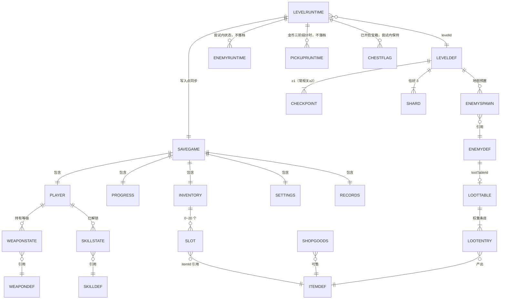

（上半部与 SRS 附录 C4 一致；LOOTTABLE/LEVELRUNTIME/ENEMYRUNTIME/PICKUPRUNTIME/CHESTFLAG 为本设计补充的运行时实体，持久化边界以"落档/不落档"标注，与 FR-11 规则 7 的死亡重置语义一致。）

#### 7.4.4 DD-17 容量与体积预算

| 数据 | 预算 | 依据与核算 |
|---|---|---|
| 单份存档 | <2 KB | DR-02 示例 JSON 实测约 1 KB；上限情形（20 槽全武器 + 12 关全记录 + 21 技能）估算 <2 KB → localStorage 5 MB 配额（SRS 2.5）容纳 >2500 份，corrupt 备份堆积无配额风险 |
| 静态配置 | <100 KB（源码） | 八表合计条目 <200，TS 常量表体积可忽略 |
| 地图 JSON ×12 | ≤6 MB | 单关最大 6400×1536 px = 200×48 瓦片 ×5 瓦片层 CSV ≈ 200 KB/关（FR-11 规则 2 上限尺寸核算） |
| 资源总量 | ≤30 MB | NFR-03 硬指标；分配：图集 ≤8 MB、音频 ≤12 MB、地图 ≤6 MB、其余 ≤4 MB |
| 首屏 JS | gzip ≤600 KB | NFR-03；Phaser chunk 339 KB（SRS 实测基线）+ 应用 chunk 预算 ≤260 KB（Vue 运行时 ~34 KB gzip + 领域/UI 代码） |

### 7.5 数据一致性策略（DD-14）

| # | 策略 | 机制 | 防御的不一致 |
|---|---|---|---|
| K1 | 单一数据源 | ARCH-5 状态归属表 + ARCH-9：每个字段唯一写者；UI 只读快照（IF-M 各 getSnapshot 返回 Readonly） | UI 缓存与领域值漂移 |
| K2 | 变更后广播 | store 命令成功后同步发布对应 DR-04 事件（4.6 约定 3 唯一发布方），订阅方以事件为刷新信号、以快照为数据源（事件不携带权威数据副本——载荷仅为定位/提示信息的例外见 IF-E02~E06，其数值字段在订阅方使用前不回写） | 多界面显示不同步（FR-05/08/14 三处联动） |
| K3 | 事务化复合操作 | ShopService.buy / upgradeWeapon：先全量校验后统一提交，任一步失败整体不生效（FLOW-S4） | 扣款成功入包失败类半事务 |
| K4 | 持久化投影一致 | 存档 = 八 store toSnapshot 的原子聚合（同一帧管线外一次性采集），checksum 覆盖全档 | 存档内分节互相矛盾 |
| K5 | 读档宽容恢复 | 单字段非法 → 丢弃该条目 + warn（DR-02 校验规则）；结构级非法（checksum/parse）→ 整档按 EX-02；进度级非法（解锁不连续）→ 截断到合法前缀（4.3.7） | 篡改/旧档导致不可玩 |
| K6 | 静态数据 fail-fast | 配置/地图校验不过 → 拒绝进关（DD-02、5.9），运行中永不出现半配置状态 | 引用悬空（图标缺失、敌人参数缺失） |
| K7 | 帧内顺序一致 | 管线固定次序（ARCH-13）：同帧互杀以玩家死亡为准、先伤害后拾取后 HUD，消除顺序歧义 | 同帧事件次序不确定导致的数值矛盾 |

### 7.6 界面字段 ↔ 数据字段 ↔ 接口参数三方对照（DD-15）

评分标准要求"数据设计与功能需求、界面字段、接口参数相互对应"，逐界面核对如下（界面布局见第 8 章 UI 编号）：

| 界面字段（第 8 章） | 数据字段（权威源） | 接口参数/通道 | 需求 |
|---|---|---|---|
| HP 条 + `当前/上限` 文本（UI-03） | ResourceSnapshot.hp/hpMax | IF-E02（文本 10 Hz）+ IF-M13 getPerFrame.hpRatio（条形 rAF） | FR-14 规则 1/7/8 |
| SP 条（UI-03） | ResourceSnapshot.sp/spMax | 同上 spRatio | FR-14 规则 1 |
| 金币图标+数量（UI-03） | EconomyService.getCoins() | IF-E02 coins | FR-14 规则 2、FR-09 |
| 遗迹残片图标+数量（UI-03） | EconomyService.getMaterials()['itm_relic_shard'] | IF-E02 materials | FR-14 规则 2、FR-10 升级材料 |
| 技能栏 4 格：图标/快捷键/冷却扇形/剩余秒数 1 位小数（UI-03） | SkillService.loadout + getCooldownLeft | IF-M13 getPerFrame.cooldowns（扇形）+ IF-E02 快照（图标） | FR-07 规则 6/7、FR-14 规则 3 |
| 主副手武器图标+等级、当前手持高亮（UI-03） | InventoryStore.equipped + WeaponService.getLevelFactor 上下文 | IF-E07 + getPerFrame.weaponIcons | FR-05、FR-14 规则 4 |
| Boss 血条 600×12 + 名称（UI-03） | BossBrain hp/hpMax + BossDef 名称 | getPerFrame.bossBar | FR-03、FR-14 规则 5、AT-50 |
| 关卡编号 + 已激活检查点数（UI-03） | LevelContext.levelId + checkpoints 激活位 | getPerFrame.levelId/checkpointsActive | FR-14 规则 6 |
| 低血 2 Hz 闪烁（UI-03） | getPerFrame.lowHp（hp/hpMax<30%） | rAF 通道 CSS class 切换 | FR-06 规则 8 |
| "+N" 金币浮动文本（UI-03 世界内） | PickupSystem 拾取事件参数 | WorldFxLayer 直调（场景内，6.2.3） | FR-09 规则 4 |
| 背包 20 格图标/数量/稀有度边框（UI-06） | InventorySnapshot.slots[].itemId/count + ItemDef.category | IF-E07 → useDomainStore | FR-08 规则 1/2 |
| 悬停浮层：名称/类别/效果/数量/售价（UI-06） | ItemDef.name/category/description/price + SlotEntry.count | IF-M06 getTooltip | FR-08 规则 4 |
| 商店行：名称/价格/缺口/已拥有/已满级（UI-07） | GoodsView（IF-M08 listGoods 聚合 ItemDef/WeaponDef.price + EconomyService 余额） | IF-M08 | FR-10 规则 2、边界 |
| 升级面板：当前级→下级、金币/材料成本（UI-07） | WeaponState.level + EconomyService.upgradeCost | IF-M04/M07 | FR-10 规则 3、AT-36 |
| 技能树节点三态 + SKP 余额 + 剩余可获点数（UI-08） | TreeSnapshot（IF-M05） | IF-M05 getTreeSnapshot + IF-E08 | FR-07、AT-25/26 |
| 结算页：用时/击杀/碎片/金币/新纪录（UI-05） | IF-E06 载荷 + RecordStore.submitResult 返回 | IF-E06 | FR-15 规则 4、FR-19 规则 3 |
| 关卡选择节点：锁形/最佳用时/碎片数（UI-02） | LevelProgressView（IF-M09）+ RecordStore.getLevelRecord | IF-M09/M10 | FR-12 规则 3 |
| 最佳榜 12 关分组 + 占位文本（UI-10） | LevelRecord/GlobalStats（IF-M10） | IF-M10 | FR-19 规则 2/4、AT-65 |
| 设置：三音量滑块/全屏/震屏/重映射（UI-09） | Settings（IF-M11） | IF-M11 + IF-E09 | FR-18 |
| 教学提示图标+文字（UI-11） | hints 触发区 id → 文案表（`ui/i18n.ts`，C7） | TutorialDirector → TutorialHints（EventBus 桥接 composable） | FR-17 规则 2 |
| 死亡浮层"损失金币 N"（UI-05） | IF-E04 载荷 lostCoins（EconomyService.applyDeathPenalty 产物） | IF-E04 | S3、FR-11 规则 7 |
| 错误横幅/导出按钮（UI-12） | SaveSystem.isMemoryOnlyMode + IF-E11 reason | IF-E11 | EX-01 |
| "继续游戏"可用/置灰（UI-01） | AppBoot.ready resolve 值（snapshot 是否 null，6.2.4） | Promise（非事件） | FR-13 规则 7、FR-15 |

核对结论：第 8 章每个界面元素都能落到唯一权威数据字段与唯一接口通道；无"界面有字段、数据无来源"或"数据有字段、界面无呈现"的悬空项（追溯矩阵 12.3 反向核对同步确认）。
---

## 8. 界面与交互设计要点

> 本章回应设计要素 6「界面与交互设计要点：覆盖不同用户角色」与评分项「非功能设计（10 分）」中的界面部分。界面行为需求以 SRS FR-14/15/17/18/19 与 2.3 用户画像为准；本章给出 DOM UI（DEC-1）下的布局分区、交互约定与角色差异化落实。界面编号 UI-nn 与 4.5 组件树、7.6 三方对照表一致。

### 8.1 用户角色差异化要点（U1/U2/U3，SRS 2.3）

| 角色 | SRS 诉求 | 界面设计落实 | 涉及 UI |
|---|---|---|---|
| U1 休闲玩家 | 即开即玩、明确引导、失败惩罚可接受 | 主菜单仅 6 个入口且"开始游戏"视觉权重最高（唯一强调色按钮）；教学提示层内嵌 1-1（UI-11）；死亡浮层只显示单一动作提示"按任意键从检查点继续"，不展示复杂统计；购买按钮置灰 + 差额提示代替报错 | UI-01/05/07/11 |
| U2 平台跳跃爱好者 | 精确数值、成绩明细、build 取舍 | HUD 数值文本 `当前/上限` 精确显示；技能冷却剩余秒数保留 1 位小数；结算页四要素明细 + 新纪录标记；技能树显示"剩余可获点数 42-已用"（AT-26）；最佳榜按关分组 | UI-03/05/08/10 |
| U3 课程评审教师 | 5 分钟看到可运行成果、可追溯 | 主菜单一键"开始游戏"直达 1-1；暂停菜单常驻"操作说明"页（完整按键表，SRS 3.1）；加载页显示构建版本与需求文档指引文本 | UI-01/04/13 |
| 左手习惯用户（U1 子集） | 按键重映射 | 设置面板重映射区（低优先级子项，裁剪时整区隐藏且操作说明仍显示默认键表，FR-18 边界） | UI-09 |

### 8.2 界面清单、导航与公共交互约定

**UI-00 UiShell 导航图**（FR-15"各界面间可双向导航"的落实；态迁移见 4.5，Esc 栈式返回）：

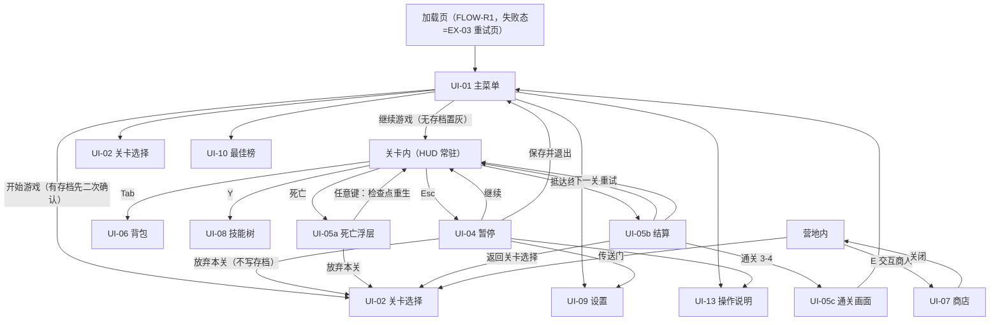

导航硬指标：主菜单出发 ≤3 次点击进入任意已解锁关卡（AT-52：主菜单→关卡选择→关卡节点 = 2 次点击，达标）。

**公共交互约定**（全界面统一，可验证性来源）：

| 编号 | 约定 | 需求依据 |
|---|---|---|
| UI-C1 | 键盘导航：方向键移动焦点、Enter 确认、Esc 返回上一层；焦点元素 2 px 高亮外描边（对比度 ≥3:1）；面板打开时焦点陷阱 | FR-15 规则 7、AT-55、NFR-07 |
| UI-C2 | 防连点：按钮组件统一封装"同帧单次点击"（rAF 标志复位）；1 秒 5 连击不产生重复场景加载 | FR-15 边界 |
| UI-C3 | 过渡动画：界面切换 0.3 s 淡入淡出（Vue `<Transition>`）；场景切换 0.4 s（SceneDirector） | FR-15 规则 6、FR-12 规则 5 |
| UI-C4 | 打开任一 overlay 即发布 `ui:overlay`（IF-E12）→ 场景 `pause()`，HUD 保持显示但停止更新 | FR-15 规则 8、FR-14 边界 |
| UI-C5 | 禁止态视觉语言统一：置灰 + 悬停显示原因文案（金币差额/前置技能名/"已满级"/"背包已满"），不使用弹窗报错 | FR-10 边界、FR-07 边界、EX-10 |
| UI-C6 | 文本集中管理：全部界面文案在 `ui/i18n.ts`（简体中文，C7），错误码→文案映射同址 | C7、E-1 |
| UI-C7 | Toast 通道：`save:written`"已保存"1.5 s 淡出；EX-01 横幅为常驻态（非 Toast），带"导出存档"按钮与"重试保存" | FR-13 输出、EX-01 |

### 8.3 各界面设计要点与线框

**UI-01 主菜单**（MOD-26）：纵向 6 入口（开始游戏/继续游戏/关卡选择/设置/操作说明/最佳榜），画布中央偏左，右侧留出 Phaser 背景层（视差动画背景，纯展示）。"继续游戏"状态由 AppBoot.ready 结果决定（高亮/置灰，6.2.4、7.6 末行）；"开始游戏"在有存档时触发覆盖二次确认对话框（UI-C5 风格的确认框，FR-15 规则 1）。

**UI-02 关卡选择**（MOD-27）：按场景分页（3 页签），每页 4 节点横向路径图：

```
[森林遗迹]  ①觉醒回廊 ── ②藤蔓断崖 ── ③遗迹守卫 ── ④🔒Boss
             已通关        已通关        可进入       未解锁
             ★187.4s 3/3  ★203.1s 2/3   (当前)      (锁形图标)
```

节点三态：锁定（锁形，不响应点击，FR-12 规则 3）/可进入（强调色）/已通关（最佳用时 + 碎片 n/3）。数据源 IF-M09 + IF-M10（7.6 对照表）。

**UI-03 HUD**（MOD-25，常驻，DOM 实现）——布局分区图（1024×768 逻辑坐标系，等比缩放见 8.4）：

```
┌──────────────────────────────────────────────────────────────┐
│ HP [█████████░░░] 78/100        ┌── 石像守卫者 ──────────┐    │
│ SP [██████░░░░░░] 32/50         │ ████████░░░░░░░░░░░░ │    │ ← Boss 血条 600×12
│ ◉ 320   ▣ 4                     └───────────────────────┘    │   顶部中央，仅 Boss 战
│ 1-2 · 检查点 2/3                                              │
│                                                              │
│         （中央 512×384 核心可视区：禁止任何 HUD 元素，          │
│           FR-14 边界；本区仅世界内容 + 世界内浮动文本）          │
│                                                              │
│                                    主手[短剑 Lv2] 副手[轻弩]  │ ← 武器栏，当前手持高亮
│                                    [1]⚔6.0s [2]✦ [3] [4]    │ ← 技能栏 4×48px，冷却扇形+秒数
└──────────────────────────────────────────────────────────────┘
  ↑ 左上三行：HP/SP 条(180×14 / 180×10)+数值、金币/材料、关卡/检查点
```

尺寸/位置/节流/闪烁全部执行 FR-14 处理规则 1~8（数值文本 ≤10 Hz 走 IF-E02，条形与冷却扇形走 rAF 高频通道，4.3.10 双通道）；HP ≤30% 血条 2 Hz 闪烁（CSS animation，合成器执行不占主线程）；1280×720 视口下无溢出（AT-51，由 8.4 缩放方案保证）。

**UI-04 暂停**（MOD-28）：五入口纵列（继续/设置/操作说明/保存并退出/放弃本关）；"放弃本关"二次确认并注明"不保存本关进度"（FR-15 规则 3）；Boss 战中"保存并退出"附加提示"Boss 进度不会保存，已消耗物品不返还"（EX-12 用户告知义务）。

**UI-05 结算三形态**（MOD-29）：
- 05a 死亡浮层：暗色半透明遮罩 + "损失金币 N" + "按任意键从检查点继续"（U1 简化原则）+ 次要按钮"放弃本关"。
- 05b 关卡结算：四要素表（用时 mm:ss.s / 击杀 / 碎片 n/3 / 获得金币）+ 条件性"新纪录"徽标（RecordStore.submitResult 返回）+ Boss 关"场景已解锁"提示 + 三按钮（下一关/重试/返回，FR-15 规则 4）。用时显示与 level:cleared.timeSec 同源，误差 ≤1 s（AT-54）。
- 05c 通关画面：制作人员滚动 + 总用时（totalPlaySec）→ 返回主菜单（S8 异常分支）。

**UI-06 背包**（MOD-30）：5×4 网格（20 格，格 64×64 px），格内：图标 48 px + 右下角数量文本（堆叠 >1 时）+ 稀有度边框色（common 白 / rare 蓝 / epic 紫——设计参数：稀有度由 ItemDef.category+price 区间推导，DD-03 items.ts 注释约定，不新增配置字段）；右侧详情栏（悬停联动：名称/类别/效果/数量/售价 + 操作按钮）；底部"整理"按钮；右键上下文菜单（装备到主手/装备到副手/丢弃）。拖拽排序为低优先级子项（HTML5 drag 事件实现，裁剪时移除，FLOW-S5）。

**UI-07 商店**（MOD-31）：左列商品行（图标/名称/价格），右列玩家资产（金币/材料）与选中商品详情；武器升级区显示 `当前级 → 下一级` 与双成本（金币 + 遗迹残片 n），任一不足对应成本行标红（UI-C5）；"已拥有"/"已满级"徽标（FR-10 边界）。

**UI-08 技能树**（MOD-32）：三分支纵向三列（刃影/弩矢/遗迹），节点 56 px 圆角方块 + 前置连线；节点三态视觉：已解锁（点亮+图标）/可解锁（呼吸闪烁）/锁定（灰 + 前置名提示）；顶部 SKP 余额 + "剩余可获：N"（AT-26）；点击节点弹详情卡（spCost/冷却/效果/解锁按钮）；loadout 四槽横排于底部，主动技能解锁后可拖入/点击装备，满槽替换需确认（FR-07 边界）。

**UI-09 设置**（MOD-33）：三音量滑块（0~100 步进 5，实时生效——`input` 事件即调 IF-M11，不等确认）；全屏开关（拒绝时提示 F11 并回弹，FR-18 边界）；屏幕震动开关；重映射区（低优先级子项）：四组动作各一个"点击后按键捕获"框，冲突时红字提示并拒绝写入；底部"恢复默认"。

**UI-10 最佳榜**（MOD-34）：按场景三组 × 每关一行（关卡名/最佳用时/最佳碎片），无记录行显示占位文本"— —"（AT-65）；顶部全局统计（总死亡/总击杀/总时长/碎片 n/36）。

**UI-11 教学提示层**（MOD-35）：屏幕下方 96 px 固定区域（不遮挡角色与前方地形，FR-17 边界），键帽图标 + 文字（如"← → 移动"），0.5 s 淡出动画，8 s 超时自动淡出；同一提示全周期一次（tutorialDone 入存档）。

**UI-12 全局错误横幅**（MOD-36）：顶部横幅（EX-01"存档不可用，进度仅保存在本次会话"+ 导出按钮；EX-02 损坏弹窗为模态对话框，确认后关闭）；EXD-1/EXD-4 兜底提示同载体。

**UI-13 操作说明**：完整默认按键表（SRS 3.1 表原样渲染，含重映射后的当前键位）；主菜单与暂停菜单双入口（FR-17 规则 5、U3 诉求）。

### 8.4 响应式与缩放策略（NFR-06 落实）

| 层 | 策略 |
|---|---|
| Phaser 画布 | `Scale.FIT` + 逻辑分辨率 1024×768（SRS 2.5）：等比缩放居中，浏览器窗口 1280×720~2560×1440 无拉伸变形；resize 事件由 ScaleManager 处理（EX-06） |
| DOM UI 层 | UI 根容器与画布同尺寸定位（absolute 覆盖于 `#game-container`），采用同一缩放因子：`transform: scale(k)`，k = min(视口宽/1024, 视口高/768)，由 AppLifecycle 在 resize 时经 CSS 变量下发（单一来源，画布与 DOM 永远同步缩放；k 计算与 Scale.FIT 公式一致，无黑边错位） |
| 字体 | 逻辑分辨率下最小 14 px（NFR-07），随容器等比缩放，物理像素下限在 1280×720（k=0.9375）时为 13.1 px——**设计修正**：为保证 NFR-07"最小字号 ≥14 px"在最小视口也成立，UI 文本基准字号取 15 px（15×0.9375 ≈ 14.06 px ≥14）。此为设计参数，不改需求 |
| HUD 安全区 | HUD 元素锚定四角，中央 512×384 禁区（FR-14 边界）在任意 k 下按逻辑坐标不变 |

### 8.5 视觉规范要点

对比度：正文/背景 ≥4.5:1、标题 ≥3:1（NFR-07）——深色 UI 底（#1a1c2c 系）+ 浅色文本（#f4f4f4 系）为默认令牌，写入 CSS 设计令牌表（`ui/tokens.css`），取色工具按 WCAG 2.1 公式可验（AT-72）；状态色：强调（可交互）/禁用灰/警示红/新纪录金。像素风格 UI（9-slice 边框图集）与游戏美术一致；全部 UI 图标来自 UI 图集（DD-11），不使用图标字体（体积与许可考虑）。

---

## 9. 非功能设计

> 本章回应设计要素 7「非功能设计」与评分项「非功能设计（10 分）」。

### 9.1 非功能设计总述

SRS 第 4 章的十条 NFR 全部量化且给出测量方法，本文档不另设数值目标。设计应对的组织方式：每条 NFR 落实到具体架构元素（ARCH）、模块（MOD）、接口（IF）或数据机制（DD），并区分**结构性保证**（由架构与管线顺序天然成立，如 NF-02 输入延迟）与**预算性约束**（以打点/门禁/断言持续验证，如 NF-01 帧预算、NF-03 体积预算），后者全部配备第 13 章的 TT 验证手段。约束与假设（C/A/D）的逐条消解见 9.3。

### 9.2 NFR 逐条设计应对

逐条给出：设计应对（落到编号元素）→ 可度量目标（原文引用 SRS）→ 验证思路（AT 编号 + TT 编号）：

| 编号 | NFR | 设计应对 | 可度量目标（SRS 原文） | 验证 |
|---|---|---|---|---|
| NF-01 | NFR-01 帧率 | ①ARCH-13 固定管线消除顺序抖动；②HUD 双通道节流（4.3.10：文本 10 Hz、条形 rAF+CSS 合成器路径）；③对象池（DD-13）消除帧内分配；④同屏敌人 24 上限 + AI 冻结（4.3.2 budgetPass）；⑤纹理图集合并 draw call（DD-11）；⑥重活出帧（ARCH-12：存档/地图解析仅管线外） | 常规关稳定 60 FPS、单帧 P95 ≤16.7 ms；Boss 战 P95 ≤20 ms；10 分钟采样 >33.3 ms 帧占比 <1% | AT-66；TT-06 帧预算断言（开发构建管线各阶段 performance.now 打点，阶段超预算 console 警告） |
| NF-02 | NFR-02 输入延迟 | 输入采集位于管线阶段 1，同帧完成状态机迁移与动画切换（4.3.1）；DOM 不拦截画布键盘事件（UI 面板关闭时 `pointer-events:none`，键盘监听挂 window 捕获阶段但仅在 overlay 态激活焦点陷阱） | 按键到视觉反馈 ≤2 帧（33 ms @60FPS） | AT-67 慢动作录屏逐帧 |
| NF-03 | NFR-03 加载与体积 | Vite 既有 Phaser 独立分包（manualChunks）；应用 chunk 预算 ≤260 KB gzip（DD-17 核算）；资源总量 ≤30 MB 预算表（DD-17）；关卡地图按关懒加载（进关时 load，不随首屏）；图集按场景分组（3 场景 + UI 共 4 组），首屏只加载 UI+场景一组 | 首屏 JS gzip ≤600 KB；资源 ≤30 MB；首屏可交互 ≤3 s；关卡切换 ≤1.5 s | AT-68；TT-07 构建体积门禁脚本（build 后统计 gzip 体积超预算即失败） |
| NF-04 | NFR-04 内存与长稳 | DisposalRegistry 统一登记-反注册（4.6 约定 1）：场景 shutdown 时计时器/EventBus 订阅/Tween 全清；对象池随场景销毁重建（DD-13）；领域单例常驻但无场景引用（不持有 GameObject，防 detached 泄漏）；HudOverlay rAF 随 UiLayer 卸载注销（6.3.4） | 2 小时 + ≥20 次切关后堆增长 <10%；无 detached DOM 增长 | AT-69；TT-08 切关泄漏冒烟（开发构建每 5 次切关打印 EventBus.listenerTotalLengths 与池占用断言） |
| NF-05 | NFR-05 存档可靠 | 双键写入状态机（DD-10）+ 崩溃一致性论证（7.3.3）；checksum+迁移链（DD-09）；EX-01 降级（内存模式+导出）；EX-02 损坏备份；写入 ≤50 ms 预算与管线外排队（4.3.8） | 失败不覆盖既有存档 + 导出降级；损坏不白屏；写入 ≤50 ms | AT-45~47、AT-70；TT-01 SaveSystem 单测族 |
| NF-06 | NFR-06 兼容与自适应 | Scale.FIT + DOM 同因子缩放（8.4）；resize → EX-06 重布局钩子；WebGL 丢失/不可用 → EX-04 Canvas 回退 + 30 FPS 提示；不使用浏览器前沿 API（Fullscreen 拒绝有回退，6.3.3） | 4 浏览器可通关 1-1；1280×720~2560×1440 等比无变形；回退可用 | AT-71 手工矩阵（TT-09 清单化） |
| NF-07 | NFR-07 易用性 | 教学触发区（MOD-09/UI-11）；UI-C1 键盘导航 + 焦点高亮；对比度/字号设计令牌（8.5，字号基准 15 px 修正）；Esc 一键暂停（全局快捷键，任意态 1 次按键内到达暂停，FR-15）；禁止态原因文案（UI-C5） | ≥2/3 测试者 5 分钟通关 1-1 求助 ≤1；对比度 ≥4.5:1/≥3:1；最小字号 ≥14 px | AT-60/72；TT-09 可用性测试脚本 |
| NF-08 | NFR-08 可维护可扩 | ARCH-7 领域引擎无关（Vitest 直测纯 TS）；ARCH-8 表驱动 + DD-02 校验（新增武器 = weapons.ts + 图集帧 ≤2 文件）；E-1 错误码登记表；DD-08 类型化存档契约；模块公开接口全部 IF 化（第 6 章）；`vue-tsc --noEmit` 入 CI 脚本 | strict 零错误；核心数值模块覆盖率 ≥80%；新增武器改动 ≤2 文件 | AT-73；TT-01~05 |
| NF-09 | NFR-09 安全合规 | 运行时零网络：代码层不 import/调用 fetch/XHR/WebSocket/sendBeacon（TT-10 静态扫描：`grep -rE "fetch\(|XMLHttpRequest|WebSocket|sendBeacon" src/` 仅允许命中注释）；构建期统一 `*-nolog`（ARCH-14，D4）；存档 checksum 拒载（DD-09）；素材许可登记流程（DD-11） | Network 面板完整通关 1-1 零请求；篡改存档拒载；许可清单一一对应 | AT-74；TT-10 |
| NF-10 | NFR-10 音频 | AudioAdapter 用户手势内 unlock（FLOW-S1 步骤 1，冷启动零自动播放报错）；三路音量 master×channel 乘积实时应用（IF-X02）；visibilitychange → 暂停 BGM 与循环（EX-05，AppLifecycle→AudioAdapter.onVisibility）；音量 0 不卸载资源（SettingsStore 边界） | 首次交互后可播；三路独立实时生效并持久化；失焦暂停恢复 | AT-75 |

### 9.3 约束、假设与依赖的设计消解

| SRS 条目 | 设计的遵守/消解方式 |
|---|---|
| C1 技术栈锁定 | 全部模块以 Phaser 4.0.0 + Vue 3.5.13 + TS 5.7.3 + Vite 6.3.2 能力为限；未引入任何新运行时依赖（仅新增 devDependency：Vitest，见 D2） |
| C2 纯前端 | 架构无服务端组件（ARCH-14/15）；6.4 第三方接口声明 |
| C3 Arcade Physics | 物理仅用 Arcade（StaticGroup/overlap/body）；单向平台以碰撞回调容差实现（7.2.2），不引入 Matter.js |
| C4 素材许可 | DD-11 登记流程；图集来源限 Kenney/Pixel Frog/SunnyLand（SRS 已核实 CC0），Tiny Swords 逐包核实后方可用 |
| C5 代码规范 | strict TS（Result 判别联合依赖 strictNullChecks）；4 空格/CRLF/UTF-8（仓库 .editorconfig） |
| C6 工期 | 模块设计深度分级（4.1）；低优先级子项（拖拽/重映射/洗点）均为可独立移除的隔离设计（各自单一入口，FLOW-S5/UI-08/UI-09），裁剪顺序遵循 SRS 3.1 |
| C7 语言 | UI-C6 文本集中 `ui/i18n.ts` |
| A1 键鼠假设 | InputGateway 仅键鼠；无触控分支 |
| A2 localStorage ≥1MB | DD-17 核算单档 <2 KB；probe 探测失败即 EX-01 |
| A3 CC0 素材够用 | DD-11 图集规划按 CC0 包的既有内容组织；缺口时的替换流程 = 换图集帧名（ItemDef.icon 引用制，不改代码） |
| A4 单存档槽 | 键族含 slot 段（7.3.1）；SaveSystem 接口签名 slot: 0，扩多槽只改调用点 |
| D1 Phaser 4 API | 接口设计仅使用随包 skills 已核实的 API 面（tilemapTiledJSON、Arcade、Scale.FIT、Sound）；实现期遇 v3/v4 差异按随包 `v3-to-v4-migration` skill 处理，不影响本设计结构 |
| D2 Vitest | 新增 devDependency `vitest`；测试边界 = 领域层 + 适配器（TT-01~05，13 章）；若被否决则覆盖率指标降级为 SRS D2 预案（人工走查记录） |
| D3 Tiled | 地图管线：Tiled 编辑 → CSV JSON 导出 → `public/assets/levels/`（7.2.2）；校验兜底地图质量（DD-02 V-地图组） |
| D4 构建遥测 | ARCH-14：开发与构建一律 `dev-nolog`/`build-nolog`，写入 README 与 TT-07 门禁（`npm run build` 带 log.js 的版本仅允许在显式知情下使用） |

---

## 10. 异常与故障处理设计

> 本章回应设计要素 8「异常与故障处理设计」与评分项「关键流程与异常处理设计（15 分）」的异常部分。10.2 将 SRS EX-01~12 逐条落到检测点、处理路径与恢复策略；10.3 补充本设计新引入的故障模式 EXD-1~4（编号区分于 SRS，见 1.5）。

### 10.1 设计原则

| 编号 | 原则 | 内容 |
|---|---|---|
| FDP-1 | 检测点前移 | 浏览器 API 异常一律在适配层捕获并翻译为错误码（ARCH-11）；领域层只见错误码不见浏览器异常类型 |
| FDP-2 | 分级响应 | 数据级异常（单字段非法）→ 宽容恢复（丢弃+警告）；资源级异常（存储/音频不可用）→ 降级运行；结构级异常（存档损坏/配置非法）→ 拒绝进入 + 现场保留；程序级异常（未捕获错误）→ 全局兜底安全退场 |
| FDP-3 | 失败不扩散 | 任一子系统失败不得中断游戏主循环（存档失败游戏继续、音频失败静音继续、UI 失败画布继续——EXD-1） |
| FDP-4 | 用户可感知 | 每个 EX 的用户可见反馈有明确载体（10.2 表"反馈载体"列）；静默处理仅限 EX-09（SRS 定义玩家不可见） |
| FDP-5 | 现场可诊断 | 损坏存档 `.corrupt` 备份、EX-11 连续 3 次警告日志、EX-09 调用栈记录（1 分钟去重）——为课程评审与后续维护留证据 |

### 10.2 SRS EX-01~12 的设计处理路径

| EX | 检测点（模块） | 处理路径（调用链） | 恢复策略 | 用户反馈载体 | 流程/设计引用 |
|---|---|---|---|---|---|
| EX-01 存储不可用/配额满 | StorageAdapter.writeAtomic 捕获 QuotaExceededError/SecurityError（IF-X01） | SaveSystem.write → `save:failed`（IF-E11）→ GlobalErrorBoundary 进入 MemoryOnly 态（DD-10 状态机）；暂停自动存档 | 用户"导出存档 JSON"（exportAsDownload）；恢复权限后横幅"重试保存"重新入队 | UI-12 常驻横幅 + 导出/重试按钮 | FLOW-S7、DD-10、NF-05 |
| EX-02 存档损坏/版本不符 | SaveSystem.load：JSON.parse / checksum / schemaVersion 三重校验 | StorageAdapter.rename → `.corrupt.<时间戳>` 备份 → 初始化新档 → Result CORRUPT | 新档开始；备份保留供诊断（7.3.1） | UI-12 模态弹窗"已损坏，已新建进度（旧数据已备份）"，确认关闭 | FLOW-S7 读档路径 |
| EX-03 资源/地图加载失败 | PreloaderScene load 错误回调；LevelLoader.validate（MAP_INVALID/ASSET_MISSING） | 中止进关，停留加载页；失败资源清单写入 LoadingView 状态 | 重试按钮重新 load；连续 3 次 → 提示检查网络/刷新 | UI（加载页）错误清单 + 重试 | FLOW-R1、FLOW-L1、5.9 |
| EX-04 WebGL 不可用/上下文丢失 | Phaser type:AUTO 回退；AppLifecycle 监听 webglcontextlost（IF-X04） | 回退 Canvas 2D；丢失 → 尝试 restore → 失败则 SceneDirector.gotoMenu | 刷新重试；性能目标降 30 FPS（NF-01 预算表切换） | 主菜单"兼容模式运行"提示条 | ARCH-16、6.3.4 |
| EX-05 失焦/后台节流 | AppLifecycle visibilitychange/blur（IF-X04） | 暂停循环（Phaser pauseOnBlur）+ 领域 tick 停摆（帧增量驱动天然暂停）+ InputGateway 清零 + AudioAdapter.onVisibility(true) 停 BGM + 自动弹暂停菜单（UiShell → 'paused'） | 重聚焦后玩家手动"继续" | UI-04 暂停菜单 | 4.3.1、6.3.4、9.2 NF-10 |
| EX-06 resize/全屏切换 | Phaser ScaleManager + AppLifecycle resize | Scale.FIT 重算 + CSS 变量下发新 k（8.4）+ HUD 锚点按逻辑坐标不变 | 自动完成 | 无（平滑缩放即反馈） | 8.4 |
| EX-07 按键卡键 | AppLifecycle blur → InputGateway 清零（4.3.1） | 恢复焦点后以 justPressed 语义重建（按住不放的重映射到下一次物理按下） | 自动；玩家按一次对应键复位 | 无（角色停止漂移即恢复） | FLOW-S2 异常 4 |
| EX-08 AudioContext 被阻止 | AudioAdapter.unlock 返回 AUDIO_BLOCKED（IF-X02） | 音频系统挂起态；游戏静音运行；挂起播放请求入队 | 首次用户手势 unlock 成功后自动重放 BGM | 主菜单静音图标（UI-01） | FLOW-S1 步骤 1 |
| EX-09 数值异常 | DamageCalculator/ResourceSystem/EconomyService/RecordStore 入口钳制（IF-M02/03/07/10） | 钳制到合法区间 + console.warn（含调用栈，1 分钟同款去重）；clamped 标志随 Result 返回 | 自动钳制，游戏不中断 | 玩家不可见（SRS 原文） | FLOW-S2 异常 1、5.8 |
| EX-10 背包已满 | InventoryStore.addItem 返回 INVENTORY_FULL（IF-M06） | 拾取路径：PickupSystem.notifyInventoryFull → 地面保留 10 s 倒计时；购买路径：ShopService 事务中止不扣款（K3） | 丢弃/整理后重新拾取；倒计时结束掉落物消失 | "背包已满"Toast + 掉落物上方倒计时文本（WorldFxLayer） | FLOW-S2 异常 2、FLOW-S4 |
| EX-11 卡进几何体/掉出地图 | PlayerController 物理回调（embedded 检测）+ `position.y > deathPlaneY + 512`（4.3.1） | teleportTo(最近激活检查点 ∥ 出生点)（IF-M19）；不判死亡不扣金币；同关连续 3 次 → 警告日志（含坐标，诊断地图缺陷） | 自动传送；0.3 s 黑屏过渡（SceneDirector.fade） | 短暂黑屏后出现在检查点 | FLOW-S3 异常 1、5.10 异常 2（Boss 无击退预防） |
| EX-12 Boss 战退出/刷新 | 写入点白名单天然排除 Boss 战进行中（4.3.8 WritePolicy）；刷新 = 会话重启走 FLOW-R1 | 重进 Boss 关：LevelLoader 重建 + BossBrain 满 HP + 检查点 = Boss 房入口；已消耗物品不返还（消耗即时生效语义，FR-08） | 重新挑战 | 暂停菜单退出前提示（UI-04 附加文案） | 5.10 异常 1、FLOW-S7 异常 4/5 |

### 10.3 设计层新增故障模式（EXD）

本设计引入的机制（DOM UI 双栈、EventBus 广播、领域断言）带来 SRS 未覆盖的故障面，逐条定义：

| 编号 | 故障模式 | 触发条件 | 处理路径 | 恢复策略 | 用户反馈 |
|---|---|---|---|---|---|
| EXD-1 | Vue 组件渲染异常 | 某面板组件 render/生命周期抛错（数据形状意外、浏览器兼容缺陷） | Vue `app.config.errorHandler` + 组件级 `onErrorCaptured`（GlobalErrorBoundary 包裹每个 overlay 面板）：捕获 → 卸载该面板 → UiShell 回退 'none' 态 → `ui:overlay{open:false}` 保证场景恢复运行 | 游戏主循环不受影响（FDP-3：Phaser 与 Vue 异常域天然隔离，双栈架构的可靠性红利，DEC-1）；面板可重新打开 | "界面出现异常，已关闭该面板"Toast；控制台完整栈 |
| EXD-2 | EventBus 订阅回调异常 | 某订阅方处理事件时抛错（Phaser EventEmitter 同步分发，异常会中断后续订阅方） | 全部跨层订阅统一经 composable/包装器 `safeOn(event, handler)` 注册：try/catch 每个 handler，异常转 EXD-1 通道记录，不中断其余订阅方与发布方 | 单个订阅方失效不影响事件链其余消费者 | 控制台错误（含事件名+订阅方标识） |
| EXD-3 | 领域层不变量违例 | 开发期缺陷：非法状态机迁移、快照分节互斥字段矛盾（如 coins<0 进入 UI） | 领域层入口 `invariant(cond, msg)`：开发构建抛 AssertionError（尽早暴露）；生产构建降级为 EX-09 钳制 + 去重警告（玩家体验优先） | 开发期修复；生产期钳制兜底 | 开发期 console 红字；生产期不可见 |
| EXD-4 | 全局未捕获异常/Promise 拒绝 | 任何逃逸出上述通道的错误 | IF-X05：window error/unhandledrejection + Vue errorHandler 兜底 → 记录 → game 实例健康则 SceneDirector.gotoMenu()；渲染不可用则纯 DOM 提示页 | 安全退回主菜单，保证不白屏（NFR-05 精神的一致性延伸）；存档按最近写入点保留 | "出现异常，已回到主菜单"提示页 |

**与 SRS 编号体系的关系**：EXD-n 不修改、不替代任何 EX-nn；EX-nn 的语义与 SRS 第 6 章完全一致，EXD 是设计实现机制自身的故障面（2.3 第 1 类"设计细化"）。EXD-3 生产降级路径与 EX-09 合流；EXD-1/2/4 的反馈载体复用 UI-12。

### 10.4 故障注入验证视图

全部 EX/EXD 均有可执行的注入手段（第 13 章 TT-11 故障注入清单）：EX-01/02 用 StorageAdapter mock 与手工写坏 localStorage（AT-46/47/70）；EX-04 用 `chrome://gpu` 禁用 WebGL；EX-05/07 用标签页切换与 Alt+Tab；EX-08 用冷启动不交互观察 Console；EX-09 用开发构建控制台直调领域接口传 NaN；EXD-1 用开发构建向面板 props 注入畸形快照；EXD-4 用控制台 `throw`。注入结果逐项记录进验收档案（SRS 7.1 通过判据）。

---

## 11. 设计决策与权衡

> 本章回应设计要素 9「设计决策与权衡」。每条决策：背景 → 备选方案比较 → 结论与否决理由 → 影响面。标注"继承"的决策由 SRS 约束/需求预先锁定，本文档确认执行并补全设计层论证，不重新裁定。

### DEC-1 UI 技术栈：Vue DOM UI（选定） vs 全 Phaser UI vs 混合

| 备选 | 优点 | 缺点 |
|---|---|---|
| **A. Vue DOM UI（选定）** | 复杂界面（背包拖拽、技能树、商店列表、键盘导航/焦点陷阱）用 HTML/CSS 原生能力实现，开发效率与可访问性最高；与模板既有 Vue+EventBus 架构和 DR-04 事件契约（hud:update 接收方"HUD 层"）零冲突；UI 异常与游戏循环天然隔离（EXD-1 红利） | 双栈并存：需要 DOM/画布同步缩放方案（8.4）；HUD 高频更新需专门通道设计（性能质疑点，见下） |
| B. 全 Phaser UI | 单一渲染栈，无跨栈通信；缩放天然一致 | 文本排版/悬停提示/拖拽/焦点管理全部手写（Phaser 无 DOM 级 UI 原语），FR-08/15 的交互细节工期风险高（C6）；与 DR-04 的 Vue 事件契约部分作废（需改 SRS）；UI 崩溃与游戏循环同域 |
| C. 混合（HUD 入 Phaser，菜单用 Vue） | HUD 逐帧更新走画布无 DOM 开销 | 两套 UI 技术栈同时维护（字体/主题/布局逻辑双份）；HUD 与菜单共享的数据绑定逻辑分裂两处，违背单一数据源的一致性管理（K1/K2 复杂化） |

**结论**：选 A。**性能质疑的正面回应**：DOM HUD 的风险在逐帧样式重算——设计上以 4.3.10 双通道消解：文本 10 Hz（本就是 FR-14 规则 8 的需求上限），条形/冷却扇形走 rAF 直写 CSS 变量 + `transform: scaleX()`（合成器路径，不触发布局与重绘）；AT-48/51/66 覆盖验证。若实测仍超帧预算（NF-01 打点），回退路径明确：仅将 HUD 迁入 Phaser UIScene（其余界面不动），影响面被 HudViewModel 接口隔离（IF-M13 双通道契约不变）——该回退不需要重构任何领域模块，风险可控。
**影响**：ARCH-1/2/6、MOD-25~36、8.4 缩放方案、EXD-1/2。（本决策经撰写者裁定，与实验 2 任务对接确认。）

### DEC-2 领域层与引擎解耦（选定） vs 逻辑内聚于 Scene

| 备选 | 优点 | 缺点 |
|---|---|---|
| **A. 独立领域层（选定）** | NFR-08 覆盖率 ≥80% 可达成（纯 TS 直测，无需浏览器/引擎环境）；数值调优（附录 A ±20%）与手感迭代不触碰渲染代码；EX-09 钳制逻辑集中 | 多一层间接（Phaser 侧薄封装）；初学者心智成本 |
| B. 逻辑写在 Scene/GameObject 内 | 文件少、直观 | 单测必须起 Phaser 环境（headless 脆弱且慢）；伤害/经济公式与 Tween/Sprite 纠缠，AT-73"新增武器 ≤2 文件"不可达 |

**结论**：选 A。本项目 75 条 AT 用例中约 30 条依赖精确数值行为，可测试性是硬需求而非风格偏好。**影响**：ARCH-7、第 4 章模块划分、TT-01~05。

### DEC-3 物理方案：Arcade Physics（继承 C3，确认执行）

SRS 约束 C3 已锁定 Arcade、否决 Matter.js（刚体物理对平台跳跃收益低且调试成本高）。设计层确认：全部物理需求（AABB 实体碰撞、单向平台、击退、磁吸直线运动）均在 Arcade 能力面内（随包 `physics-arcade` skill 已核实）；单向平台以碰撞回调速度/位置容差实现（7.2.2，设计参数 4 px），不使用任何 Matter 专属能力。**影响**：MOD-01/03/05/06/07 的物理实现方式。

### DEC-4 持久化介质：localStorage 双键写入（继承 FR-13） vs IndexedDB vs 直接覆盖

| 备选 | 优点 | 缺点 |
|---|---|---|
| **A. localStorage + 双键写入（选定，SRS FR-13 规则 4 已定方向）** | 同步 API 简单可靠；5 MB 配额对 <2 KB 单档绰绰有余（DD-17）；双键顺序保证崩溃一致性（7.3.3 论证） | 同步写有帧内阻塞风险——已由"管线外排队 + ≤50 ms 预算"消解（4.3.8） |
| B. IndexedDB | 异步、容量大 | 异步事务对单档 <2 KB 场景过度设计；API 复杂度（版本迁移、事务错误面）与单人工期（C6）不匹配；SRS DR-02/AT-47 全部按 localStorage 语义撰写，换介质 = 需求变更 |
| C. localStorage 直接覆盖 | 最简 | 写入中断损坏唯一存档，违背 FR-13 规则 4 与 NFR-05"不得覆盖既有存档"，被 SRS 明确否决 |

**结论**：A（设计确认 SRS 方向并给出状态机与一致性论证）。**影响**：MOD-20/37、DD-07/09/10。

### DEC-5 状态管理：自建领域单例 store + shallowRef 桥接（选定） vs Pinia vs 组件本地状态

| 备选 | 优点 | 缺点 |
|---|---|---|
| **A. 自建单例 + useDomainStore（选定）** | 领域层零框架依赖（ARCH-7 的前提：Pinia store 无法脱离 Vue 单测）；快照整体替换语义简单、无深层响应式追踪开销；新增运行时依赖 = 0 | 需自写 ~50 行 composable 桥接；无 DevTools 时间旅行（单人项目收益低） |
| B. Pinia | 生态成熟、DevTools | 状态被迫住进 Vue 反应式系统 → 领域逻辑与 Vue 耦合，Vitest 需挂 Vue 环境；帧内高频状态（冷却计时）进深层响应式有代理开销 |
| C. 组件本地状态 + props | 无库 | 多界面共享同一数据（金币出现在 HUD/商店/结算）必然重复源，违背 K1 |

**结论**：选 A（ARCH-6）。规模论证：13 个领域 store、订阅方 ≤12 个组件，自建桥接的复杂度低于引入并约束 Pinia 的复杂度。**影响**：ARCH-6、4.5、全部 Vue 模块。

### DEC-6 配置表载体：TS 常量表（选定） vs JSON 文件

| 备选 | 优点 | 缺点 |
|---|---|---|
| **A. TS 常量表（选定）** | 编译期类型检查（SRS 5.1 取值范围可写成类型+运行时校验双保险，DD-02 V6）；重构安全（改字段名全表报错）；tree-shaking 友好；SRS DR-01 原文允许"TS 常量表或 JSON" | 非程序员不可编辑（单人项目无此角色）；改数值需重编译（Vite HMR 秒级，无实际影响） |
| B. JSON 文件 | 运行时可替换、外部工具友好 | 无编译期校验，全部错误延迟到运行时（DD-02 负担加重）；面向 Mod/编辑器的扩展性在 SRS 8.2 已明确排除 |

**结论**：选 A。**影响**：DD-03 文件组织、MOD-23。

### DEC-7 地图编码：Tiled CSV 明文（继承 DR-03，确认执行）

SRS DR-03 已规定 CSV 明文（便于 git diff 与版本管理，不用 base64）。设计确认：12 关 ≤6 MB 体积预算可接受（DD-17）；LevelLoader 解析路径不受编码影响（Phaser tilemapTiledJSON 原生支持 CSV）。**影响**：7.2.2、DD-17。

### DEC-8 高频实体管理：对象池（选定） vs 即时创建销毁

| 备选 | 优点 | 缺点 |
|---|---|---|
| **A. 对象池（选定）** | 消除帧内 GC 压力（NFR-01 >33.3 ms 帧占比 <1% 的主要威胁是 GC 尖峰）；NFR-04 堆稳定 | 复用时重置遗漏会产生"幽灵弹丸"类缺陷——以 DD-13 重置项清单 + TT-08 冒烟约束 |
| B. 即时创建销毁 | 代码直观 | 高频战斗（每关 20~80 次命中 + 金币簇）下分配/回收尖峰不可控，AT-66/69 风险高 |

**结论**：选 A，池范围仅限高频短生命周期实体（弹丸/金币/浮动文本/粒子）；敌人不池化（每关数量有限、生命周期长，池化收益低复杂度高——**明确不做**，防过度设计）。**影响**：MOD-06/07/10、DD-13。

### DEC-9 线程模型：单主线程（选定） vs Web Worker 拆分

| 备选 | 优点 | 缺点 |
|---|---|---|
| **A. 单线程（选定）** | 无序列化/同步成本；Phaser 主循环即单线程模型；调试简单 | 重计算与渲染争抢主线程——已由 ARCH-12（重活出帧）与 NF-01 打点约束 |
| B. Worker 拆分（AI/寻路或存档计算入 Worker） | 主线程纯净 | 本项目最重的帧内计算是 24 敌人 AI（budgetPass 后实际更少），量级远未达需要 Worker 的程度（每帧 <1 ms 预估，TT-06 验证）；postMessage 序列化开销可能反超收益；Phaser 对象不可跨线程 |

**结论**：选 A。**触发重审的条件**（可验证性）：TT-06 打点显示 EnemyAI+CombatResolver 合计 P95 >4 ms 时重估——该阈值写入开发构建断言。**影响**：ARCH-15。

### DEC-10 模板场景处置：改造而非全部保留

模板五场景中 Boot/Preloader 职责吻合直接复用；Game 改造为 LevelScene；MainMenu/GameOver 移除（界面职责移交 Vue，DEC-1 的推论）。**权衡**：保留空壳 MainMenu 场景可少改 `main.ts`，但会产生"Phaser 场景与 Vue 视图双重主菜单"的状态同步负担——移除是更小的总复杂度。`main.ts` 场景注册表更新为 `[Boot, Preloader, Level, Camp]`（ARCH-17）。**影响**：ARCH-17、MOD-11、6.2.4。

### 决策汇总表

| 决策 | 选定方案 | 性质 | 主要影响 |
|---|---|---|---|
| DEC-1 | Vue DOM UI + Phaser 世界 | 本文档裁定（撰写者确认） | 架构分层、MOD-25~36、8 章 |
| DEC-2 | 领域层引擎无关 | 本文档裁定 | ARCH-7、可测试性 |
| DEC-3 | Arcade Physics | 继承 C3 | 物理实现方式 |
| DEC-4 | localStorage 双键写入 | 继承 FR-13 + 设计论证 | MOD-20/37、DD-10 |
| DEC-5 | 自建 store + shallowRef 桥接 | 本文档裁定 | ARCH-6 |
| DEC-6 | TS 常量配置表 | 本文档裁定（DR-01 允许域内） | DD-03 |
| DEC-7 | Tiled CSV 明文 | 继承 DR-03 | 7.2.2 |
| DEC-8 | 高频实体对象池（敌人不池化） | 本文档裁定 | DD-13 |
| DEC-9 | 单主线程 | 本文档裁定 | ARCH-15 |
| DEC-10 | 模板场景改造/移除 | 本文档裁定 | ARCH-17 |
---

## 12. 需求追溯矩阵

> 本章回应设计要素 10「需求追溯矩阵」与评分项「完备性与可追溯性（15 分）」。12.1 为正向矩阵（需求 → 设计元素），12.2 为反向矩阵（设计元素 → 需求或技术原因），12.3 为高优先级覆盖自查，12.4 为内部一致性自查记录。编号族含义见 1.5。

### 12.1 正向矩阵：需求 → 设计元素

**功能需求（FR）**：

| 需求 | 模块 | 接口 | 流程 | 数据 | 界面 | 其他（架构/决策/异常） |
|---|---|---|---|---|---|---|
| FR-01 移动跳跃 | MOD-01 | IF-M19 | FLOW-S2 | DD-12 | UI-13（键表） | ARCH-13 阶段 1/2、DEC-3、EX-07/11 路径 |
| FR-02 相机 | MOD-02 | IF-M19（getMotionState 消费） | FLOW-B1（锁定） | — | — | ARCH-16、EX-06 |
| FR-03 敌人/Boss AI | MOD-03 | IF-M15（applyHit） | FLOW-S2、FLOW-B1 | DD-06、DD-12 | UI-03（Boss 血条数据） | 4.3.2 同屏预算（NF-01）、EX-11 预防（5.10） |
| FR-04 战斗判定 | MOD-04、MOD-12 | IF-M02、IF-M15 | FLOW-S2 | DD-12 | UI-03（伤害数字经 FX） | K7 同帧顺序、EX-09 钳制 |
| FR-05 武器 | MOD-14 | IF-M04 | FLOW-S5（装备）、FLOW-S2（切换） | DD-03 weapons.ts、DD-08 weapons 分节 | UI-03 武器栏、UI-06 右键装备 | ARCH-8 |
| FR-06 HP/SP | MOD-13 | IF-M03 | FLOW-S2 | DD-08 player 分节 | UI-03 血/能量条、低血闪烁 | ARCH-13 阶段 8、EX-05 计时暂停 |
| FR-07 技能树 | MOD-15 | IF-M05 | FLOW-S6 | DD-03 skills.ts、DD-08 skills 分节 | UI-08、UI-03 技能栏 | 4.3.5 决策/执行分离 |
| FR-08 背包 | MOD-16 | IF-M06 | FLOW-S5 | DD-08 inventory 分节 | UI-06 | EX-10 路径、K3 事务 |
| FR-09 金币掉落拾取 | MOD-07、MOD-17 | IF-M07、IF-M18 | FLOW-S2 | DD-13 金币池 | UI-03 金币数、"+N"浮动文本 | EX-10 |
| FR-10 商店升级 | MOD-18 | IF-M08 | FLOW-S4 | DD-03 goods.ts | UI-07 | K3 事务、ARCH-17 CampScene |
| FR-11 关卡/检查点 | MOD-05、MOD-07 | IF-M14 | FLOW-L1、FLOW-S3 | DD-04、DD-05 | — | EX-03/11/12 路径 |
| FR-12 切换/解锁 | MOD-19、MOD-11 | IF-M09、IF-M17 | FLOW-S8、FLOW-L1 | DD-08 progress 分节 | UI-02 | K5 前缀截断、ARCH-17 |
| FR-13 存档读档 | MOD-20、MOD-37 | IF-M16、IF-X01 | FLOW-S7、FLOW-R1 | DD-07/08/09/10 | UI-01 继续置灰、UI-12 | NF-05、EX-01/02 |
| FR-14 HUD | MOD-24、MOD-25 | IF-M13、IF-E02 | FLOW-S2（管线阶段 10） | DD-15 对照表 | UI-03 | 4.3.10 双通道、DEC-1 |
| FR-15 界面导航 | MOD-26~29、MOD-36 | IF-E12 | 5.5、UI-00 导航图 | — | UI-00~05、UI-13 | 4.5 UiShell、UI-C1~C7 |
| FR-16 音效动画 | MOD-08、MOD-10 | IF-X02 | FLOW-S1（解锁） | DD-11 | UI-09（音量） | EX-08、DEC-1（震动开关旁路） |
| FR-17 教学 | MOD-09、MOD-35 | —（场景内直调 + composable 桥接） | FLOW-S1 | DD-05 hints 组、DD-08 tutorialDone | UI-11 | — |
| FR-18 设置 | MOD-22、MOD-33、MOD-39 | IF-M11、IF-X03、IF-E09 | —（面板直连） | DD-08 settings 分节 | UI-09 | EX-08（全屏拒绝回退） |
| FR-19 最佳榜 | MOD-21、MOD-34 | IF-M10 | FLOW-S8 | DD-08 records 分节 | UI-10、UI-05b 新纪录 | EX-09（用时 ≤0 丢弃） |

**非功能需求（NFR）**：

| 需求 | 设计应对（第 9 章） | 关键机制元素 | 验证 |
|---|---|---|---|
| NFR-01 帧率 | NF-01 | ARCH-12/13、DD-13、4.3.2 budgetPass、4.3.10 双通道 | AT-66、TT-06 |
| NFR-02 输入延迟 | NF-02 | ARCH-13 阶段 1、4.3.1 状态机同帧迁移 | AT-67 |
| NFR-03 体积加载 | NF-03 | ARCH-14 分包、DD-17 预算表、7.4.4 图集分组 | AT-68、TT-07 |
| NFR-04 内存长稳 | NF-04 | 4.6 约定 1 DisposalRegistry、DD-13、6.3.4 rAF 注销 | AT-69、TT-08 |
| NFR-05 存档可靠 | NF-05 | DD-09/10、7.3.3 一致性论证、IF-X01 | AT-45~47、AT-70、TT-01 |
| NFR-06 兼容自适应 | NF-06 | ARCH-16、8.4 缩放、IF-X04 | AT-71、TT-09 |
| NFR-07 易用性 | NF-07 | UI-11 教学、UI-C1 键盘导航、8.5 令牌 | AT-60/72、TT-09 |
| NFR-08 可维护可扩 | NF-08 | ARCH-7/8、DEC-2/5/6、DD-02、第 6 章接口化 | AT-73、TT-01~05 |
| NFR-09 安全合规 | NF-09 | 6.4 声明、ARCH-14 nolog、DD-11 许可登记 | AT-74、TT-10 |
| NFR-10 音频 | NF-10 | IF-X02、FLOW-S1 步骤 1、EX-05 联动 | AT-75 |

**数据需求（DR）**：

| 需求 | 设计落实 |
|---|---|
| DR-01 配置表 | DD-02 校验清单、DD-03 类型化与文件组织、MOD-23、IF-M12、DEC-6 |
| DR-02 存档结构 | DD-07 键族、DD-08 类型化与字段归属、DD-09 checksum/迁移、DD-10 双键状态机、MOD-20、IF-M16 |
| DR-03 地图格式 | DD-04 图层映射、DD-05 hints 扩展注、MOD-05、IF-M14、DEC-7 |
| DR-04 事件契约 | IF-E01~E12（6.2，零修改零新增）、4.6 约定 3 唯一发布方、6.2.3 直调边界、6.2.4 AppBoot 说明 |
| DR-05 外部接口 | IF-X01~X05、MOD-37~40、ARCH-11、6.4 无第三方声明 |

**异常故障模式（EX-01~12）**：全部落于 10.2 表（检测点/处理路径/恢复策略/反馈载体四列即追溯）；设计层新增 EXD-1~4 见 10.3。

**使用场景（S1~S8）**：S1→FLOW-R1+FLOW-S1；S2→FLOW-S2；S3→FLOW-S3；S4→FLOW-S4；S5→FLOW-S5；S6→FLOW-S6；S7→FLOW-S7；S8→FLOW-S8。补充流程 FLOW-L1、FLOW-B1 分别追溯 FR-11/DR-03 与 FR-03。

### 12.2 反向矩阵：设计元素 → 需求或技术原因

MOD-01~40 的逐模块追溯已在 4.1 清单表"追溯"列给出（40/40 非空，其中 UI/适配模块另见 4.4/4.5/6.3）。其余设计元素：

| 设计元素 | 回溯依据 |
|---|---|
| ARCH-1/2/3 分层与依赖规则 | 技术原因：C1 技术栈（Phaser+Vue 双栈既成事实）+ NFR-08 可测试性；层间通信方式由 DR-04（EventBus 契约）决定 |
| ARCH-4 命令/通知分工 | DR-04（事件用于通知）+ 技术原因：同步命令需要返回失败码（EX-10 等 UI 即时反馈） |
| ARCH-5 状态归属表 | FR-05/06/08/12/13/18/19 各状态的需求语义 + K1 一致性 |
| ARCH-6 UI 反应式桥接 | DEC-5（领域层可测性前提 ARCH-7） |
| ARCH-7 领域引擎无关 | NFR-08（覆盖率 ≥80%、新增武器 ≤2 文件） |
| ARCH-8 配置表驱动 | DR-01、NFR-08、FR-05 规则 7 |
| ARCH-9 单一数据源 | DR-02 字段唯一性 + 技术原因（防 UI/领域双写漂移） |
| ARCH-10 事件单向流 | DR-04 载荷纯对象约定 + 技术原因（可调试性） |
| ARCH-11 适配器兜底 | DR-05、EX-01/04/05/07/08 检测点需求 + TT mock 接缝 |
| ARCH-12 帧预算内工作 | NFR-01/02/05（写入 ≤50 ms 不入帧） |
| ARCH-13 update 管线 | NFR-01/02 + FR-04 规则（判定顺序）、K7 |
| ARCH-14/15/16 部署运行视图 | SRS 2.5 运行环境、NFR-03/06/09、C2、D4、DEC-9 |
| ARCH-17 场景清单 | FR-10（营地）、FR-11/12（关卡）、FR-15（界面移交 Vue）、DEC-10 |
| FLOW-R1~B1（11 条） | SRS S1~S8 + FR-11（加载校验）+ FR-03（Boss 阶段） |
| IF-M01 Result/错误码 | 技术原因：E-1~E-4 错误约定统一；错误码全部出自 EX-01/02/03/10 与 FR-05/07/08/10 的失败分支 |
| IF-M02~M19 | 对应模块公开面（4.1 追溯列） |
| IF-E01~E12 | DR-04 原样（零修改零新增，6.2.2 一致性声明） |
| IF-X01~X05 | DR-05 七项 + EX-01/04/05/07/08 + EXD-4 |
| DD-01~17 | DD-01 分类（技术原因：生命周期差异）；DD-02/03→DR-01；DD-04/05→DR-03+FR-17；DD-06→FR-03 规则 4；DD-07/08/09/10→DR-02+FR-13；DD-11→FR-16+C4+NFR-03；DD-12→FR-11 规则 7（敌人不落档）；DD-13→NFR-01/04；DD-14/15→评分完备性要求+K1~K7；DD-16→SRS 附录 C4 扩展；DD-17→NFR-03/05+SRS 2.5 |
| UI-00~13、UI-C1~C7 | FR-14/15/17/18/19、SRS 2.3 画像差异、NFR-06/07 |
| NF-01~10 | NFR-01~10 一一对应 |
| FDP-1~5 | 技术原因：SRS 第 6 章 12 类异常的设计学归纳；FDP-3 源自 C2 纯前端单进程约束 |
| EXD-1~4 | 技术原因：DEC-1 双栈、DR-04 广播、ARCH-7 断言、NFR-05 不白屏精神的延伸（10.3 逐条触发条件） |
| DEC-1~10 | 每条决策表内已列备选比较与否决理由；DEC-3/4/7 继承 SRS 约束/需求原文 |
| TT-01~11 | NFR-08、SRS 7.1 验收方法、AT-66~75 测量方法 |

**空洞项自查**：反向矩阵中不存在"仅技术原因且无需求关联"的装饰性设计元素；全部技术原因元素（ARCH-4/9/10、FDP、EXD、DD-13 等）均在理由列注明其防御的需求风险（一致性/可靠性/可测性）。

### 12.3 高优先级需求覆盖自查

SRS 高优先级需求 = 14 条 FR（FR-01~09、FR-11~15）+ NFR-01/02/05/07。逐条核对 12.1：每条均定位到 **≥1 个模块 + ≥1 个接口或流程**（最薄项 FR-02：MOD-02 + FLOW-B1 相机锁定 + ARCH-16，仍满足双定位）。**结论：无"需求有、设计缺"空洞项。**中优先级 FR-10/16/17/18 与低优先级 FR-19 同样全覆盖（12.1 表 19/19 行非空）。

### 12.4 内部一致性自查记录

| # | 检查项 | 方法与结果 |
|---|---|---|
| 1 | 流程 ↔ 接口 | 第 5 章 11 条流程中出现的全部方法调用与事件 emit 逐一比对第 6 章签名：事件名与 DR-04 逐字一致（IF-E 表 12/12）；方法调用均可在 IF-M01~M19 定位；无未定义调用 |
| 2 | 接口 ↔ 数据 | IF-M 签名中的类型（SlotEntry/WeaponState/TreeSnapshot/HudSnapshot/SaveData…）与 DD-03/DD-08/DD-12 定义同源（`src/game/data/*` 单一出处）；IF-E 载荷字段 = DR-04 原文字段 |
| 3 | 数据 ↔ 界面 | DD-15 三方对照表 23 行覆盖第 8 章全部界面元素；无悬空字段（7.6 核对结论） |
| 4 | 数值零偏差 | 全文数值抽查（跳跃 480/1300、土狼 100 ms/缓冲 120 ms、i-frame 0.8 s、hitbox 40×36、弹速 520/射程 480、升级 `round(60×n^1.5)`、SKP 46/42、金币上限 99999、死亡不扣金币、HUD 180×14/180×10/600×12/48×48、禁区 512×384、同屏 24、节流 10 Hz、写入 50 ms）均与 SRS 正文/附录 A 一致；新增技术参数（池容量、oneway 容差 4 px、字号基准 15 px、DEC-9 阈值 4 ms）均已标注"设计参数"并给出依据 |
| 5 | 编号完整性 | ARCH-1~17、MOD-01~40、FLOW×11、IF-M01~M19/IF-E01~E12/IF-X01~X05、DD-01~17、UI-00~13+UI-C1~C7、NF-01~10、FDP-1~5、EXD-1~4、DEC-1~10、TT-01~11：编号连续、无复用、交叉引用可解析（附录 A 索引） |
| 6 | 与 SRS 无矛盾 | 2.4 基线核对 + 本章 1~4 项；SRS 5.1 PlayerState 的 position/velocity 与 DR-02 存档不含位置字段的表面差异已按 SRS 语义消解（7.3.2"运行时位置恢复"段），非矛盾 |

---

## 13. 测试与验证考虑

> 本章回应设计要素 11「测试与验证考虑」。回答两个问题：本设计**如何被验证**（13.1~13.3：测试分层、可测试接缝、AT 对照）；设计结论**如何被检查**（13.4：决策复审条件与设计评审清单）。测试框架依赖 D2（Vitest，devDependency），执行 SRS 7.1 全部验收方法。

### 13.1 测试分层（TT-01 ~ TT-11）

| 编号 | 层 | 对象与内容 | 通过判据 | 需求锚点 |
|---|---|---|---|---|
| TT-01 | 单元测试（Vitest，领域层） | ①DamageCalculator：黄金样本表（基础 12×等级系数 1.15×rng 端点 0.95/1.05 → AT-12/17 数值区间断言）+ NaN/负值钳制（EX-09）；②EconomyService：升级成本 `round(60×n^1.5)` 全五级、死亡不扣金币与奖励幂等、掉落表权重分布（注入确定性 rng，10^4 次采样卡方检验）；③SaveSystem：编解码往返、FNV-1a 黄金样本、迁移链（构造 v0→v1 假迁移）、损坏四路径（parse/checksum/schemaVersion 高于/迁移抛错）、双键中断模拟（mock setItem 在第 1/2/3 步抛错，断言正式键可读——AT-47/70）；④ConfigRegistry：V1~V6 正反例（合法表通过 + 每类校验一个非法样本拒绝）；⑤InventoryStore：堆叠合并/装备回原格/整理排序（AT-28~30）；⑥SkillService：前置/余额/loadout 满替换（AT-24~26）；⑦ProgressService：解锁链推进、连续前缀截断（AT-41~44）；⑧RecordStore：新纪录判定、≤0 丢弃（AT-64/65） | 语句覆盖率 ≥80%（NFR-08 核心数值模块 = 上述 ①②③④ + ResourceSystem）；全部用例绿 | NFR-08、AT-12/17/24~30/36/40~47/64/65/70 |
| TT-02 | 组件测试（Vitest + @vue/test-utils） | UiShell 态迁移与 `ui:overlay` 发布、Esc 栈式返回、防连点（同帧双触发仅一次）、焦点陷阱与键盘导航（UI-C1）、InventoryPanel 快照渲染（20 格/置灰/悬停）、MainMenu"继续游戏"置灰逻辑 | 关键交互路径全覆盖；无快照漂移 | FR-15、AT-52~55 |
| TT-03 | 适配器契约测试 | StorageAdapter：mock localStorage（抛 QuotaExceededError/SecurityError/正常）三态下 writeAtomic 语义（正式键不变性断言）；AudioAdapter：unlock 拒绝路径；FullscreenAdapter：Promise 拒绝 → 错误码 | 契约表（6.3）逐行为断言 | EX-01/08、NFR-05 |
| TT-04 | 集成冒烟（开发构建 + 脚本化操作） | FLOW-S2 主链（击杀→掉落→拾取→HUD 更新）、FLOW-S3（死亡→损失→重生状态断言）、FLOW-S7（触发点→落档→刷新→恢复，AT-45 自动化版）、FLOW-L1（12 关逐一 load+validate 通过） | 四条链全绿；每关校验零错误 | FR-04/09/11/13 |
| TT-05 | 架构守护 | ①`npx vue-tsc --noEmit` 零错误（AT-73）；②依赖规则门禁：`grep -rl "from 'phaser'" src/game/domain/` 必须为空（ARCH-7）、`grep -rE "localStorage\.|new AudioContext|document\.requestFullscreen" src/game/domain/ src/ui/` 必须为空（ARCH-11）；③错误码登记表与实际使用一致性脚本；④DR-04 事件名字面量仅存在于 `events.ts` 与订阅桥接层（ARCH-10） | 门禁脚本入 `npm run check`，CI/提交前执行 | NFR-08、ARCH-7/10/11 |
| TT-06 | 帧预算打点 | 开发构建管线 10 阶段 `performance.now()` 打点，滚动 P95 显示；断言：EnemyAI+CombatResolver 合计 P95 ≤4 ms（DEC-9 复审阈值）、全管线 P95 ≤12 ms（为渲染留 4.7 ms） | 2-2 与 1-4 两关采样达标 | NFR-01、AT-66 |
| TT-07 | 构建体积门禁 | `npm run build-nolog` 后脚本统计：应用 chunk gzip ≤260 KB、总量 ≤600 KB、资源 ≤30 MB（DD-17 预算表） | 超预算构建失败 | NFR-03、AT-68 |
| TT-08 | 泄漏冒烟 | 开发构建每 5 次切关断言：EventBus 监听器总数回到基线、四池占用 = 初始容量、`DisposalRegistry` 待清理数 = 0 | 20 次切关零增长趋势 | NFR-04、AT-69 |
| TT-09 | 手工矩阵与可用性 | ①浏览器矩阵：4 浏览器 × 3 视口 × 核心流程清单（AT-71 展开为勾选表）；②可用性：3 名测试者脚本（任务卡、计时、求助计数、错误操作记录，AT-60/72）；③对比度取色记录表 | AT-71/72 判据 | NFR-06/07 |
| TT-10 | 零网络静态扫描 | `grep -rE "fetch\(|XMLHttpRequest|WebSocket|sendBeacon|import\(.http" src/` 仅允许注释命中；构建产物 dist 同款扫描；运行时 Network 面板录屏（AT-74） | 三层扫描零命中 | NFR-09 |
| TT-11 | 故障注入 | 10.4 注入手段清单逐项执行：EX-01~12 + EXD-1~4 共 16 项，每项记录（注入方式/预期行为/实际行为/AT 编号） | 16/16 与 10.2/10.3 表定义行为一致 | SRS 7.1 M4 出口条件 |

### 13.2 可测试接缝设计（每个关键模块的注入点）

| 模块 | 接缝 | 用途 |
|---|---|---|
| DamageCalculator / EconomyService.rollLoot | `rng: () => number` 参数注入 | 确定性数值断言（TT-01） |
| SaveSystem | 构造入参 `storage: StorageAdapter` 接口注入 | mock 配额/损坏/中断（TT-01/03） |
| ConfigRegistry | `validateAll` 接受表数据入参（默认导入内置表） | 非法配置样本注入（TT-01 ④） |
| 全部领域 store | `fromSnapshot` 公开（IF-M16） | 任意存档状态构造 |
| PlayerController | InputGateway 可替换（接口注入）；`teleportTo` 公开 | 脚本化操作序列（TT-04）、EX-11 模拟 |
| LevelLoader | `load` 返回 Result 不抛错 | 12 关批量校验（TT-04） |
| HudViewModel | `tick(dt)` 手动驱动 | 节流行为断言（10 Hz 边界） |
| AudioAdapter / FullscreenAdapter | 接口化（IF-X02/03） | 浏览器策略失败模拟 |
| Vue 组件 | `useDomainStore` 可传入 mock store | 组件测试无领域依赖（TT-02） |

### 13.3 AT 用例 ↔ 模块/接口对照（细化 SRS 9.2）

| AT 区段 | 验证对象 | 模块/接缝 | 测试层 |
|---|---|---|---|
| AT-01~07 | 移动/跳跃/相机 | MOD-01（InputGateway 注入）、MOD-02 | 手工 + TT-04 |
| AT-08~11 | 敌人/Boss AI | MOD-03（brain 可单步驱动） | 手工 |
| AT-12~15 | 战斗判定 | MOD-04/12（rng 注入） | TT-01 + 手工 |
| AT-16~19 | 武器 | MOD-14/18 | TT-01 + 手工 |
| AT-20~23 | HP/SP | MOD-13（tick 手动驱动） | TT-01 + 手工 |
| AT-24~26 | 技能 | MOD-15 | TT-01 + 手工 |
| AT-27~30 | 背包 | MOD-16 | TT-01/02 |
| AT-31~33 | 金币 | MOD-07/17 | TT-01 + 手工 |
| AT-34~36 | 商店 | MOD-18 | TT-01/02 |
| AT-37~40 | 关卡 | MOD-05（12 关批量校验） | TT-04 |
| AT-41~44 | 解锁 | MOD-19 | TT-01 |
| AT-45~47、AT-70 | 存档 | MOD-20/37（storage 注入） | TT-01/03 |
| AT-48~51 | HUD | MOD-24/25 | TT-02 + 手工 |
| AT-52~55 | 界面导航 | MOD-26~29（UiShell） | TT-02 |
| AT-56~58 | 音效 | MOD-08 | 手工 |
| AT-59~60 | 教学 | MOD-09/35 | TT-09 |
| AT-61~63 | 设置 | MOD-22/33/39 | TT-02 + 手工 |
| AT-64~65 | 最佳榜 | MOD-21/34 | TT-01 |
| AT-66~69 | 性能/内存 | 管线打点、池、DisposalRegistry | TT-06/07/08 |
| AT-71~72 | 兼容/易用 | 8.4 缩放、UI-C1 | TT-09 |
| AT-73 | 可维护 | 架构守护 | TT-05 |
| AT-74 | 安全合规 | 零网络扫描、许可清单 | TT-10 |
| AT-75 | 音频 | AudioAdapter | 手工 + TT-03 |

### 13.4 设计结论的可检查性

每条 DEC 均绑定可执行的复审条件（可验证性要求）：DEC-1 → AT-48/51/66 + NF-01 打点（超预算即触发"HUD 迁入 Phaser UIScene"预案，影响面已界定）；DEC-2/5/6 → TT-05 门禁（违反即失败）；DEC-8 → TT-08；DEC-9 → TT-06 的 4 ms 阈值断言；DEC-3/4/7/10 → 继承 SRS 约束，随 AT-37~47/70 验证。设计评审清单（自评用）：①每个模块能说出唯一职责与状态归属；②每条流程的异常分支都有 EX/EXD 编号；③每个界面字段能在 DD-15 找到权威源；④每个错误码能在 IF-M01 登记表找到；⑤每个数值能标注 SRS 出处或"设计参数"。

---

## 14. 附录

### 附录 A 设计元素编号索引

| 编号族 | 范围 | 定义处 |
|---|---|---|
| ARCH | 1~17 | 第 3 章（ARCH-13 管线、ARCH-17 场景表在 3.3.2/3.5） |
| MOD | 01~40 | 4.1 清单表（详细设计 4.3，简述 4.4，Vue 层 4.5） |
| FLOW | R1、S1~S8、L1、B1（11 条） | 3.3.1 与第 5 章 |
| IF-M | 01~19 | 6.1 |
| IF-E | 01~12 | 6.2（= DR-04 12 事件） |
| IF-X | 01~05 | 6.3 |
| DD | 01~17 | 第 7 章（DD-05 为 7.2.2 表注、DD-06 为 7.2.1 Boss 阶段结构） |
| UI | 00~13、UI-C1~C7 | 第 8 章 |
| NF | 01~10 | 9.2 |
| FDP | 1~5 | 10.1 |
| EXD | 1~4 | 10.3 |
| DEC | 1~10 | 第 11 章 |
| TT | 01~11 | 13.1 |

### 附录 B 图表索引

| 图 | 位置 | 内容 |
|---|---|---|
| 架构分层图 | 3.1 ARCH-1 | 五层 + 适配层与依赖方向 |
| 启动时序图 | 3.3.1 FLOW-R1 | 冷启动/校验/读档 |
| 部署视图 | 3.4 ARCH-14 | 构建产物与托管 |
| 模块依赖图 | 4.2 | 40 模块依赖边 |
| 双键写入状态机 | 7.3.3 DD-10 | 存档写入/失败/降级 |
| 运行时 ER 图 | 7.4.3 DD-16 | SRS 附录 C4 扩展 |
| S2/S3/S4/S6/S7(×2)/S8/L1/B1 时序图 | 5.2~5.10 | 关键流程 |
| 导航图 | 8.2 UI-00 | 界面态迁移 |
| HUD 布局图 | 8.3 UI-03 | 分区与安全区 |

### 附录 C 评分标准覆盖对照

| 评分维度 | 分值 | 本文档对应章节 |
|---|---|---|
| 架构与模块设计 | 20 | 第 3 章（分层 ARCH-1~6、职责与依赖 ARCH-2/3、部署运行视图 3.3/3.4、规模匹配 3.6）+ 第 4 章（边界与职责 4.1、耦合解释 4.2/4.6、关键模块 4.3） |
| 接口设计 | 15 | 第 6 章（内部 IF-M、事件 IF-E 与 DR-04 逐字一致、外部 IF-X、错误约定 6.1.1、调用限制各表、无虚构第三方 6.4） |
| 数据设计 | 20 | 第 7 章（模型与存储结构 DD-01~17、实体字段格式约束 7.2/7.3、一致性策略 7.5 K1~K7、三方对应 7.6） |
| 关键流程与异常处理设计 | 15 | 第 5 章（11 条流程含正常/分支/异常，判断与数据读写对应 5.11）+ 第 10 章（EX-01~12 路径表、EXD-1~4、恢复策略、注入验证 10.4） |
| 非功能设计 | 10 | 第 9 章（NF-01~10 应对+可度量目标+验证）+ 第 8 章（U1/U2/U3 角色覆盖）+ 9.3（约束/假设/依赖） |
| 完备性与可追溯性 | 15 | 第 2 章（基线明确、零改动声明）+ 第 12 章（双向矩阵、高优先级覆盖自查、一致性自查）+ 1.5 要素映射表 |
| 可验证性与规范性 | 5 | 13.4（设计结论可检查）+ 1.5（编号/术语/助动词规范）+ 12.4 检查 5（编号完整性）+ 全文图表统一 Mermaid、术语沿用 SRS 1.3 |

### 附录 D 与 SRS 的引用约定及版本记录

**引用约定**：本文档中 `FR/NFR/DR/EX/AT/C/A/D/S/U/附录 A/附录 B` 编号一律指向 `docs/需求分析文档.md` v1.0；`ARCH/MOD/FLOW/IF/DD/UI/NF/FDP/EXD/DEC/TT` 为本文档自有编号（1.5）。两文档编号族无交集、无歧义。

**版本记录**：

| 版本 | 日期 | 说明 |
|---|---|---|
| v1.0 | 2026-10-12 | 首版：基于 SRS v1.0（零改动）完成全部 12 项设计要素；关键决策 DEC-1（Vue DOM UI）经撰写者裁定 |

**后续演进约定**：若实现期触发 SRS 9.3 需求变更（超出附录 A ±20% 的数值调整、DR-04 事件增改等），须先改 SRS 递增版本，再同步修订本文档对应章节并在附录 D 追加版本行；本文档的 DEC 复审条件（13.4）触发时同样递增版本。

---

**文档结束** ｜ 版本 v1.0 ｜ 2026-10-12 ｜ 需求基线：`docs/需求分析文档.md` v1.0 ｜ SRS 配套记录（实验 1 产物，仅供追溯）：`docs/AI协作记录.md`、`docs/人工核实说明.md`

## 2026-11-01 目录组织补充

沿用既有 ARCH/MOD/IF 分层与行为契约，层内按职责归类，测试与实现分离。LevelScene保留生命周期和帧调度，技能执行与结算数据委托独立模块；EnemyAI区分集合、实体与Boss行为；UiLayer区分组装、导航与存档交互。运行数值、事件载荷和存档结构不因本次整理改变。原版本路径作为历史依据保留，当前路径见 [代码路径迁移对照](代码路径迁移对照.md) 与 [代码导读](代码导读.md)。
