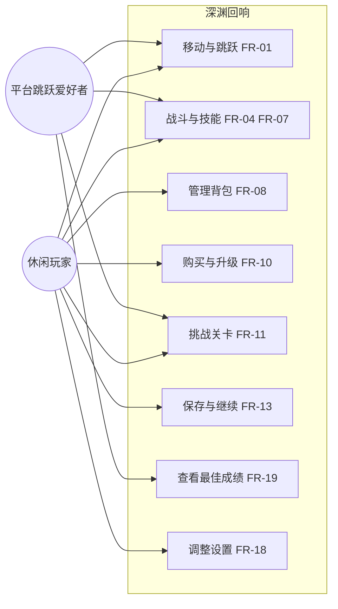
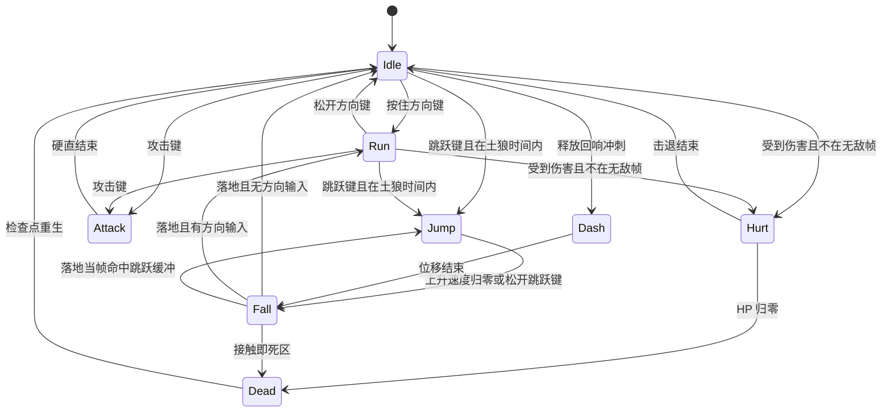
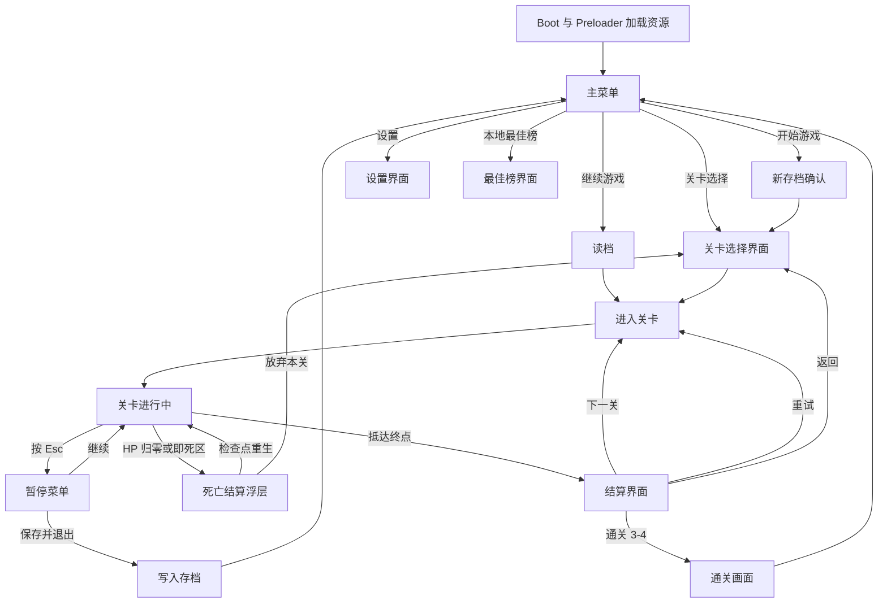
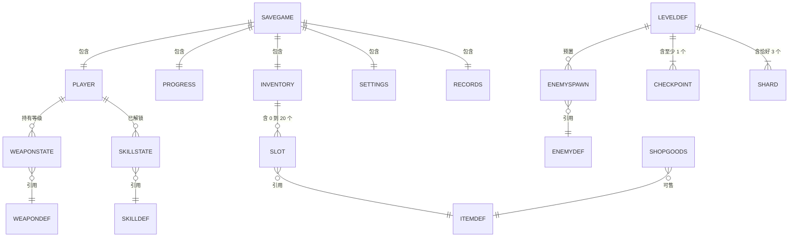
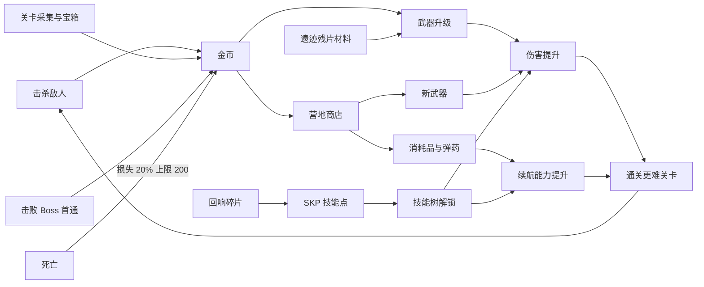

# 《深渊回响》需求分析文档

| 项目 | 内容 |
|---|---|
| 项目名称 | 《深渊回响》（Echoes of the Abyss），仓库代号 SEAPP |
| 文档类型 | 软件需求规格说明（SRS） |
| 文档版本 | v1.0 |
| 编写日期 | 2026-09-28 |
| 编写方式 | AI 辅助 + 人工审阅裁定，协作过程见 `docs/AI协作记录.md` |
| 核实说明 | 关键结论核实记录见 `docs/人工核实说明.md` |
| 适用阶段 | 需求分析；作为概要设计、详细设计与测试用例设计的输入 |

---

## 1. 引言

### 1.1 编写目的

本文档定义《深渊回响》——一款运行在桌面浏览器中的单人 2D 横版平台跳跃动作游戏——的完整需求，包括功能需求、非功能需求、数据需求、异常处理、验收标准与范围边界。

文档面向三类读者：项目开发者（本人）、课程评审教师、后续接手实现或测试的协作者。每条需求均带唯一编号、优先级、可验证的验收标准与来源，可直接作为设计依据与测试用例设计的输入。

本文档不描述实现方案（类结构、算法实现等），仅在第 2.6 节说明已由现有仓库决定的技术选型约束。

### 1.2 项目背景与问题陈述

**背景**：本项目为软件工程课程个人实验作业，需在既有代码仓库基础上完成一个可运行的 Web 应用并提交需求分析文档。仓库现状是 Phaser 官方 Vue + TypeScript 模板（详见 2.2 节），仅包含场景骨架与一个来回漂浮的 Logo，没有任何游戏玩法。

**问题陈述**：模板本身不构成产品。要在课程工期内把它变成"能玩、好玩、可验收"的游戏，必须先回答三个问题：

1. 玩法边界在哪里。平台跳跃手感、战斗、成长、关卡内容各做到什么程度，哪些明确不做。
2. 需求是否可验证。"手感好""流畅""界面友好"这类表述无法测试，必须转换为帧率、输入延迟、通关时间等可测量指标。
3. 单人开发如何控制范围。在没有服务端、没有美术团队、没有测试团队的前提下，哪些功能会吃掉工期，必须前置裁剪。

**要解决的用户问题**：休闲玩家在碎片时间（单次 5~15 分钟）里，希望打开浏览器即玩、无需下载安装、无需注册登录，获得有成长感与探索感的动作平台跳跃体验，并能随时中断、下次打开时延续进度。

**成功判据**（与 7.3 节里程碑验收对应）：12 个关卡全部可通关；核心操作稳定 60 FPS；进度可保存并正确读回；全部高优先级需求通过对应验收用例。

### 1.3 术语与缩略语

| 术语 | 含义 |
|---|---|
| HP | Hit Point，生命值，归零即死亡 |
| SP | 技能能量（Skill Power），释放主动技能的消耗资源，随时间与击杀回复 |
| SKP | 技能点数（Skill Point），解锁技能树节点的货币，来源于关卡收集与 Boss 奖励 |
| i-frame | 无敌帧，受击后短时间内不受伤害 |
| hitbox / hurtbox | 攻击判定框 / 受击判定框 |
| 土狼时间 | Coyote Time，离开平台边缘后仍允许起跳的宽限时间 |
| 跳跃缓冲 | Jump Buffer，落地前提前按下跳跃键、落地瞬间自动起跳的宽限机制 |
| 可变跳高 | 按住跳跃键跳得更高、提前松手则截断上升速度 |
| Tilemap | 瓦片地图，本作使用 Tiled 导出的 JSON 格式 |
| 检查点 | Checkpoint，关卡内重生点 |
| 掉落表 | Loot Table，敌人死亡时按权重随机产出物品的配置 |
| 存档槽 | Save Slot，一份独立存档数据的存储位置 |
| HUD | Head-Up Display，游戏内叠加信息层 |
| Boss 阶段 | Boss 按剩余 HP 比例切换的行为状态 |
| 回响碎片 | 关卡内收集物，每枚兑换 1 SKP |
| FR / NFR / DR / AT / EX | 功能需求 / 非功能需求 / 数据需求 / 验收用例 / 异常故障模式 的编号前缀 |
| CC0 | Creative Commons Zero，公有领域贡献许可 |

> **二义性消除说明**：SP 与 SKP 是两个独立资源，全文不混用。SP 为能量条（战斗内消耗与回复），SKP 为技能点数（跨关卡积累、用于解锁技能树）。此约定由撰写者人工裁定，避免"技能点"一词同时指代两种资源。

### 1.4 参考资料

| 编号 | 资料 | 用途 |
|---|---|---|
| R1 | IEEE Std 830-1998《软件需求规格说明书推荐实践》 | 文档结构与需求描述规范 |
| R2 | GB/T 8567-2006《计算机软件文档编制规范》 | 中文章节组织习惯 |
| R3 | Phaser 4.0.0 随包 skills 目录 `node_modules/phaser/skills/`（含 `physics-arcade`、`tilemaps`、`scale-and-responsive`、`input-keyboard-mouse-touch`、`audio-and-sound`、`v3-to-v4-migration`） | 技术可行性核实与 API 依据 |
| R4 | Phaser 官方模板 `template-vue-ts` v1.3.0 | 仓库现状基线 |
| R5 | Kenney 资源许可说明 https://kenney.nl/support | 素材许可核实（全站资源 CC0） |
| R6 | Pixel Frog《Pixel Adventure 1》 https://pixelfrog-assets.itch.io/pixel-adventure-1 | 素材许可核实（CC0） |
| R7 | Ansimuz《SunnyLand Woods》 https://ansimuz.itch.io/sunnyland-woods | 素材许可核实（CC0 v1.0 Universal） |
| R8 | 课程实验要求与评分标准（正确性与可行性 20 / 完备性与无二义性 20 / 可验证性与规范性 20 / 优先级合理性一致性 10 / 易追溯性 10 / AI 协作与人工核实 20） | 需求覆盖度与优先级划分依据 |
| R9 | 用户原始需求描述与 5 轮共 14 个澄清问题的选择（2026-09-28） | 需求来源，全文实录见 `docs/AI协作记录.md` |

### 1.5 文档约定

**编号规则**：`FR-nn` 功能需求，`NFR-nn` 非功能需求，`DR-nn` 数据需求，`AT-nn` 验收用例，`EX-nn` 异常与故障模式。编号一经分配不复用；废弃条目保留编号并标注 `[已废弃]` 与废弃原因，以便后续功能变更可追溯至最初定义。

**优先级定义**（与使用频率对齐，依据 R8）：

| 优先级 | 定义 | 判据 |
|---|---|---|
| 高 | 缺失即产品不可用 | 每局必用（秒级~分钟级触发），或阻断主流程 |
| 中 | 缺失则体验明显受损但仍可通关 | 每关或每次会话触发数次 |
| 低 | 锦上添花，工期紧张时可延后 | 整个游戏周期触发 ≤3 次，或仅影响观感 |

**需求描述格式**：每条功能需求固定包含 需求描述 / 输入 / 处理规则 / 输出 / 异常与边界 / 验收标准 / 来源 七个字段。措辞使用"必须（shall）/ 应当（should）/ 可以（may）"三级助动词，禁止使用"尽量、快速、友好、较好、适当"等不可测量表述。

**需求与背景分离**：第 1、2 章为背景与总体描述，不构成可测试的需求条目；第 3~6 章为需求本体；第 7 章为验收；第 8 章为边界；第 9 章为追溯；第 10 章为基线数据附录。测试用例只允许引用第 3~6 章编号。

---

## 2. 总体描述

### 2.1 产品定位与目标

**一句话定位**：无需安装、打开即玩的单人 2D 横版平台跳跃动作游戏，以"精准跳跃手感 + 轻量战斗成长 + 手工关卡探索"为核心体验。

**产品类型**：动作平台跳跃（Action Platformer）。手感容错设计参考《Celeste》，成长结构参考《Hollow Knight》，但规模压缩到课程工期可完成的 12 关。

| 目标 | 度量方式 | 关联需求 |
|---|---|---|
| G1 手感可信 | 具备土狼时间与跳跃缓冲，输入延迟 ≤2 帧 | FR-01、NFR-02 |
| G2 内容完整 | 12 关全部可通关，含 3 个 Boss，主线首通 50~70 分钟 | FR-11、FR-12、附录 B |
| G3 成长有感 | 武器升级、技能树、背包三条成长线形成闭环 | FR-05、FR-07、FR-08、FR-10 |
| G4 进度不丢 | 本地存档可靠，异常时可恢复 | FR-13、NFR-05 |
| G5 可验收 | 每条需求均有可执行验收标准，共 75 条验收用例 | 第 7 章 |

**非目标**：不追求高保真美术表现；不做多人竞技；不做长期运营（无赛季、无内购、无广告）。

### 2.2 现状基线（可追溯依据）

以下为撰写本文档时仓库的真实状态，均已通过命令核实（核实命令与证据见 `docs/人工核实说明.md` 第 2 节）。

| 项 | 现状 | 对需求的影响 |
|---|---|---|
| 依赖版本 | phaser 4.0.0、vue 3.5.13、vite 6.3.2、typescript 5.7.3 | 约束 C1；Phaser 4 与 Phaser 3 API 存在差异，实现期需参考随包 `v3-to-v4-migration` skill |
| 画布 | 1024×768，`type: AUTO`（`src/game/main.ts`） | 逻辑分辨率基线，NFR-06 缩放策略以此为准 |
| 物理 | `GameConfig` 中未配置 `physics` 字段 | FR-01 需新增 Arcade Physics 配置；已核实 `node_modules/phaser/dist/phaser-arcade-physics.js` 存在 |
| 场景 | Boot、Preloader、MainMenu、Game、GameOver 五个空壳场景 | FR-15 可复用现有骨架，需新增关卡选择、暂停、商店、背包、结算场景或覆盖层 |
| 通信 | `src/game/EventBus.ts` 提供 Phaser ↔ Vue 事件总线 | DR-04 事件契约以此为基础设施 |
| 资源 | `public/assets/` 仅 bg.png、logo.png、star.png | 全部游戏素材需新引入，见约束 C4 |
| 构建 | `vite/config.prod.mjs` 使用 terser 压缩、Phaser 独立分包、`base: './'` | NFR-03 体积指标与 NFR-09 静态托管可行性依据 |
| 测试与规范 | 无测试框架、无 ESLint 配置；`.editorconfig` 规定 4 空格缩进、UTF-8、CRLF | NFR-08 需新增测试框架，见依赖 D2 |
| 构建脚本 | `package.json` 的 `dev`/`build` 会执行 `log.js`，向 `gryzor.co` 发送一次 GET（含事件名、Phaser 版本、包名） | NFR-09 的"无网络请求"限定为**浏览器运行时**；构建期遥测须在设计阶段决定保留或改用 `dev-nolog`/`build-nolog` |

### 2.3 目标用户与画像

| 编号 | 用户类型 | 特征与诉求 | 对应需求 | 依据 |
|---|---|---|---|---|
| U1 | 休闲玩家（主要，预估占 70%） | 18~30 岁，碎片时间单次 5~15 分钟；拒绝下载安装与注册登录；失败惩罚过重会直接流失；需要明确引导 | FR-01、FR-13、FR-14、FR-17、NFR-07；死亡采用检查点重生而非有限生命 | 澄清轮次 R4 用户选择"检查点重生"；R2 选择"纯本地离线"排除注册 |
| U2 | 平台跳跃爱好者（次要，预估占 25%） | 追求操作精度与完成度；会重复挑战刷收集与最佳时间；对输入延迟敏感 | FR-01 土狼时间与跳跃缓冲、FR-19 本地最佳榜、附录 B 每关 3 枚回响碎片 | 用户原始需求含"技能树、金币、背包"等成长要素，指向中重度玩法 |
| U3 | 课程评审教师（特殊，预估占 5%） | 不长时间游玩，读文档并抽查运行；关注需求可追溯性、可验证性、边界清晰度；期望 5 分钟内看到可运行成果 | 第 7 章验收、第 9 章追溯、NFR-03 首屏可交互 ≤3 s | R8 评分标准中"易追溯性""可验证性"合计 30 分 |

**明确排除的用户**：移动端触屏用户（无虚拟按键，见 8.2）；多人对战玩家；需要完整无障碍方案的用户（v1 仅保证对比度、可暂停、屏幕震动开关与按键重映射，不做字幕与读屏支持）。

**不同用户的人机界面差异**：U1 依赖教学关内的图文提示与默认按键（FR-17）；U2 依赖 HUD 的精确数值显示、技能冷却遮罩与结算页成绩明细（FR-14、FR-15）；U3 依赖主菜单一键进入游戏与暂停页的"操作说明"入口（FR-15）。左手习惯用户可通过按键重映射改变移动键位（FR-18 中的低优先级子项）。

### 2.4 使用场景与用户故事

**S1 首次进入与教学**
参与者：U1。前置条件：首次打开页面，无存档。
主流程：加载进度条 → 主菜单（仅"开始游戏"高亮，"继续游戏"置灰）→ 进入 1-1 → 屏幕下方依次出现"← → 移动""空格 跳跃""J 攻击"图文提示，每项提示在玩家完成对应操作后消失 → 到达终点旗帜 → 结算页显示用时与收集数 → 自动存档并解锁 1-2。
异常分支：加载失败走 EX-03；AudioContext 未解锁时静音运行并走 EX-08。
关联需求：FR-13、FR-15、FR-16、FR-17、NFR-03、NFR-07。

**S2 单局闯关**
参与者：U1/U2。前置条件：已在关卡内。
主流程：横向推进 → 跳跃跨越地形 → 攻击击杀敌人 → 拾取掉落金币与材料 → 触发检查点（有音效与图标反馈）→ 抵达终点。
异常分支：受击进入 i-frame 并闪烁；HP 归零转 S3；背包满时拾取失败并提示（EX-10）。
关联需求：FR-01、FR-03、FR-04、FR-05、FR-06、FR-08、FR-09、FR-11、FR-14。

**S3 死亡与检查点重试**
参与者：U1。前置条件：关卡内 HP 归零或坠入即死区。
主流程：死亡动画 0.8 s → 结算浮层显示"损失金币 N"→ 玩家按任意键 → 在最近检查点重生，HP/SP 回满，敌人重置为初始位置，已开启的宝箱与已收集的碎片保持收集状态。
异常分支：金币不足 20% 损失额时按实际持有量扣除，不为负。
关联需求：FR-06、FR-09、FR-14；参数见附录 A。

**S4 营地商店购物**
参与者：U1/U2。前置条件：通关任一常规关，进入场景间营地。
主流程：按 E 与商人交互 → 商店界面左列商品（药水、投掷物、副武器）右列价格与持有金币 → 点击购买 → 金币扣除、物品入背包、播放购买音效 → 关闭界面返回营地。
异常分支：金币不足时购买按钮置灰并显示差额；背包满时提示"背包已满"且不扣款（EX-10）。
关联需求：FR-08、FR-09、FR-10、FR-15。

**S5 背包整理与装备切换**
参与者：U1/U2。前置条件：任意非战斗暂停状态。
主流程：按 Tab 打开背包 → 20 格网格显示物品图标、数量与稀有度边框 → 鼠标悬停显示名称与效果说明 → 右键武器执行"装备到主手/副手" → 左键消耗品执行"使用" → 拖拽调整格子顺序 → 关闭背包，装备结果立即生效。
异常分支：装备第三把武器时自动将原主手武器放回其原格子，不产生物品丢失。
关联需求：FR-05、FR-08、FR-15。

**S6 技能加点**
参与者：U2。前置条件：持有 ≥1 SKP。
主流程：按 K 打开技能树 → 三分支（刃影/弩矢/遗迹）节点图，已解锁高亮、可解锁闪烁、未满足前置置灰 → 点击节点显示消耗与效果 → 确认解锁 → SKP 扣除、节点点亮、技能出现在 HUD 技能栏。
异常分支：SKP 不足或前置未满足时点击给出文字提示，不扣点。
关联需求：FR-07、FR-14、FR-15；点数收支见附录 A。

**S7 中途中断与下次继续**
参与者：U1。前置条件：关卡进行中。
主流程：按 Esc 暂停 → 选择"保存并退出" → 写入存档（记录当前关卡与最近检查点）→ 返回主菜单。下次打开 → "继续游戏"高亮 → 点击后从该关卡最近检查点开始，背包、金币、技能、武器等级与首次进入时一致。
异常分支：写入失败走 EX-01，提供导出降级；存档损坏走 EX-02。
关联需求：FR-13、FR-15、NFR-05。

**S8 通关结算与刷新最佳成绩**
参与者：U2。前置条件：完成关卡或全游戏。
主流程：抵达终点 → 结算页显示本关用时、击杀数、收集碎片数、获得金币 → 若用时优于历史最佳则显示"新纪录"标记 → 写入本地最佳榜 → 返回关卡选择，下一关解锁。
异常分支：全 12 关通关后显示制作人员与总用时，返回主菜单。
关联需求：FR-13、FR-15、FR-16、FR-19。

### 2.5 运行环境

| 类别 | 要求 |
|---|---|
| 客户端 | 桌面浏览器：Chrome / Edge ≥ 最近两个大版本，Firefox ≥ 最近两个大版本，Safari ≥ 17 |
| 硬件基线 | 双核 CPU、集成显卡（Intel Iris Xe 或同级）、4 GB 可用内存 |
| 显示 | 视口 1280×720 ~ 2560×1440；逻辑分辨率 1024×768 等比缩放，不拉伸变形 |
| 输入 | 键盘（必需）+ 鼠标（菜单、背包、商店操作）；手柄不支持，见 8.2 |
| 网络 | 首次加载需网络获取静态资源；加载完成后可离线运行，运行时无网络请求 |
| 存储 | 浏览器 localStorage；单源配额按行业惯例约 5 MB，实际值随浏览器而异，须实测（见 `docs/人工核实说明.md` 3.4） |
| 服务端 | 无 |
| 部署 | 任意静态托管；构建产物 `base: './'`，支持子路径部署 |

### 2.6 设计与实现约束

| 编号 | 约束 | 说明 |
|---|---|---|
| C1 | 技术栈锁定 | Phaser 4.0.0 + Vue 3.5.13 + TypeScript 5.7.3 + Vite 6.3.2，由既有仓库决定，不引入其他游戏引擎 |
| C2 | 纯前端 | 不得依赖自建服务端；不得引入需要后端账号体系的功能 |
| C3 | 物理方案 | 使用 Phaser Arcade Physics（已核实可用）；不引入 Matter.js，刚体物理对平台跳跃收益低且调试成本高 |
| C4 | 素材许可 | 只允许 CC0 或明确授权免费商用的素材。每个素材包使用前须登记名称、来源 URL、许可证类型、获取日期至 `docs/素材许可清单.md`。已核实候选：Kenney（全站资源 CC0）、Pixel Frog《Pixel Adventure 1》（CC0）、Ansimuz《SunnyLand Woods》（CC0）。**注意**：Pixel Frog《Tiny Swords》采用自定义许可（可商用、无需署名）而非 CC0，须逐包核实，不可按作者一概而论 |
| C5 | 代码规范 | TypeScript `strict: true`（仓库已配置）；遵循 `.editorconfig`（4 空格缩进、UTF-8、CRLF） |
| C6 | 工期 | 个人开发，须在课程工期内完成；需求优先级即工期不足时的裁剪顺序（先裁低优先级） |
| C7 | 语言 | 界面文本为简体中文，集中管理以便后续扩展 |

### 2.7 假设与依赖

| 编号 | 类型 | 内容 | 依据 | 若不成立的影响与对策 |
|---|---|---|---|---|
| A1 | 假设 | 玩家使用键盘 + 鼠标的桌面设备 | 澄清轮次 R3 用户选择"桌面键鼠为主" | 需追加移动端触控需求，已在 8.2 明确排除 |
| A2 | 假设 | localStorage 可用且可用配额 ≥1 MB | 主流浏览器默认行为 | 存档降级为内存态 + 手动导出 JSON，降级路径见 NFR-05 |
| A3 | 假设 | CC0 素材足以覆盖角色、敌人、瓦片、UI、音效 | R5/R6/R7 已核实许可 | 需自制或替换素材，影响工期（约束 C6） |
| A4 | 假设 | 单存档槽足以满足课程作业场景 | 澄清轮次 R2 选择"纯本地离线"，未要求多周目 | 若需多存档，DR-02 的键名已预留 `slot` 字段，可扩展 |
| D1 | 依赖 | Phaser 4.0.0 的 Arcade Physics 与 Tilemap API 稳定可用 | 已核实本地包构建产物与类型定义 | 降级至 Phaser 3，影响 API 写法与迁移成本 |
| D2 | 依赖 | 需新增 Vitest 作为 devDependency 以满足 NFR-08 覆盖率指标 | 仓库现无测试框架 | 若不引入，NFR-08 覆盖率指标改为人工代码走查记录 |
| D3 | 依赖 | 需 Tiled 或兼容编辑器制作关卡地图 | FR-11 采用手工设计关卡 | 改为代码生成地图，关卡设计效率与质量下降 |
| D4 | 依赖 | 构建期遥测脚本 `log.js` 可保留，或改用 `dev-nolog` / `build-nolog` | 已阅读 `log.js` 源码，确认其为 Node 构建期脚本，不在浏览器运行 | 若课程要求零外发请求，构建与开发必须使用 `*-nolog` 脚本 |

---

## 3. 功能需求

### 3.1 分组与优先级总览

| 编号 | 名称 | 分组 | 优先级 | 使用频率（优先级判据） |
|---|---|---|---|---|
| FR-01 | 角色移动与跳跃 | 角色与相机 | 高 | 持续，每帧判定 |
| FR-02 | 相机跟随与视口 | 角色与相机 | 高 | 持续，每帧更新 |
| FR-03 | 敌人与 Boss AI | 战斗 | 高 | 每关 8~30 次遭遇 |
| FR-04 | 战斗判定与伤害结算 | 战斗 | 高 | 每关 20~80 次命中判定 |
| FR-05 | 武器系统 | 战斗 | 高 | 每关持续使用；切换每关 0~5 次 |
| FR-06 | HP 与 SP 资源 | 战斗 | 高 | 持续，每帧结算回复 |
| FR-07 | 技能树与技能释放 | 战斗 | 高 | 主动技能每场战斗 3~10 次；加点每场景 1~3 次 |
| FR-08 | 背包系统 | 物品与经济 | 高 | 每关开启 1~3 次 |
| FR-09 | 金币掉落与拾取 | 物品与经济 | 高 | 每关 10~40 次 |
| FR-10 | 商店与升级服务 | 物品与经济 | 中 | 每场景 1~3 次 |
| FR-11 | 关卡内容与检查点 | 关卡 | 高 | 每关 1 次通关 + 每次死亡 1 次 |
| FR-12 | 场景切换与关卡解锁 | 关卡 | 高 | 每关 1 次 |
| FR-13 | 存档与读档 | 流程与呈现 | 高 | 每会话 1~3 次 |
| FR-14 | HUD 与信息呈现 | 流程与呈现 | 高 | 持续显示 |
| FR-15 | 界面流程与导航 | 流程与呈现 | 高 | 每会话 5~15 次 |
| FR-16 | 音效与动画反馈 | 流程与呈现 | 中 | 持续，但不影响可玩性 |
| FR-17 | 教学引导 | 流程与呈现 | 中 | 仅 1-1 触发一次 |
| FR-18 | 设置项 | 流程与呈现 | 中 | 每会话 ≤1 次 |
| FR-19 | 本地最佳榜 | 流程与呈现 | 低 | 整个游戏周期 ≤10 次查看 |

优先级分布：高 14 条、中 4 条、低 1 条，合计 19 条。高优先级占比偏高是动作游戏的固有特征——核心循环（移动、战斗、关卡、存档）任一环缺失即不可玩。**工期不足时的裁剪顺序**（与约束 C6 对应）：FR-19 → FR-18 非必需子项 → FR-17 → FR-16 → FR-10 → 将 FR-07 技能树压缩为单分支 6 节点 → 将 FR-11 关卡数由 12 压缩至 9（每场景 2 常规 + 1 Boss）。裁剪不得触及 FR-01~FR-06、FR-08、FR-09、FR-11~FR-15 的主体。

**默认按键映射**（FR-01/04/05/07/08/15/18 共同引用，可经 FR-18 重映射）：

| 操作 | 默认按键 |
|---|---|
| 水平移动 | A / D 或 ← / → |
| 跳跃 | Space |
| 主手攻击 | J 或 鼠标左键 |
| 副手攻击（远程） | K 或 鼠标右键 |
| 技能 1~4 | 1 / 2 / 3 / 4 |
| 交互（商人、宝箱、传送门） | E |
| 背包 | Tab |
| 技能树 | Y |
| 暂停 / 菜单 | Esc |
| 全屏切换 | F |

### 3.2 角色与相机

#### FR-01 角色移动与跳跃（优先级：高）

| 字段 | 内容 |
|---|---|
| 需求描述 | 玩家角色必须在二维侧视场景中完成水平移动、单次跳跃与下落，具备平台跳跃游戏通用的操作容错机制 |
| 输入 | 水平方向键（按住为持续输入，松开为释放）；跳跃键（按下事件与松开事件分别采集） |
| 处理规则 | 1) 水平加速度 0→210 px/s，加速时间 0.12 s，松手后 0.10 s 内减速至 0；2) 空中水平操控系数 0.85；3) 跳跃初速度 480 px/s（向上），重力 1300 px/s²，理论跳跃高度约 88 px（约 2.8 个 32 px 瓦片）；4) 土狼时间 100 ms：离开可行走表面后 100 ms 内按跳跃仍生效；5) 跳跃缓冲 120 ms：落地前 120 ms 内按跳跃，落地当帧自动起跳；6) 可变跳高：上升途中松开跳跃键且垂直速度小于 -180 px/s 时，垂直速度截断为 -180 px/s；7) 角色朝向随水平输入方向翻转；8) 碰撞体为 22×44 px 的 AABB，与瓦片碰撞层做实体碰撞 |
| 输出 | 角色位置与速度更新；移动/起跳/落地/下落四类动画状态切换；起跳与落地音效（FR-16）；落地时的轻微相机下沉（FR-02） |
| 异常与边界 | 同时按下左右方向键时角色保持静止且不播放移动动画；顶到天花板时垂直速度归零并开始下落；卡在墙体与平台夹角时按 EX-11 处理；输入设备失焦时按 EX-07 清零输入状态 |
| 验收标准 | AT-01：平地左右移动最高速度稳定在 210±10 px/s；AT-02：在平台边缘外 80 ms 按跳跃可成功起跳，130 ms 按跳跃不起跳；AT-03：落地前 100 ms 按跳跃，落地后 1 帧内起跳；AT-04：短按跳跃上升高度为长按的 40%~60% |
| 来源 | 用户原始需求"可以实现正常的左右移动、跳跃"（R9）；土狼时间与跳跃缓冲为 AI 建议，撰写者采纳，理由是 U1/U2 均对手感容错有明确要求 |

#### FR-02 相机跟随与视口（优先级：高）

| 字段 | 内容 |
|---|---|
| 需求描述 | 主相机必须跟随玩家角色，使角色始终处于可视区域内，并受关卡边界钳制 |
| 输入 | 玩家角色坐标与速度；当前关卡地图尺寸 |
| 处理规则 | 1) 相机以插值方式跟随，水平方向到达目标位置的时间常数 0.12 s，垂直方向 0.18 s；2) 角色水平偏移屏幕中心 96 px（朝向前方），垂直偏移 48 px（偏下）；3) 相机视口不得超出地图边界，地图小于视口时居中显示；4) 角色落地时相机在 0.10 s 内向下位移 6 px 后回弹；5) Boss 战锁定相机至 Boss 战场矩形区域 |
| 输出 | 每帧相机视口位置；可视区域内的瓦片与实体渲染 |
| 异常与边界 | 角色被击退至地图外时相机不越界；窗口 resize 时按 NFR-06 等比重算视口，不得出现黑边拉伸 |
| 验收标准 | AT-05：角色以最高速度水平移动时不会离开可视区域；AT-06：角色贴近地图左/右/上/下边界时相机停止跟随且无画面撕裂；AT-07：Boss 战期间相机不离开锁定区域 |
| 来源 | AI 建议（用户原始需求未提及相机），撰写者采纳，理由是横向卷轴关卡在无相机跟随时不可玩 |

### 3.3 战斗

#### FR-03 敌人与 Boss AI（优先级：高）

| 字段 | 内容 |
|---|---|
| 需求描述 | 游戏必须提供四类具备可预测行为模式的敌人，以及三个多阶段 Boss |
| 输入 | 玩家坐标与状态；敌人自身坐标、HP、配置参数（DR-01）；地形碰撞层 |
| 处理规则 | 2026-10-28 用户确认普通敌人差异化：巡逻型改为慢速远程，60 px/s 巡逻、300 px 侦测，中距离停步瞄准 0.6 s 后单发，弹速 230 px/s、射程 480 px、伤害 10，后摇 0.5 s 后再冷却 1.5 s；近身仅退让最多 72 px。追击型以 160 px/s 逼近，60 px 内停步前摇 0.3 s、240 px/s 扑击 0.18 s、伤害 12，后摇 0.55 s 后再冷却 0.65 s。飞行型巡航半径 96 px、巡航速度上限 50 px/s，300 px 内以 110 px/s 追踪玩家上方，220 px 内且位于目标上方时前摇 0.65 s，末 0.18 s 锁定，之后以 300 px/s 直线俯冲；伤害 14，0.85 s / 260 px / 撞墙 / 越过锁定目标任一条件结束，后摇 1 s 后再冷却 1.2 s，升空重整或归巢。地面追击、巡逻、扑击和退让均检查墙体与悬崖；短暂丢失目标只追踪最后可见位置，2.5 s 后归巢，活动范围有出生点距离限制。精英型保留既有地面行为；Boss 保留三阶段及独立技能配置。普通敌人受击可打断施招，死亡动画按素材配置；详细参数与调整原因见《普通敌人行为差异化调整》。 |
| 输出 | 敌人位置与动画状态；对玩家的主动攻击、敌弹与接触伤害事件（FR-04）；死亡时的掉落物生成；Boss 血条显隐事件（FR-14） |
| 异常与边界 | 敌人不得穿出瓦片碰撞层；同屏敌人数量上限 24 个，超出时最远敌人冻结 AI 但保留渲染；玩家死亡后所有敌人回到初始位置与满 HP；敌人卡在几何体内时按 EX-11 处理 |
| 验收标准 | AT-08：地面敌人在平台边缘不主动坠落，远程型前摇后单发且不会无限退让；AT-09：近战型先预警再扑击，玩家脱离视线 2.5 s 后归巢，短暂遮挡不立刻反向巡逻；AT-10：飞行型范围内追踪、末段锁定再俯冲，扑空仍结束攻击，随后有 1.0 s 可安全近身反击的后摇；AT-11：Boss 在 HP 降至 66% 与 33% 时各切换一次阶段，切换期间玩家攻击不造成伤害。 |
| 来源 | 用户原始需求"有敌人"（R9）；四类划分与 Boss 三阶段结构为 AI 建议，撰写者采纳并限定同屏上限以满足 NFR-01 |

#### FR-04 战斗判定与伤害结算（优先级：高）

| 字段 | 内容 |
|---|---|
| 需求描述 | 系统必须基于 hitbox 与 hurtbox 的重叠判定攻击命中，并按统一公式结算伤害 |
| 输入 | 攻击方武器参数（基础伤害、攻击范围、判定持续帧）；受击方 HP、防御参数、i-frame 状态 |
| 处理规则 | 1) 近战攻击在角色朝向一侧生成 40×36 px 的 hitbox，持续 0.10 s，同一次挥击对同一目标最多命中 1 次；2) 远程攻击生成弹丸实体，弹速 520 px/s，射程 480 px，超出射程或命中瓦片碰撞层即销毁；3) 伤害公式：`实际伤害 = round(基础伤害 × 武器等级系数 × 技能加成系数 × 随机(0.95~1.05))`，结果最小为 1；4) 玩家受击后进入 0.8 s i-frame，期间角色以 8 Hz 频率闪烁，不受任何伤害；5) 敌人受击后进入 0.15 s 硬直；6) 玩家对敌人造成伤害时显示浮动数字（0.6 s 上浮 24 px 后淡出）；7) 接触伤害：普通敌人的前摇、主动攻击及后摇期间关闭接触伤害，主动攻击独立判定且同次最多命中一次；其余阶段玩家与敌人碰撞体重叠且玩家不在 i-frame 时，玩家按敌人配置统一受到 5 点接触伤害，反向击退强度参数为 60（初速度 180 px/s，实际位移受移动减速影响；2026-10-27 用户调整，见《敌人接触伤害与击退调整》） |
| 输出 | HP 变更事件；浮动伤害数字；命中特效与音效（FR-16）；受击闪白 0.08 s；玩家死亡事件（HP ≤0 时） |
| 异常与边界 | 伤害计算结果出现 NaN 或负值时按 EX-09 处理并回退为最小伤害 1；玩家与敌人同时死亡时以玩家死亡为准（关卡失败）；i-frame 期间不得叠加受击 |
| 验收标准 | AT-12：初始短剑单次挥击对巡逻型敌人造成 11~13 点伤害（基础 12，浮动 ±5%）；AT-13：玩家受击后 0.8 s 内连续接触敌人不掉血；AT-14：远程弹丸飞行超过 480 px 后自动消失且不造成伤害；AT-15：同一次挥击对同一敌人只结算一次伤害 |
| 来源 | 用户原始需求"有武器系统"隐含战斗判定（R9）；伤害公式与 i-frame 时长为 AI 建议，撰写者修改了 i-frame 时长（AI 初拟 1.2 s，改为 0.8 s），理由是 1.2 s 在密集敌群中会让玩家近乎无敌，削弱战斗张力 |

#### FR-05 武器系统（优先级：高）

| 字段 | 内容 |
|---|---|
| 需求描述 | 游戏必须提供近战与远程两类武器，支持主副双槽装备、实时切换与等级升级 |
| 输入 | 主手攻击键、副手攻击键、切换键（鼠标滚轮或 Q）；背包中的武器物品；升级操作（FR-10） |
| 处理规则 | 1) 初始武器：主手"遗迹短剑"（近战，基础伤害 12，攻速 2.5 次/s，硬直 0.12 s）；2) v1 提供 6 把武器：近战 3 把（短剑、双手斧、双匕首）、远程 3 把（轻弩、火杖、飞镖枪）；3) 武器等级 1~5，每级基础伤害 +15%，等级系数 = 1 + 0.15×(等级-1)；4) 升级消耗金币与材料，成本见附录 A；5) 切换武器在 0.20 s 内完成，切换期间不可攻击；6) 远程武器消耗弹药类物品（飞镖/箭矢），弹药为 0 时不可射击并给出提示；7) 武器参数全部由配置表驱动（DR-01），新增武器不得修改战斗逻辑代码 |
| 输出 | 攻击动作与 hitbox 生成；武器切换后的 HUD 图标更新（FR-14）；升级后的属性面板数值更新 |
| 异常与边界 | 主副手装备同一把武器时按两份独立实例处理（各自等级）；背包中无远程武器时副手攻击键无效且不报错；弹药不足时点击射击播放空仓音效并显示"弹药不足" |
| 验收标准 | AT-16：按切换键后 0.20 s 内 HUD 武器图标与攻击动作同步变更；AT-17：短剑由 1 级升至 2 级后单次伤害由 12 提升至 13.8（结算后 13~15）；AT-18：金币或材料不足时升级按钮置灰并显示缺口数量；AT-19：弹药为 0 时远程攻击不生成弹丸 |
| 来源 | 用户原始需求"有武器系统"（R9）；近战/远程两类与双槽切换为 AI 建议，撰写者采纳；6 把武器数量为撰写者依据工期（约束 C6）人工设定 |

#### FR-06 HP 与 SP 资源（优先级：高）

| 字段 | 内容 |
|---|---|
| 需求描述 | 玩家必须具备 HP（生命）与 SP（技能能量）两条独立资源，并按规定规则消耗与回复 |
| 输入 | 伤害事件（FR-04）；技能释放请求（FR-07）；消耗品使用（FR-08）；时间流逝；击杀事件 |
| 处理规则 | 1) HP 初始与上限均为 100，可通过技能树被动提升，上限最高 200；2) SP 初始与上限均为 50，最高 150；3) HP 不随时间自然回复，仅通过药水、治疗技能与检查点重生回复；4) SP 在脱战状态（3 s 内未造成伤害也未受伤）以 4 点/s 回复，战斗状态不回复；5) 每次击杀敌人额外回复 6 点 SP；6) HP ≤0 触发死亡流程（FR-11 检查点重生）；7) SP 不足时技能不可释放，给出视觉与听觉反馈；8) HP 低于 30% 时 HUD 血条以 2 Hz 闪烁警示 |
| 输出 | HUD 血条与能量条数值与长度更新（FR-14）；死亡事件；SP 不足提示 |
| 异常与边界 | HP 不得超过上限，超出部分丢弃；SP 回复计算在标签页失焦期间暂停（EX-05）；数值溢出或 NaN 按 EX-09 处理 |
| 验收标准 | AT-20：脱战 3 s 后 SP 以 4±0.5 点/s 回复至上限后停止；AT-21：击杀一个敌人后 SP 立即 +6；AT-22：HP 降至 0 后 0.8 s 内进入死亡流程；AT-23：SP 为 15 时释放消耗 20 SP 的技能不生效且给出提示 |
| 来源 | 用户原始需求"hp 和 sp"（R9）；SP 定位为"技能能量"由澄清轮次 R3 用户选择确认；回复速率 4 点/s 为 AI 建议，撰写者采纳并附加脱战条件以强制玩家在战斗中使用药水与走位 |

#### FR-07 技能树与技能释放（优先级：高）

| 字段 | 内容 |
|---|---|
| 需求描述 | 游戏必须提供三分支技能树，玩家使用 SKP 解锁节点，已解锁的主动技能可在战斗中释放 |
| 输入 | 技能树界面点击（鼠标）；战斗中的技能快捷键 1~4；SP 余量；冷却计时 |
| 处理规则 | 1) 三分支：**刃影**（近战强化）、**弩矢**（远程强化）、**遗迹**（机动与生存）；2) 共 21 个节点，全解锁需 46 SKP，玩家最多可获得 42 SKP（36 枚回响碎片 + 3 个 Boss 各 2 点），因此必须做取舍；3) 节点分主动（占用技能栏 1 格）与被动（立即生效）；4) 主动技能示例：旋风斩（SP 20，半径 80 px 范围伤害 25，冷却 6 s）、多重射击（SP 18，3 发 15° 扇形弹丸，冷却 5 s）、回响冲刺（SP 12，位移 180 px，位移期间无敌 0.2 s，冷却 1.2 s）、治疗祷言（SP 30，回复 35 HP，冷却 20 s）；5) 前置节点未解锁时后续节点不可解锁；6) 主动技能最多同时装备 4 个，绑定快捷键 1~4；7) 冷却中的技能图标显示扇形遮罩与剩余秒数；8) 子项（低优先级，可延后）：SKP 重置（洗点），消耗 200 金币返还全部已用 SKP |
| 输出 | 技能树界面的节点状态（已解锁/可解锁/锁定）；技能释放的特效、音效与伤害事件；HUD 技能栏图标与冷却遮罩 |
| 异常与边界 | SP 不足或冷却未结束时释放请求被拒绝并给出提示，不消耗任何资源；技能栏已满时解锁新的主动技能须先替换，替换不得导致已消耗 SKP 退还；技能效果在关卡切换后保持 |
| 验收标准 | AT-24：解锁旋风斩后按 1 键，SP 减少 20、半径 80 px 内敌人受到 25 点伤害、图标进入 6 s 冷却；AT-25：前置节点未解锁时点击后续节点给出"需先解锁 XXX"提示且 SKP 不变；AT-26：全技能树总消耗 46 SKP，玩家最多获得 42 SKP，界面必须显示"剩余可获点数"以提示取舍 |
| 来源 | 用户原始需求"有技能数"（理解为技能树，R9）；SP 作为技能能量的定位由澄清轮次 R3 确认；点数收支（46 需 / 42 得）为撰写者人工设定，目的是制造build取舍而非满解锁 |

### 3.4 物品与经济

#### FR-08 背包系统（优先级：高）

| 字段 | 内容 |
|---|---|
| 需求描述 | 游戏必须提供固定容量的背包界面，用于查看、使用、装备、丢弃与整理物品 |
| 输入 | Tab 键开启/关闭；鼠标左键（使用/选中）、右键（装备/上下文菜单）、拖拽（排序，低优先级子项） |
| 处理规则 | 1) 固定 20 格，5×4 网格布局；2) 物品分三类：武器（不堆叠，占 1 格）、消耗品（堆叠上限 99）、材料（堆叠上限 99）；3) 拾取时优先合并到已有堆叠，其次占用空格；4) 悬停显示物品名称、类别、效果说明、数量与售价；5) 消耗品左键立即使用（药水回复 HP/SP，投掷物在关闭背包后进入投掷模式）；6) 武器右键选择"装备到主手"或"装备到副手"，原槽位武器返回其来源格子；7) 丢弃需二次确认；8) "整理"按钮按 武器→消耗品→材料 排序并合并堆叠 |
| 输出 | 背包网格界面与物品图标；装备变更事件（同步 FR-05 与 HUD）；使用后的 HP/SP 变更；物品数量变更 |
| 异常与边界 | 背包满时拾取失败，物品保留在地面 10 s 后消失，并弹出"背包已满"提示（EX-10）；战斗中可打开背包，打开时游戏暂停（单机无需锁定帧）；界面开启期间禁用移动与攻击输入 |
| 验收标准 | AT-27：20 格全满时拾取金币以外的物品，物品不进入背包且出现提示；AT-28：使用小型 HP 药水后 HP 增加 30 且不超过上限，数量减 1；AT-29：装备第二把武器后原主手武器仍在背包中且未丢失；AT-30：点击整理后物品按类别排序且同类堆叠合并 |
| 来源 | 用户原始需求"背包系统"（R9）；容量 20 格与三类物品划分为澄清轮次 R4 用户选择"武器+消耗品+材料"后由撰写者确定 |

#### FR-09 金币掉落与拾取（优先级：高）

| 字段 | 内容 |
|---|---|
| 需求描述 | 敌人死亡与关卡采集点必须产出金币，玩家接触后自动拾取并计入持有量 |
| 输入 | 敌人死亡事件与掉落表（DR-01）；关卡中预置的金币堆与宝箱；玩家碰撞体 |
| 处理规则 | 1) 金币以实体形式掉落，带随机水平初速度（±60 px/s）与向上初速度 200 px/s，受重力落在地面；2) 掉落后 0.4 s 内不可拾取（避免瞬间吸附），之后进入 3.0 s 静止期；3) 静止期结束后若玩家位于 96 px 范围内，金币以 300 px/s 飞向玩家并被吸收；4) 拾取后金币计数增加并播放音效与浮动"+N"文本；5) 关卡内预置金币堆共约每关 120~180 枚，分布在跳跃路线与隐藏角落；6) 金币持有量上限 99999，达到上限后不再拾取并提示 |
| 输出 | HUD 金币数值更新（FR-14）；拾取音效与视觉反馈（FR-16）；存档中的金币字段变更（FR-13） |
| 异常与边界 | 金币掉入即死区（熔岩、深渊）时立即销毁；死亡时按附录 A 规则损失金币，损失额不得超过当前持有量；关卡内未拾取的金币在离开关卡后不保留 |
| 验收标准 | AT-31：击杀巡逻型敌人后掉落 3~6 枚金币且可全部拾取；AT-32：金币掉落后 0.4 s 内走过不拾取，0.4 s 后进入范围被吸收；AT-33：持有 99999 金币时拾取不改变数值并给出提示 |
| 来源 | 用户原始需求"金币系统"（R9）；磁吸拾取机制为 AI 建议，撰写者采纳，理由是逐个精确踩金币会打断平台跳跃节奏 |

#### FR-10 商店与升级服务（优先级：中）

| 字段 | 内容 |
|---|---|
| 需求描述 | 场景间营地必须提供商人 NPC，玩家可用金币购买消耗品与武器，并对已拥有武器进行升级 |
| 输入 | E 键交互；商店界面鼠标点击；玩家金币、材料与武器持有状态 |
| 处理规则 | 1) 3 个场景各设 1 个营地，营地内商人提供固定商品表（DR-01）；2) 商品：小型 HP 药水 25 金币、小型 SP 药水 20 金币、飞镖×10 15 金币、箭矢×10 18 金币、副武器（首次购买 120~300 金币，按武器而定）；3) 武器升级消耗金币与材料，第 n 级升至 n+1 级花费 `round(60 × n^1.5)` 金币 + n 个"遗迹残片"材料；4) 购买与升级均为即时生效并写入存档；5) 商品表随场景推进解锁更多条目（场景二解锁中级药水，场景三解锁高级药水与最后两把武器） |
| 输出 | 商店界面（商品列表、价格、持有金币、买卖按钮）；购买成功/失败反馈；升级后的武器属性数值 |
| 异常与边界 | 金币或材料不足时按钮置灰并显示缺口；背包满时购买失败且不扣款（EX-10）；已拥有的武器在商品列表中显示为"已拥有"且不可重复购买；武器已满级（5 级）时升级入口显示"已满级" |
| 验收标准 | AT-34：持有 30 金币时购买 25 金币药水，金币变为 5 且背包新增 1 瓶；AT-35：持有 20 金币时购买 25 金币商品，按钮置灰且金币不变；AT-36：短剑 1→2 级消耗 60 金币 + 1 个遗迹残片，二者缺一即失败 |
| 来源 | 澄清轮次 R5 用户选择"商店加升级"作为金币主要消耗去向；升级成本公式为 AI 建议，撰写者修改了指数（AI 初拟 `n^2`，改为 `n^1.5`），理由是平方增长在 4→5 级时成本跳变过大，超出单场景可获得的金币量 |

### 3.5 关卡

#### FR-11 关卡内容与检查点（优先级：高）

| 字段 | 内容 |
|---|---|
| 需求描述 | 游戏必须提供 12 个手工设计的关卡，分布于 3 个主题场景，每关含检查点、收集物、终点与即死区 |
| 输入 | Tiled 导出的瓦片地图 JSON（DR-03）；关卡配置表（DR-01） |
| 处理规则 | 1) 关卡编号格式 `场景-序号`（如 1-1、2-4），场景一"森林遗迹"、场景二"地下洞窟"、场景三"天空神殿"，每场景 3 个常规关 + 1 个 Boss 关；2) 瓦片尺寸 32×32 px，常规关地图宽度 3200~6400 px、高度 768~1536 px；3) 每关至少 2 个检查点（Boss 关 1 个，位于 Boss 房入口）；4) 触碰检查点激活并播放反馈，激活状态在本关本次尝试内保持；5) 每关固定放置 3 枚回响碎片，其中 1 枚位于需要绕路或高难度跳跃才能到达的位置；6) 即死区（深渊、熔岩）接触后立即触发死亡流程，不扣 HP 而是直接死亡；7) 玩家死亡后从最近激活的检查点重生，HP/SP 回满，损失当前持有金币的 20%（向下取整，上限 200），敌人重置，已收集碎片与已开启宝箱保持；8) 关卡目标时长：常规关 3~5 分钟，Boss 关 4~7 分钟（详见附录 B） |
| 输出 | 关卡场景渲染；检查点激活反馈；死亡与重生流程；终点触发结算（FR-15） |
| 异常与边界 | 玩家卡进几何体或掉出地图边界按 EX-11 处理（传送至最近检查点，不判定为死亡）；地图资源加载失败按 EX-03 处理；Boss 战中途退出按 EX-12 处理 |
| 验收标准 | AT-37：12 关全部可从关卡选择界面进入并抵达终点；AT-38：每关检查点数量 ≥2（Boss 关 ≥1）且触碰后死亡重生位置为该检查点；AT-39：每关可收集到 3 枚回响碎片；AT-40：坠入即死区后立即死亡并从检查点重生，金币按 20% 规则减少 |
| 来源 | 用户原始需求"不同关卡场景"（R9）；3 场景 × 4 关 = 12 关的结构由澄清轮次 R3 用户选择"3 场景固定手工关"确认；即死区不扣 HP 直接死亡为撰写者决定，理由是扣血死亡在深渊坠落场景下会产生"掉落过程中持续掉血"的不合理表现 |

#### FR-12 场景切换与关卡解锁（优先级：高）

| 字段 | 内容 |
|---|---|
| 需求描述 | 关卡必须按顺序解锁，玩家通过终点传送门进入结算并可前往下一关或返回营地 |
| 输入 | 终点传送门交互（E 键或接触触发）；关卡选择界面点击 |
| 处理规则 | 1) 初始仅 1-1 解锁；通关第 n 关后解锁第 n+1 关；2) 通关场景内第 3 个常规关后解锁该场景 Boss 关；通关 Boss 关后解锁下一场景的营地与第 1 关；3) 关卡选择界面按场景分页显示 12 个关卡节点，未解锁显示为锁形图标且不响应点击，已通关显示最佳用时与碎片收集数；4) 已通关关卡可重复挑战（用于刷碎片与最佳时间），重复通关不再给予首通奖励；5) 场景切换使用 0.4 s 淡出淡入过渡；6) 切换过程中禁用玩家输入 |
| 输出 | 关卡选择界面状态更新；场景切换过渡动画；解锁提示（"新关卡已解锁"） |
| 异常与边界 | 存档中记录的已解锁关卡与配置表不一致时（如手动篡改）以配置表顺序为准，仅承认连续前缀；通关全部 12 关后显示通关画面并返回主菜单 |
| 验收标准 | AT-41：新存档下关卡选择界面仅 1-1 可点击；AT-42：通关 1-3 后 1-4（Boss 关）解锁；AT-43：通关 1-4 后场景二营地与 2-1 解锁；AT-44：重复通关 1-1 不改变首通奖励但可刷新最佳用时 |
| 来源 | AI 建议（用户原始需求仅提"不同关卡场景"，未定义解锁规则），撰写者采纳顺序解锁而非开放世界，理由是顺序解锁可控制难度曲线且实现成本低 |

### 3.6 流程与呈现

#### FR-13 存档与读档（优先级：高）

| 字段 | 内容 |
|---|---|
| 需求描述 | 游戏必须将玩家进度写入浏览器 localStorage，并在下次启动时正确读回 |
| 输入 | 存档触发事件（见处理规则）；localStorage 中键 `seapp.echoes.save.slot0` 的值 |
| 处理规则 | 1) v1 提供单存档槽（slot0），键名预留 slot 字段以便扩展（假设 A4）；2) 自动存档时机：关卡结算完成、离开营地、设置项变更、退出到主菜单；3) 存档数据结构见 DR-02，含 `schemaVersion` 与 `checksum`；4) 写入采用双键策略：先写 `*.pending` 键，写入成功后再覆盖正式键并删除 pending 键，避免写入中断损坏原存档；5) 读取时校验 `schemaVersion` 与 `checksum`，校验失败视为损坏（EX-02）；6) 存档内容包含：玩家资源、关卡进度与解锁状态、背包与装备、武器等级、已解锁技能与 SKP、设置项、本地最佳成绩；7) 主菜单"继续游戏"在无存档时置灰 |
| 输出 | localStorage 写入结果；读档后的游戏状态恢复；"已保存"提示（1.5 s 淡出） |
| 异常与边界 | localStorage 不可用或配额写满按 EX-01 处理；存档版本低于当前 `schemaVersion` 时执行迁移，迁移失败则按损坏处理；刷新页面时未触发存档的进度丢失按 EX-12 处理 |
| 验收标准 | AT-45：通关 1-1 后刷新页面，"继续游戏"可用且读档后金币、背包、已解锁关卡与刷新前一致；AT-46：手动将存档 JSON 改为非法内容后启动，游戏回到主菜单并提示存档损坏，不出现白屏；AT-47：写入过程中注入 `setItem` 异常，原存档仍可正常读取 |
| 来源 | 澄清轮次 R2 用户选择"纯本地离线"，确定 localStorage 为唯一持久化手段；双键写入策略为 AI 建议，撰写者采纳，理由是 localStorage 无事务支持，直接覆盖存在写入中断损坏存档的风险 |

#### FR-14 HUD 与信息呈现（优先级：高）

| 字段 | 内容 |
|---|---|
| 需求描述 | 游戏内必须持续显示玩家关键状态信息，且在 Boss 战时显示 Boss 血条 |
| 输入 | 游戏状态事件（DR-04）；当前关卡与 Boss 状态 |
| 处理规则 | 1) 左上：HP 条（红，180×14 px）与 SP 条（蓝，180×10 px），条内叠加数值文本 `当前/上限`；2) 左上第二行：金币图标 + 数量、遗迹残片图标 + 数量；3) 右下：技能栏 4 格（48×48 px），显示图标、快捷键数字、冷却扇形遮罩与剩余秒数（保留 1 位小数）；4) 右下技能栏上方：主副手武器图标与等级，当前手持武器高亮；5) 顶部中央：Boss 血条（600×12 px）与 Boss 名称，仅在 Boss 战激活时显示；6) 左上角第三行：当前关卡编号与已激活检查点数；7) HUD 数值变更使用 0.15 s 缓动过渡；8) HUD 更新频率节流至 ≤10 Hz（数值文本），条形长度可逐帧更新 |
| 输出 | HUD 图层渲染；HP ≤30% 时血条 2 Hz 闪烁；拾取金币时的"+N"浮动文本 |
| 异常与边界 | HUD 不得遮挡玩家角色所在的核心可视区域（中央 512×384 px 范围）；在 1280×720 视口下所有 HUD 元素必须完整可见且不溢出（NFR-06）；暂停与界面打开时 HUD 保持显示但停止更新 |
| 验收标准 | AT-48：受伤后 HP 条长度与数值文本在 0.15 s 内同步更新；AT-49：技能进入冷却时图标出现扇形遮罩且剩余秒数递减；AT-50：Boss 战开始时 Boss 血条出现，Boss 死亡后 1.0 s 内消失；AT-51：1280×720 视口下 HUD 无元素溢出或重叠 |
| 来源 | AI 建议（用户原始需求提到 HP/SP/金币但未提 HUD），撰写者采纳；节流至 10 Hz 是为满足 NFR-01 帧率指标 |

#### FR-15 界面流程与导航（优先级：高）

| 字段 | 内容 |
|---|---|
| 需求描述 | 游戏必须提供完整的界面流程：主菜单、关卡选择、暂停、结算、游戏结束，各界面间可双向导航 |
| 输入 | 鼠标点击、键盘导航（方向键 + Enter）、Esc 返回上一层 |
| 处理规则 | 1) **主菜单**：开始游戏（新存档，需二次确认覆盖）、继续游戏（无存档时置灰）、关卡选择、设置、操作说明、本地最佳榜；2) **关卡选择**：按场景分页显示 12 关节点（见 FR-12）；3) **暂停**（关卡内 Esc）：继续、设置、操作说明、保存并退出、放弃本关（返回关卡选择，不写存档）；4) **结算**：本关用时、击杀数、碎片收集数、获得金币、是否新纪录，按钮为"下一关""重试""返回关卡选择"；5) **游戏结束**：显示本次尝试统计，按钮为"从检查点继续""返回主菜单"；6) 界面切换使用 0.3 s 淡入淡出；7) 所有界面支持键盘导航，焦点元素有明显高亮边框；8) 界面打开时游戏逻辑暂停（单机） |
| 输出 | 各界面渲染与导航结果；界面打开/关闭事件（DR-04） |
| 异常与边界 | 在无存档时选择"继续游戏"必须置灰而非报错；结算界面在 Boss 关额外显示"场景已解锁"提示；1 秒内连续点击同一按钮 5 次及以上不得导致场景重复加载或状态错乱（同一帧内只接受一次点击） |
| 验收标准 | AT-52：从主菜单出发，可在 ≤3 次点击内进入任意已解锁关卡；AT-53：关卡内按 Esc 弹出暂停菜单，选择"继续"后游戏恢复且无状态丢失；AT-54：结算界面显示的用时与实际计时误差 ≤1 s；AT-55：所有界面均可用键盘完成导航与确认 |
| 来源 | 仓库现状（已有 MainMenu、GameOver 场景骨架，见 2.2）+ AI 建议补全关卡选择、暂停与结算；撰写者采纳并规定键盘导航以满足 NFR-07 易用性 |

#### FR-16 音效与动画反馈（优先级：中）

| 字段 | 内容 |
|---|---|
| 需求描述 | 关键游戏事件必须具备音效与动画反馈，使玩家无需阅读文字即可理解发生了什么 |
| 输入 | 游戏事件（攻击命中、受击、跳跃、落地、拾取、购买、技能释放、检查点激活、死亡、通关）；设置中的三路音量 |
| 处理规则 | 1) 提供 ≥18 个音效与 2 首 BGM（每场景 1 首，Boss 战切换为紧张变体）；2) 同一音效在 50 ms 内的重复触发合并为一次播放，避免音量叠加爆音；3) 动画反馈：攻击挥击 3~5 帧、命中闪白 0.08 s、受击角色后退 + 屏幕震动 4 px/0.12 s（可经 FR-18 关闭）、拾取金币缩放淡出 0.25 s、检查点激活粒子 0.6 s、死亡 6 帧 + 0.8 s 停顿；4) 屏幕震动幅度上限 8 px，持续时间上限 0.3 s；5) BGM 循环播放，切换使用 0.8 s 交叉淡入淡出 |
| 输出 | WebAudio 播放；精灵动画帧切换；相机震动；粒子特效 |
| 异常与边界 | AudioContext 未解锁时按 EX-08 静音运行且不阻塞游戏；音效资源缺失时静默跳过并在控制台记录警告，不得抛出未捕获异常；标签页失焦时暂停 BGM 与游戏循环（EX-05） |
| 验收标准 | AT-56：10 类关键事件各自触发可听见的独立音效；AT-57：屏幕震动关闭后受击不再有相机位移；AT-58：同帧触发 5 次同一音效时只播放 1 次且无爆音 |
| 来源 | 用户原始需求隐含"动画反馈"（提到技能与战斗）；AI 建议补全音效清单与合并策略，撰写者采纳并加了同音效合并规则以规避爆音 |

#### FR-17 教学引导（优先级：中）

| 字段 | 内容 |
|---|---|
| 需求描述 | 1-1 关必须以内嵌方式教会玩家全部基础操作，玩家无需查阅外部文档即可开始游戏 |
| 输入 | 玩家位置与操作完成情况；关卡中预置的提示触发区 |
| 处理规则 | 1) 1-1 关按顺序设置 5 个提示触发区：移动、跳跃、攻击、拾取金币、交互（宝箱/传送门）；2) 玩家进入触发区时屏幕下方显示图标 + 文字提示（如"← → 移动"），提示在玩家完成对应操作后 0.5 s 淡出；3) 提示最长显示 8 s，超时自动淡出且不重复出现；4) 同一提示在整个游戏周期内只显示一次，状态写入存档；5) 暂停菜单提供"操作说明"页，展示完整按键表（见 3.1） |
| 输出 | 屏幕提示图层；提示显示/消失动画 |
| 异常与边界 | 提示不得遮挡角色与前方地形（固定于屏幕下方 96 px 区域）；已完成教学的存档重新挑战 1-1 时不再显示提示 |
| 验收标准 | AT-59：新存档进入 1-1 后 5 个提示按顺序出现，且每个提示在对应操作完成后消失；AT-60：3 名未接触本作的测试者在不看任何文档的情况下 5 分钟内通关 1-1（同时验证 NFR-07） |
| 来源 | AI 建议，撰写者采纳。理由：U1 休闲玩家画像明确"需要引导"，且 NFR-07 的"5 分钟通关第一关"指标在没有教学的情况下不可达 |

#### FR-18 设置项（优先级：中）

| 字段 | 内容 |
|---|---|
| 需求描述 | 游戏必须提供可在运行时调整并持久化的设置项 |
| 输入 | 设置界面滑块、开关、下拉框；键盘按键（重映射子项） |
| 处理规则 | 1) 必需设置项：主音量、音乐音量、音效音量（各 0~100%，步进 5%，实时生效）；全屏切换；屏幕震动开关（默认开）；2) 低优先级子项（可延后）：按键重映射，支持移动、跳跃、主手攻击、交互四组按键的自定义，冲突时提示并拒绝；3) 全部设置随存档持久化（DR-02），变更即写入；4) 设置界面可从主菜单与暂停菜单进入，返回后回到来源界面 |
| 输出 | 设置界面状态；音量与全屏的即时生效结果；写入存档的确认 |
| 异常与边界 | 全屏请求被浏览器拒绝时提示"请按 F11 手动全屏"并恢复开关状态；音量为 0 时不得卸载音频资源（保持可即时恢复）；重映射子项若被裁剪，默认按键表必须在操作说明中完整可见 |
| 验收标准 | AT-61：将音乐音量调至 0 后 BGM 立即静音，重开游戏后仍为 0；AT-62：关闭屏幕震动后受击不产生相机位移，且该设置在刷新后保持；AT-63：全屏开关在支持的浏览器中生效 |
| 来源 | AI 建议，撰写者采纳并限定为四项必需设置以控制工期；屏幕震动开关对应 U1 的防眩晕需求（2.3 节） |

#### FR-19 本地最佳榜（优先级：低）

| 字段 | 内容 |
|---|---|
| 需求描述 | 游戏应当在本地记录每关最佳通关用时与总收集情况，供玩家自我挑战 |
| 输入 | 关卡结算事件（用时、碎片数、击杀数） |
| 处理规则 | 1) 记录每关最佳用时（秒，保留 1 位小数）与最佳碎片收集数；2) 记录全局统计：总死亡次数、总游戏时长、总击杀数、碎片收集总数 /36；3) 刷新纪录时在结算页显示"新纪录"标记；4) 榜单界面按场景分组显示 12 关的最佳成绩；5) 数据仅存本地，不上传（NFR-09）；6) 不提供跨玩家排名（在线排行榜见 8.2 范围外） |
| 输出 | 最佳榜界面；结算页新纪录标记 |
| 异常与边界 | 存档中缺失该字段时（旧版本存档迁移）以空记录初始化，不得报错；用时为 0 或负值时视为无效记录并丢弃（EX-09） |
| 验收标准 | AT-64：以更短用时重复通关 1-1 后，最佳榜中的用时被替换为更短值且结算页出现"新纪录"；AT-65：最佳榜在无任何记录时显示占位文本而非空白或报错 |
| 来源 | 澄清轮次 R2 用户选择"纯本地离线"后，AI 初拟的"在线排行榜"由撰写者降级改写为"本地历史最佳榜"，理由是离线约束下无法保证排名数据的可信性与可用性 |

---

## 4. 非功能需求

全部指标均可通过指定方法测量。测量环境基线：Windows 或 macOS 桌面，Chrome 最新稳定版，1920×1080 窗口，Intel Iris Xe 或同级集成显卡，有线网络加载后离线运行。

| 编号 | 名称 | 优先级 | 量化指标 | 测量方法 |
|---|---|---|---|---|
| NFR-01 | 帧率与帧时间 | 高 | 常规关卡稳定 60 FPS，单帧耗时 P95 ≤16.7 ms；Boss 战 P95 ≤20 ms；连续 10 分钟采样中帧耗时 >33.3 ms 的帧占比 <1% | 读取 Phaser `game.loop.actualFps`，配合 DevTools Performance 录制 60 s，导出帧耗时分布统计 |
| NFR-02 | 输入响应延迟 | 高 | 按键按下到对应视觉反馈（角色动画首帧）延迟 ≤2 帧，即 ≤33 ms @60 FPS | 240 FPS 慢动作录屏逐帧计数，每种操作测 3 次取最大值 |
| NFR-03 | 加载时间与产物体积 | 中 | `npm run build-nolog` 产物中首屏 JS（含 Phaser 运行时）gzip 后 ≤600 KB（实测 Phaser 4.0.0 完整 min 包 gzip 为 339 KB，Arcade Physics 专用包为 307 KB，余量留给游戏代码与 Vue 运行时）；静态资源总量 ≤30 MB；本地静态服务器下首屏可交互（主菜单可见可点击）≤3 s；关卡切换加载 ≤1.5 s | 构建后统计产物体积并与实测基线对比；DevTools Performance 与 Lighthouse 测可交互时间；关卡切换用 Performance 打点 |
| NFR-04 | 内存与长时运行稳定性 | 中 | 连续运行 2 小时且关卡切换 ≥20 次后，JS 堆占用相对基线增长 <10%；无持续增长的 detached DOM 节点；场景切换后前一场景的定时器、事件监听与 Tween 必须全部清理 | DevTools Memory 在开始、1 小时、2 小时各取一次堆快照并对比 |
| NFR-05 | 存档可靠性 | 高 | 存档写入失败（配额满或隐私模式）时不得覆盖既有存档，必须弹出可读提示并提供"导出存档 JSON"降级路径；损坏存档不得导致白屏，必须回退主菜单并提示；存档写入耗时 ≤50 ms | 手工注入异常（覆写 `localStorage.setItem` 抛错）；手工写入非法 JSON 与错误 `schemaVersion` 后启动；Performance 打点测写入耗时 |
| NFR-06 | 兼容性与自适应 | 中 | Chrome、Edge、Firefox 各自最近两个大版本与 Safari ≥17 可完整通关 1-1；视口 1280×720 ~ 2560×1440 下画面等比缩放（`Scale.FIT`），无拉伸变形、无 HUD 溢出、无黑边遮挡内容；WebGL 不可用时回退 Canvas 渲染，帧率目标降为 30 FPS 并在主菜单提示 | 浏览器矩阵手工验证清单（4 浏览器 × 3 视口 × 核心流程）；用 `chrome://gpu` 或强制禁用 WebGL 验证回退 |
| NFR-07 | 易用性 | 高 | 3 名未接触本作的测试者中 ≥2 人在无外部文档的情况下 5 分钟内通关 1-1，且求助次数 ≤1 次；UI 正文文本与背景对比度 ≥4.5:1，标题 ≥3:1；1024×768 逻辑分辨率下最小字号 ≥14 px；任意时刻可在 1 次按键内暂停 | 可用性测试（记录完成时间、求助次数、错误操作）；对比度用取色工具按 WCAG 2.1 公式计算 |
| NFR-08 | 可维护性与可扩展性 | 中 | TypeScript `strict: true`（仓库已配置）下 `vue-tsc --noEmit` 零错误；武器、敌人、技能、商品、关卡参数全部由配置表驱动（DR-01），新增一把武器只需增加配置项而不修改战斗逻辑代码；核心数值模块（伤害计算、经济计算、存档编解码）单元测试语句覆盖率 ≥80% | 运行 `npx vue-tsc --noEmit`；代码走查确认新增武器改动文件数 ≤2；运行测试框架覆盖率报告（依赖 D2） |
| NFR-09 | 安全与合规 | 中 | 浏览器运行时零网络请求（DevTools Network 面板在完整通关 1-1 期间无任何 `fetch`/`XHR`/`WebSocket`/`sendBeacon` 记录）；存档含 `schemaVersion` 与 `checksum`，校验失败即拒载；所有素材在 `docs/素材许可清单.md` 登记名称、来源 URL、许可证类型、获取日期，且许可证为 CC0 或明确授权免费商用 | Network 面板录屏留证；构造篡改存档验证拒载；人工核对许可清单与素材实际来源页面 |
| NFR-10 | 音频行为 | 中 | 首次用户交互（点击"开始游戏"）后 AudioContext 必须解锁并可播放；主音量、音乐音量、音效音量三路独立可调（0~100%，步进 5%）且实时生效并持久化；标签页失焦时暂停 BGM 与游戏循环，重新聚焦后可恢复 | 冷启动后不交互直接观察 Console 无自动播放报错；交互后验证播放；切换标签页观察 `document.visibilityState` 处理与音频停止 |

**构建期遥测说明**：`package.json` 的 `dev` 与 `build` 脚本会先执行 `log.js`，向 `gryzor.co` 发起一次 GET 请求（见 2.2）。该请求发生在 Node 构建期，不属于浏览器运行时，因此不违反 NFR-09。若课程或评审要求构建过程零外发请求，必须改用 `npm run dev-nolog` 与 `npm run build-nolog`（仓库已提供）。此结论已人工核实（见 `docs/人工核实说明.md` 2.9）。

---

## 5. 数据需求与接口

### 5.1 DR-01 配置表数据（优先级：高）

所有数值参数必须由配置表驱动（NFR-08），存放于 `src/game/data/` 下的 TS 常量表或 JSON 文件。以下为字段定义，**取值范围即校验规则**，超出范围的值在加载时必须报错并拒绝进入关卡。

**玩家运行时状态（PlayerState）**

| 字段 | 类型 | 取值范围 | 默认值 |
|---|---|---|---|
| hp | number | 0 ~ hpMax | 100 |
| hpMax | number | 100 ~ 200 | 100 |
| sp | number | 0 ~ spMax | 50 |
| spMax | number | 50 ~ 150 | 50 |
| coins | integer | 0 ~ 99999 | 0 |
| skillPoints | integer | 0 ~ 42 | 0 |
| position | { x: number, y: number } | 当前地图边界内 | 关卡出生点 |
| velocity | { x: number, y: number } | -600 ~ 600 px/s | { 0, 0 } |
| facing | 1 或 -1 | 枚举 | 1 |
| iFrameUntil | number（毫秒时间戳） | ≥ 0 | 0 |
| state | 枚举 | idle / run / jump / fall / attack / hurt / dead | idle |

**武器配置（WeaponDef）**

| 字段 | 类型 | 取值范围 | 短剑默认值 |
|---|---|---|---|
| id | string | 全局唯一，`wpn_` 前缀 | wpn_shortsword |
| type | 枚举 | melee / ranged | melee |
| baseDamage | number | 5 ~ 60 | 12 |
| attackSpeed | number（次/秒） | 0.5 ~ 6.0 | 2.5 |
| range | number（px） | 近战 20~80，远程 200~600 | 40 |
| projectileSpeed | number（px/s） | 远程专用，300 ~ 800 | 不适用 |
| ammoItemId | string 或 null | 远程必填 | null |
| hitboxSize | { w: number, h: number } | 8 ~ 120 px | { 40, 36 } |
| level | integer | 1 ~ 5 | 1 |
| price | integer（金币） | 120 ~ 300 | 初始持有 |

**敌人配置（EnemyDef）**

| 字段 | 类型 | 取值范围 | 巡逻型默认值 |
|---|---|---|---|
| id | string | 全局唯一，`enm_` 前缀 | enm_patrol |
| kind | 枚举 | patrol / chaser / flyer / boss | patrol |
| hp | integer | 20 ~ 1400 | 30 |
| contactDamage | integer | 5 ~ 30 | 5 |
| moveSpeed | number（px/s） | 40 ~ 180 | 60 |
| detectRange | number（px） | 100 ~ 300 | 160 |
| coinsDrop | [integer, integer] | 0 ~ 350，min ≤ max | [3, 6] |
| lootTableId | string 或 null | 引用掉落表 | null |
| hurtboxSize | { w: number, h: number } | 8 ~ 160 px | { 28, 32 } |
| phases | array（长度 3） | Boss 专用 | 不适用 |

**技能配置（SkillDef）**

| 字段 | 类型 | 取值范围 | 旋风斩默认值 |
|---|---|---|---|
| id | string | 全局唯一，`sk_` 前缀 | sk_whirlwind |
| branch | 枚举 | blade / bolt / ruin | blade |
| kind | 枚举 | active / passive | active |
| spCost | integer | 主动 8 ~ 40，被动 0 | 20 |
| cooldown | number（秒） | 主动 0.5 ~ 30，被动 0 | 6 |
| skpCost | integer | 1 ~ 4 | 2 |
| prerequisiteId | string 或 null | 必须是同分支已存在的技能 id | null |
| effect | 结构化对象 | 伤害 5~60 / 位移 60~240 px / 回复 10~50 | { damage: 25, radius: 80 } |

**物品配置（ItemDef）**

| 字段 | 类型 | 取值范围 |
|---|---|---|
| id | string | 全局唯一，`itm_` 前缀 |
| name | string | 1 ~ 12 个汉字 |
| category | 枚举 | weapon / consumable / material |
| stackMax | integer | 武器为 1，其余为 99 |
| effect | { hp?: number, sp?: number } | 回复量 10 ~ 60，仅消耗品 |
| throwable | boolean | 仅投掷类消耗品为 true |
| price | integer | 5 ~ 300 |
| icon | string | 图集帧名，必须存在 |
| description | string | ≤ 40 个汉字 |

**关卡配置（LevelDef）**

| 字段 | 类型 | 取值范围 |
|---|---|---|
| id | string | 格式 `场景-序号`，共 12 个 |
| sceneId | integer | 1 ~ 3 |
| tilemapAsset | string | 指向 DR-03 格式的 JSON 文件 |
| bgmId | string | 必须是已加载音频资源 |
| isBossLevel | boolean | 每场景最后一关为 true |
| bossId | string 或 null | isBossLevel 为 true 时必填 |
| targetTimeSec | integer | 常规关 180~300，Boss 关 240~420 |
| shardIds | string[3] | 固定 3 枚，id 关卡内唯一 |

**商品配置（ShopGoodsDef）**：`{ id, refType: item 或 weapon, refId, price, unlockScene: 1|2|3, stockLimit: integer 或 null }`，`price` 取值 15~300，`refId` 必须在 ItemDef 或 WeaponDef 中存在。

### 5.2 DR-02 存档数据结构（优先级：高）

存储键：`seapp.echoes.save.slot0`（v1 单槽，键名预留 slot 编号，见假设 A4）。值为 UTF-8 JSON 字符串。

```json
{
  "schemaVersion": 1,
  "checksum": "9f2c41ab",
  "savedAt": "2026-09-28T14:03:11+08:00",
  "player": {
    "hp": 100, "hpMax": 100, "sp": 50, "spMax": 50,
    "coins": 320, "skillPoints": 7, "materials": { "itm_relic_shard": 4 }
  },
  "progress": {
    "unlockedLevels": ["1-1", "1-2", "1-3"],
    "clearedLevels": ["1-1", "1-2"],
    "collectedShards": ["1-1-a", "1-1-b", "1-2-c"],
    "tutorialDone": true
  },
  "inventory": {
    "capacity": 20,
    "slots": [
      { "slot": 0, "itemId": "itm_potion_hp_s", "count": 3 },
      { "slot": 1, "itemId": "wpn_crossbow", "count": 1 }
    ],
    "equipped": { "main": "wpn_shortsword", "sub": "wpn_crossbow" }
  },
  "weapons": { "wpn_shortsword": { "level": 2 }, "wpn_crossbow": { "level": 1 } },
  "skills": { "unlocked": ["sk_whirlwind", "sk_dash"], "loadout": ["sk_whirlwind", "sk_dash", null, null] },
  "settings": {
    "masterVolume": 80, "musicVolume": 60, "sfxVolume": 90,
    "screenShake": true, "fullscreen": false, "keymap": null
  },
  "records": {
    "bestTimeSec": { "1-1": 187.4 },
    "bestShards": { "1-1": 3 },
    "totalDeaths": 12, "totalKills": 214, "totalPlaySec": 5320
  }
}
```

**字段校验规则**：`schemaVersion` 为正整数；`checksum` 为 8 位十六进制字符串；所有数值字段必须为有限数（非 NaN、非 Infinity）；`coins`、`skillPoints`、`totalDeaths` 为非负整数；`unlockedLevels` 必须是关卡顺序表中的连续前缀（FR-12 边界）；`inventory.slots[].slot` 取值 0~19 且不重复；`count` 取值 1~stackMax；`itemId`、`refId` 必须在配置表中存在，不存在时该条目丢弃并在控制台记录警告。

**校验和算法**：对移除 `checksum` 字段后的 JSON 规范化字符串（键按字典序排序、无多余空白）计算 FNV-1a 32 位哈希，输出 8 位小写十六进制。

**版本迁移规则**：读档时若存档 `schemaVersion` 低于当前值，按版本号顺序执行迁移函数链（如 1→2、2→3）；任一迁移失败或存档版本高于当前版本，一律视为损坏存档，按 EX-02 处理。迁移成功后立即以新 `schemaVersion` 与重算的 `checksum` 覆写存档。

### 5.3 DR-03 关卡地图数据格式（优先级：高）

使用 Tiled 导出的 JSON 格式（依赖 D3）。固定参数：`orientation: "orthogonal"`、`tilewidth: 32`、`tileheight: 32`，瓦片数据 `encoding` 为无压缩 CSV 数组（便于 git diff 与版本管理，不使用 base64）。

| 图层名 | 类型 | 用途与规则 |
|---|---|---|
| collision | 瓦片图层 | 实体碰撞；瓦片自定义属性 `solid=true` |
| oneway | 瓦片图层 | 单向平台，仅从上方碰撞，下方可穿越 |
| decor_back / decor_front | 瓦片图层 | 背景与前景装饰，无碰撞；front 层渲染深度高于玩家 |
| spawn | 对象图层 | 玩家出生点，对象名固定 `player_spawn`，每关有且仅有 1 个 |
| enemies | 对象图层 | 敌人生成点，对象名等于 EnemyDef 的 id，对象位置为敌人初始坐标 |
| checkpoints | 对象图层 | 检查点，对象名 `cp_1` ~ `cp_n`，常规关 n ≥ 2，Boss 关 n ≥ 1 |
| shards | 对象图层 | 回响碎片，对象名 `shard_a` / `shard_b` / `shard_c`，每关恰好 3 个 |
| pickups | 对象图层 | 金币堆与宝箱，对象名 `coin_cluster_*` / `chest_*` |
| hazards | 对象图层 | 即死区矩形，对象 `type` 为 `death_plane` |
| goal | 对象图层 | 终点传送门，对象名固定 `goal` |

**加载校验**：地图加载后必须校验 `spawn` 与 `goal` 存在且唯一、`checkpoints` 数量满足下限、`shards` 恰好 3 个；任一校验失败必须中止进入关卡，并给出含关卡 id 与缺失项的错误提示（EX-03）。

### 5.4 DR-04 事件契约（优先级：高）

基于仓库现有 `src/game/EventBus.ts`（Phaser 与 Vue 之间的事件总线，见 2.2）。事件名使用 `域:动作` 小写命名，载荷必须为可 JSON 序列化的纯对象。

| 事件名 | 载荷 | 发送方 | 接收方 | 说明 |
|---|---|---|---|---|
| current-scene-ready | Phaser.Scene 实例 | 各 Scene | PhaserGame.vue | 模板已有，保留不变 |
| hud:update | { hp, hpMax, sp, spMax, coins, materials } | 游戏状态模块 | HUD 层 | 节流至 ≤10 Hz（FR-14） |
| player:damaged | { amount, sourceId, hp } | 战斗结算模块 | HUD、音效、相机 | 触发闪白与屏幕震动 |
| player:died | { levelId, checkpointId, lostCoins } | 玩家控制器 | 关卡场景、UI | 触发死亡流程（FR-11） |
| enemy:killed | { enemyId, coins, position } | 战斗结算模块 | 掉落模块、SP 回复 | 触发掉落与 SP +6（FR-06） |
| level:cleared | { levelId, timeSec, kills, shards, coins } | 终点触发器 | 结算界面、存档、最佳榜 | 触发结算与自动存档 |
| inventory:changed | { slots, equipped } | 背包模块 | 背包界面、HUD | 装备变更同步 FR-05 |
| skill:unlocked | { skillId, remainingSkp } | 技能树模块 | HUD、技能树界面 | FR-07 |
| settings:changed | { ...settings } | 设置界面 | 音频、相机、存档 | 立即生效并写入存档 |
| save:written | { slot, at } | 存档模块 | UI 提示 | 显示"已保存" |
| save:failed | { slot, reason } | 存档模块 | UI 提示 | 触发 EX-01 降级路径 |
| ui:overlay | { name, open } | UI 层 | 游戏场景 | 界面开启时暂停游戏逻辑（FR-15） |

### 5.5 DR-05 外部接口与环境依赖（优先级：高）

| 接口 | 提供方 | 用途 | 失败处理 |
|---|---|---|---|
| localStorage | 浏览器 | 存档持久化 | EX-01 |
| WebAudio / AudioContext | 浏览器 | 音效与 BGM | EX-08 |
| Fullscreen API | 浏览器 | 全屏切换（FR-18） | 提示改用 F11，恢复开关状态 |
| Keyboard / Mouse 事件 | 浏览器（经 Phaser Input） | 玩家输入 | EX-07 |
| requestAnimationFrame | 浏览器 | 主循环 | EX-05 |
| WebGL / Canvas 2D 上下文 | 浏览器 | 渲染（`type: AUTO`） | EX-04 |
| 静态资源 HTTP 服务 | 托管方 | 首次加载资源 | EX-03 |

**明确不存在的外部接口**：无服务端 API、无数据库、无第三方 SDK、无 Cookie、无埋点上报、无支付接口（见 8.2 与 NFR-09）。

---

## 6. 异常与故障模式

| 编号 | 故障场景 | 触发条件 | 系统行为 | 用户可见反馈 | 恢复方式 | 关联需求 |
|---|---|---|---|---|---|---|
| EX-01 | localStorage 不可用或配额写满 | 隐私模式、用户禁用站点数据、写入抛出 QuotaExceededError | 捕获异常，保留既有存档不覆盖，暂停自动存档并置为仅内存模式 | 顶部横幅"存档不可用，进度仅保存在本次会话"，提供导出存档 JSON 按钮 | 玩家导出 JSON 自行备份；恢复站点数据权限后在下次触发点重新写入 | FR-13、NFR-05 |
| EX-02 | 存档损坏或版本不匹配 | checksum 校验失败、JSON 解析失败、schemaVersion 高于当前 | 拒绝载入，将损坏存档重命名为 `*.corrupt.<时间戳>` 保留现场，初始化新存档 | 主菜单弹窗"存档数据已损坏，已为你新建进度（旧数据已备份）" | 玩家确认后从新存档开始；损坏文件保留以便排查 | FR-13、DR-02、NFR-05 |
| EX-03 | 静态资源加载失败 | 网络中断、文件缺失、地图校验不通过 | 中止进入关卡，停留在加载页并记录失败资源清单 | 加载页显示"资源加载失败：<资源名>"与"重试"按钮 | 点击重试重新加载；连续 3 次失败提示检查网络或刷新页面 | FR-11、DR-03、NFR-03 |
| EX-04 | WebGL 不可用或上下文丢失 | 显卡驱动异常、浏览器禁用硬件加速、`webglcontextlost` 事件 | Phaser `type: AUTO` 回退 Canvas 2D；上下文丢失时尝试恢复，失败则安全退出到主菜单 | 主菜单提示"当前以兼容模式运行，帧率目标 30 FPS" | 玩家可刷新页面重试；性能指标按 NFR-06 降级 | NFR-01、NFR-06 |
| EX-05 | 标签页失焦与后台节流 | `visibilitychange` 为 hidden、窗口失去焦点 | 暂停游戏循环、计时器、SP 回复与 BGM；清空当前按键状态 | 自动弹出暂停菜单 | 重新聚焦后由玩家手动点击"继续"恢复 | FR-06、FR-15、NFR-04、NFR-10 |
| EX-06 | 窗口 resize 与全屏切换 | 用户拖动窗口、切换全屏、切换显示器 | 按 `Scale.FIT` 等比重算画布与相机视口，重新布局 HUD 锚点 | 画面平滑缩放，无拉伸变形 | 自动完成，无需用户干预 | FR-02、FR-14、NFR-06 |
| EX-07 | 按键卡键 | Alt+Tab、弹窗抢占焦点导致 keyup 丢失 | 失焦时清空全部按键状态；恢复焦点后以当前物理按键状态重建 | 角色不会持续朝一个方向移动 | 自动完成；玩家可按一次对应按键复位 | FR-01、DR-05 |
| EX-08 | AudioContext 被浏览器阻止 | 无用户交互即尝试播放、自动播放策略拦截 | 挂起音频系统，游戏以静音运行，不抛未捕获异常 | 首次点击"开始游戏"后自动解锁；解锁前主菜单显示静音图标 | 首次用户交互时调用 resume 解锁 | FR-16、NFR-10 |
| EX-09 | 数值异常 | 计算结果为 NaN 或 Infinity、HP 或金币为负、超出配置取值范围 | 拦截并钳制到合法区间，记录含调用栈的控制台警告，不中断游戏 | 玩家不可见，除非触发血条异常 | 自动钳制；同一警告 1 分钟内只记录一次以避免刷屏 | FR-04、FR-06、FR-09、DR-01 |
| EX-10 | 背包已满 | 拾取物品或购买商品时 20 格无空位且无法堆叠 | 拒绝入包，购买时不扣款；掉落物保留地面 10 s | 提示"背包已满"，掉落物上方显示倒计时 | 玩家丢弃或整理背包后重新拾取 | FR-08、FR-09、FR-10 |
| EX-11 | 玩家卡进几何体或掉出地图 | 碰撞解析异常、被击退穿墙、`position.y > deathPlaneY + 512` | 将玩家传送至最近激活检查点（无检查点则传送至出生点），不判定为死亡、不扣金币 | 短暂黑屏 0.3 s 后出现在检查点 | 自动完成；同一关卡内连续触发 3 次则记录警告日志 | FR-01、FR-11 |
| EX-12 | Boss 战中途退出或刷新页面 | 玩家在 Boss 战中选择放弃、关闭标签页、刷新页面 | Boss 战进度不写入存档；重新进入时 Boss 恢复满 HP，检查点为 Boss 房入口 | 重新进入 Boss 关时从 Boss 房入口开始 | 玩家重新挑战；已消耗的药水与金币不返还（退出前已在暂停菜单提示） | FR-11、FR-13 |

---

## 7. 验收标准

### 7.1 验收方法

| 方法 | 适用对象 | 说明 |
|---|---|---|
| 自动化单元测试 | 伤害公式、经济计算、存档编解码与校验、配置表加载校验 | 依赖 D2（Vitest），覆盖率指标见 NFR-08 |
| 手工功能测试 | 全部 FR 的行为规则与异常边界 | 按 AT 用例逐条执行，记录通过/失败与实际结果 |
| 性能采样 | NFR-01、NFR-02、NFR-03、NFR-04 | 使用 DevTools Performance / Memory 与慢动作录屏 |
| 可用性测试 | NFR-07、FR-17 | 3 名未接触本作的测试者，记录完成时间、求助次数、错误操作 |
| 兼容性矩阵验证 | NFR-06 | 4 浏览器 × 3 视口 × 核心流程（进入 1-1、战斗、开背包、存档、读档） |

**通过判据**：高优先级需求（14 条 FR 与 NFR-01/02/05/07）对应验收用例必须 100% 通过；中优先级需求对应用例通过率 ≥90%，未通过项须记录原因与延期计划；低优先级需求（FR-19）不阻断验收，但必须记录当前状态。全部 75 条用例的执行结果须留档。

**用例编号说明**：AT-01 ~ AT-65 已在第 3 章各功能需求的"验收标准"字段中逐条定义（含具体数值判据），此处不重复；AT-66 ~ AT-75 用于验证非功能需求，在 7.2 展开。

### 7.2 非功能需求验收用例

| 编号 | 关联 | 前置条件 | 步骤 | 预期结果 |
|---|---|---|---|---|
| AT-66 | NFR-01 | 生产构建，Chrome 最新版，1920×1080 窗口，Iris Xe 级显卡 | 在 2-2（含熔岩与最多敌人）连续游玩 10 分钟并 Performance 录制 60 s；再进入 2-4 Boss 战录制 60 s | 常规关 P95 帧耗时 ≤16.7 ms，>33.3 ms 帧占比 <1%；Boss 战 P95 ≤20 ms |
| AT-67 | NFR-02 | 开发构建，240 FPS 录屏软件就绪 | 分别录制跳跃、主手攻击、技能释放各 3 次，逐帧数出按键按下到动画首帧的帧数 | 每项 3 次测量的最大值 ≤2 帧（33 ms） |
| AT-68 | NFR-03 | 执行 `npm run build-nolog`，用本地静态服务器托管 `dist/` | 统计首屏 JS gzip 体积与资源总体积；Performance 记录首屏可交互时间；从关卡选择进入 3-1 记录加载时间 | 首屏 JS gzip ≤600 KB；资源总量 ≤30 MB；首屏可交互 ≤3 s；关卡加载 ≤1.5 s |
| AT-69 | NFR-04 | 开发构建，DevTools Memory 打开 | 连续游玩 2 小时，其间完成 ≥20 次关卡切换；在 0 min、60 min、120 min 各取一次堆快照 | 120 min 堆占用相对 0 min 增长 <10%；无持续增长的 detached DOM 与重复事件监听 |
| AT-70 | NFR-05 | 开发构建，可注入异常 | 1) 覆写 `localStorage.setItem` 使其抛 QuotaExceededError 后触发存档；2) 手工写入非法 JSON 后启动；3) 手工写入 `schemaVersion: 999` 后启动 | 1) 原存档未被覆盖且出现导出降级入口；2)、3) 回到主菜单并提示存档损坏，无白屏、无未捕获异常 |
| AT-71 | NFR-06 | 4 个浏览器 × 3 个视口（1280×720、1920×1080、2560×1440） | 每个组合执行核心流程：进入 1-1、移动跳跃、战斗、开背包、存档、刷新读档；再以禁用 WebGL 的方式验证回退 | 全部组合可完整通关 1-1，画面等比无变形，HUD 无溢出；WebGL 禁用时回退 Canvas 并显示兼容模式提示 |
| AT-72 | NFR-07 | 3 名未接触本作的测试者，无任何文档 | 让其自行打开页面开始游戏，记录通关 1-1 的时间、求助次数、错误操作；另用取色工具计算 HUD 与菜单文本对比度 | ≥2 人在 5 分钟内通关且求助 ≤1 次；正文对比度 ≥4.5:1，标题 ≥3:1；最小字号 ≥14 px |
| AT-73 | NFR-08 | 已安装依赖 D2 | 执行 `npx vue-tsc --noEmit`；执行测试并生成覆盖率报告；尝试新增一把武器并记录改动文件 | 类型检查零错误；核心数值模块语句覆盖率 ≥80%；新增武器改动文件数 ≤2 且不涉及战斗逻辑代码 |
| AT-74 | NFR-09 | 生产构建，DevTools Network 打开并勾选 Preserve log | 完整通关 1-1（含战斗、拾取、开背包、存档、读档）；核对 `docs/素材许可清单.md` 与每个素材的来源页面 | Network 面板无任何 fetch/XHR/WebSocket/sendBeacon 记录；许可清单条目与实际素材一一对应且许可证为 CC0 或明确免费商用 |
| AT-75 | NFR-10 | 冷启动，未做任何交互 | 观察 Console 是否有自动播放报错；点击"开始游戏"后播放 BGM；将音乐音量调至 0 并刷新；切换到其他标签页 30 s 后返回 | 冷启动无自动播放报错；交互后音频正常；音量设置在刷新后保持；失焦期间 BGM 与游戏循环暂停，返回后可恢复 |

### 7.3 里程碑验收

| 里程碑 | 包含需求 | 出口条件 |
|---|---|---|
| M1 可玩原型 | FR-01、FR-02、FR-11（仅 1-1）、FR-14（HP 与金币基础）、FR-15（主菜单与暂停） | 能在 1-1 中完成跑跳并抵达终点；AT-01~AT-07 与 AT-66 通过；无阻断性缺陷 |
| M2 战斗与成长 | FR-03（巡逻型、追击型）、FR-04、FR-05、FR-06、FR-08 | 能击杀敌人并受伤、能切换与升级武器、能使用背包与药水；AT-08~AT-30 通过 |
| M3 关卡与经济 | FR-03（飞行型、Boss）、FR-07、FR-09、FR-10、FR-12、FR-13 | 12 关顺序解锁并可通关，3 个 Boss 可击败，金币经济闭环可用，存档可读写；AT-31~AT-51 与 AT-70 通过 |
| M4 打磨与验收 | FR-16、FR-17、FR-18、FR-19 与全部 NFR | AT-52~AT-75 通过；第 6 章 12 类异常均有对应处理并通过手工验证；许可清单与追溯矩阵完整 |

---

## 8. 范围边界

### 8.1 范围内

单人单机 2D 横版平台跳跃动作游戏，桌面浏览器运行，键鼠操作；12 个手工设计关卡（3 场景 × 4 关）与 3 个多阶段 Boss；四类敌人 AI；近战与远程两类共 6 把武器、双槽切换与 5 级升级；HP 与 SP 双资源；三分支 21 节点技能树（需 46 SKP / 可得 42 SKP）；20 格背包（武器、消耗品、材料）；金币经济与营地商店；检查点重生；localStorage 单槽存档；完整界面流程与 HUD；音效与动画反馈；1-1 内嵌教学；设置项；本地最佳榜。

### 8.2 范围外

| 排除项 | 排除理由 | 未来可恢复路径 |
|---|---|---|
| 多人联机与合作 | 需要服务端、网络同步与反作弊，超出个人课程工期（约束 C6），且与澄清轮次 R2 选择的"纯本地离线"直接冲突 | 后续若立项，需先补写网络需求文档，采用帧同步或状态同步，并新增服务端与账号体系 |
| 账号与云存档 | 澄清轮次 R2 用户明确选择无服务端无账号 | DR-02 的存档结构已与服务端解耦，可原样上传；需新增鉴权与冲突合并策略 |
| 移动端触控适配 | 澄清轮次 R3 用户选择"桌面键鼠为主"；虚拟摇杆会显著改变操作手感与 HUD 布局 | 需追加响应式布局、虚拟按键与触控延迟指标，并重做 NFR-06 兼容性矩阵 |
| 手柄支持 | 同上，且需引入输入抽象层与热插拔处理 | 在输入层引入设备抽象后追加映射表即可，Phaser 已提供 gamepad 支持（已核实类型定义存在） |
| 面向玩家的关卡编辑器 | 属于独立产品级功能，与"玩到完整内容"的核心目标无关 | 需先稳定 DR-03 地图格式并保证向下兼容，再单独立项 |
| 内购与广告 | 课程作业无商业目标；引入支付会带来合规与安全需求 | 不适用 |
| 在线排行榜 | 无服务端（约束 C2）；离线环境下无法保证排名数据可信 | 已降级为 FR-19 本地最佳榜；如需在线榜，须新增服务端、匿名标识与防作弊校验 |
| Mod 与插件系统 | 需要稳定的公开 API 与版本兼容承诺，工期不允许 | 需在 NFR-08 的配置表驱动稳定后，再定义插件接口与沙箱 |
| 剧情语音与配音 | 素材获取与本地化成本高，对核心玩法无贡献 | 可在音频系统中追加语音轨与字幕需求 |
| 关卡内小地图 | 手工关卡为线性横向推进，小地图信息价值低，且增加 HUD 复杂度与绘制开销（影响 NFR-01） | 若后续加入非线性关卡（银河城结构），需重新评估 |

---

## 9. 需求追溯

### 9.1 来源追溯矩阵

来源类别：**U** = 用户原始需求描述（R9）；**C** = 澄清轮次用户选择（见 `docs/AI协作记录.md`）；**A** = AI 建议经人工采纳；**M** = AI 建议经人工修改后采纳；**X** = 撰写者自行推导；**B** = 仓库现状基线；**S** = 课程评分标准（R8）。核实状态：**已核实** = 有可复现证据（见 `docs/人工核实说明.md`）；**待实测** = 需在实现期验证。

| 需求 | 来源类别 | 来源说明 | 核实状态 | 证据位置 |
|---|---|---|---|---|
| FR-01 | U + A | 用户"左右移动、跳跃"；土狼时间与跳跃缓冲为 AI 建议 | 已核实 | 核实说明 2.5（Arcade Physics 可用）；具体数值待原型调优 |
| FR-02 | A | AI 建议，横向卷轴必需 | 已核实 | 核实说明 2.5、2.6 |
| FR-03 | U + A | 用户"有敌人"；四类划分与 Boss 三阶段为 AI 建议 | 待实测 | 同屏上限 24 需在 M2 用性能采样验证 |
| FR-04 | U + M | 用户"有武器系统"隐含；i-frame 由 AI 初拟 1.2 s 改为 0.8 s | 待实测 | 修改理由见 `docs/AI协作记录.md` 第 5 节 |
| FR-05 | U + X | 用户"有武器系统"；6 把武器数量由撰写者按工期设定 | 已核实 | 约束 C6 |
| FR-06 | U + C | 用户"hp 和 sp"；轮次 R3 确认 SP 为技能能量 | 已核实 | 协作记录 轮次 R3 |
| FR-07 | U + X | 用户"有技能数"（理解为技能树）；点数收支由撰写者设定 | 已核实 | 附录 A 点数收支核算 |
| FR-08 | U + C | 用户"背包系统"；轮次 R4 确认承载武器+消耗品+材料 | 已核实 | 协作记录 轮次 R4 |
| FR-09 | U + A | 用户"金币系统"；磁吸拾取为 AI 建议 | 待实测 | 拾取手感需试玩验证 |
| FR-10 | C + M | 轮次 R5 确认"商店加升级"；升级成本指数由 n^2 改为 n^1.5 | 已核实 | 附录 A 成本曲线与单场景金币产出核算 |
| FR-11 | U + C | 用户"不同关卡场景"；轮次 R3 确认 3 场景固定手工关 | 已核实 | 核实说明 2.6（tilemapTiledJSON 可用）；附录 B |
| FR-12 | A | AI 建议顺序解锁 | 已核实 | 与 DR-02 存档字段一致 |
| FR-13 | C + A | 轮次 R2 确认纯本地离线；双键写入策略为 AI 建议 | 已核实 | 2.2、NFR-05、核实说明 3.4 |
| FR-14 | A + S | AI 建议；评分标准要求考虑不同用户的人机界面 | 已核实 | 2.3 用户画像映射 |
| FR-15 | B + A | 仓库已有 MainMenu 与 GameOver 骨架，AI 建议补全 | 已核实 | 2.2 场景现状 |
| FR-16 | A | AI 建议补全音效清单与同音效合并策略 | 已核实 | 核实说明 2.6（audio-and-sound skill 存在） |
| FR-17 | A + X | AI 建议；因 NFR-07 指标在无教学时不可达而必须存在 | 待实测 | AT-60、AT-72 可用性测试 |
| FR-18 | A | AI 建议，撰写者限定为四项必需设置 | 已核实 | 2.3 U1 防眩晕诉求 |
| FR-19 | C + M | 离线约束下，AI 初拟"在线排行榜"被降级改写为本地最佳榜 | 已核实 | 8.2 范围外说明 |
| NFR-01 | S + X | 评分标准要求性能指标可获取 | 已核实 | 核实说明 3.1 |
| NFR-02 | X + A | 由 G1"手感可信"推导 | 待实测 | AT-67 录屏验证 |
| NFR-03 | B + X | 由构建配置与素材规模估算 | 已核实 | 2.2 构建现状；核实说明 3.3 |
| NFR-04 | S | 评分标准"故障模式及处理方式有定义" | 待实测 | AT-69 |
| NFR-05 | C + X | 离线存档为唯一持久化手段，必须定义失败路径 | 已核实 | 第 6 章 EX-01、EX-02 |
| NFR-06 | B + X | 画布 1024×768 与 `Scale.FIT` 已核实可用 | 待实测 | AT-71 浏览器矩阵 |
| NFR-07 | S + X | 评分标准"考虑不同用户的人机界面" | 待实测 | AT-72 |
| NFR-08 | B + S | 仓库已配置 strict TS 但无测试框架 | 已核实 | 2.2、依赖 D2 |
| NFR-09 | B + S | 构建期遥测已核实，运行时零请求为约束 | 已核实 | 2.2、第 4 章遥测说明、核实说明 2.9 |
| NFR-10 | A + X | 浏览器自动播放策略要求 | 待实测 | AT-75，Safari 行为需实测 |

### 9.2 需求 ↔ 验收 ↔ 设计模块映射

| 需求 | 验收用例 | 后续设计模块（建议命名） |
|---|---|---|
| FR-01、FR-02 | AT-01~AT-07 | PlayerController、CameraRig |
| FR-03、FR-04 | AT-08~AT-15 | EnemyAI、CombatResolver |
| FR-05、FR-07 | AT-16~AT-19、AT-24~AT-26 | WeaponService、SkillService |
| FR-06 | AT-20~AT-23 | ResourceSystem |
| FR-08、FR-09、FR-10 | AT-27~AT-36 | InventoryStore、EconomyService、ShopService |
| FR-11、FR-12 | AT-37~AT-44 | LevelLoader、ProgressService |
| FR-13 | AT-45~AT-47、AT-70 | SaveSystem |
| FR-14、FR-15 | AT-48~AT-55 | HudLayer、UIShell |
| FR-16 ~ FR-19 | AT-56~AT-65 | AudioDirector、TutorialDirector、SettingsStore、RecordStore |
| NFR-01 ~ NFR-10 | AT-66~AT-75 | 跨模块，由性能与质量保障活动覆盖 |

### 9.3 变更管理约定

1. 任何需求变更必须先修改本文档并递增文档版本号（v1.0 → v1.1），再修改代码；代码提交信息中引用被变更的需求编号。
2. 编号一经分配不复用。废弃条目保留编号，标题追加 `[已废弃]`，并在条目下注明废弃日期、原因与替代需求编号。
3. 新增需求使用当前分组的下一个可用编号，不得插入已有序列中间。
4. 变更影响分析必须同步更新：3.1 优先级总览、9.1 追溯矩阵、9.2 映射表、7.3 里程碑归属。
5. 全部变更记录通过 git 提交历史留痕，并在 `docs/AI协作记录.md` 追加对应轮次。

---

## 10. 附录

### 附录 A 数值基线表

**以下全部数值为需求基线，用于验收判据与设计起点，实现期可在 ±20% 范围内调整；超出该范围的调整必须按 9.3 走变更流程。** 调整原因通常是手感调优，须在提交信息中记录。

**玩家**

| 参数 | 基线值 | 说明 |
|---|---|---|
| HP 初始 / 上限 | 100 / 100（可升至 200） | 遗迹分支被动"坚韧"每级 +20 |
| SP 初始 / 上限 | 50 / 50（可升至 150） | 遗迹分支被动提升 |
| SP 脱战回复 | 4 点/s | 脱战判定：3 s 内未造成且未受到伤害 |
| SP 击杀回复 | 6 点/次 | 不超过上限 |
| 碰撞体 | 22 × 44 px | AABB |
| 行走速度 | 210 px/s | 加速 0.12 s，减速 0.10 s |
| 空中操控系数 | 0.85 | 相对地面加速度 |
| 跳跃初速度 / 重力 | 480 px/s / 1300 px/s² | 理论跳高约 88 px ≈ 2.8 个 32 px 瓦片 |
| 土狼时间 / 跳跃缓冲 | 100 ms / 120 ms | |
| 可变跳高截断速度 | -180 px/s | 松手时若上升速度更快则截断 |
| 受击 i-frame | 0.8 s | 8 Hz 闪烁 |
| 死亡金币损失 | 持有量的 20%，向下取整，上限 200 | |

**武器与技能**

| 参数 | 基线值 |
|---|---|
| 遗迹短剑（初始近战） | 伤害 12，攻速 2.5 次/s，硬直 0.12 s，hitbox 40×36 px |
| 轻弩（初始远程） | 伤害 9，射速 4 发/s，弹速 520 px/s，射程 480 px |
| 武器等级系数 | 1 + 0.15 × (等级 - 1)，等级 1~5 |
| 武器升级成本（n → n+1） | `round(60 × n^1.5)` 金币 + n 个遗迹残片 |
| 伤害随机浮动 | ±5% |
| 旋风斩 | SP 20，半径 80 px，伤害 25，冷却 6 s |
| 多重射击 | SP 18，3 发 15° 扇形，每发伤害 9，冷却 5 s |
| 回响冲刺 | SP 12，位移 180 px，无敌 0.2 s，冷却 1.2 s |
| 治疗祷言 | SP 30，回复 35 HP，冷却 20 s |
| SKP 收支 | 可得 42（碎片 36 + Boss 6）/ 全解锁需 46 |

**敌人**

| 类型 | HP | 接触伤害 | 移动速度 | 金币掉落 |
|---|---|---|---|---|
| 巡逻型（慢速远程） | 30 | 5 | 60 px/s | 3~6 |
| 追击型（快速近战） | 45 | 5 | 160 px/s，扑击 240 px/s | 6~10 |
| 飞行型 | 25 | 5 | 巡航上限 50 / 追踪 110 / 俯冲 300 px/s | 5~8 |
| 精英型 | 120 | 5 | 90 px/s | 25~35 |
| Boss 1-4 石像守卫者 | 600 | 5 | 70 px/s | 150 |
| Boss 2-4 深渊蛛后 | 900 | 5 | 110 px/s | 220 |
| Boss 3-4 回响之影 | 1400 | 5 | 130 px/s | 320 |

**经济与商店**

| 项目 | 基线值 |
|---|---|
| 单关金币产出（敌人 + 采集） | 常规关 260~420，Boss 关 450~620 |
| 单场景可获金币总量 | 约 1230~1880（3 个常规关各 260~420，加 Boss 关 450~620） |
| 小型 HP / SP 药水 | 25 / 20 金币，回复 30 HP / 25 SP |
| 中级 HP / SP 药水 | 60 / 50 金币，回复 60 HP / 50 SP（场景二解锁） |
| 高级 HP 药水 | 120 金币，回复满 HP（场景三解锁） |
| 飞镖 ×10 / 箭矢 ×10 | 15 / 18 金币 |
| 副武器购买价 | 120 / 180 / 300 金币（按强度递增） |
| 短剑 1→5 级累计成本 | 60 + 170 + 312 + 480 = 1022 金币 + 10 个遗迹残片（约占单场景金币产出的 55%~83%） |
| SKP 洗点（低优先级子项） | 200 金币返还全部已用 SKP |

### 附录 B 关卡列表

| 关卡 | 场景 | 主题 | 新增机制 | 目标时长 | 回响碎片 |
|---|---|---|---|---|---|
| 1-1 | 森林遗迹 | 觉醒回廊 | 教学：移动、跳跃、攻击、拾取、交互 | 2~3 min | 3 |
| 1-2 | 森林遗迹 | 藤蔓断崖 | 移动平台、单向平台 | 3~4 min | 3 |
| 1-3 | 森林遗迹 | 遗迹守卫 | 巡逻与追击敌人集群、首个宝箱 | 4~5 min | 3 |
| 1-4 | 森林遗迹 | Boss：石像守卫者 | Boss 三阶段、锁定相机 | 4~6 min | 3 |
| 2-1 | 地下洞窟 | 幽暗矿道 | 黑暗视野与局部光源、尖刺陷阱 | 4~5 min | 3 |
| 2-2 | 地下洞窟 | 熔岩裂隙 | 熔岩即死区、崩塌平台（踩踏后 1.0 s 消失） | 4~5 min | 3 |
| 2-3 | 地下洞窟 | 蛛巢深处 | 飞行敌人、垂直爬升段 | 约 5 min | 3 |
| 2-4 | 地下洞窟 | Boss：深渊蛛后 | 召唤小怪、蛛网减速区 | 5~7 min | 3 |
| 3-1 | 天空神殿 | 浮空阶梯 | 强风水平位移、限时消失平台 | 4~5 min | 3 |
| 3-2 | 天空神殿 | 神殿回廊 | 远程敌人、可破坏掩体 | 4~5 min | 3 |
| 3-3 | 天空神殿 | 星辉祭坛 | 精英混编、机关顺序谜题 | 约 5 min | 3 |
| 3-4 | 天空神殿 | Boss：回响之影 | 最终 Boss，复用玩家技能的多阶段 AI | 6~7 min | 3 |

常规关合计 9 关 × 约 4 min = 36 min，Boss 关 3 关 × 约 5.5 min = 16.5 min，**主线首通约 52 min**（区间 50~70 min，含少量失败重试）。含全部碎片收集与最佳时间挑战的完整体验约 **2.5~3.5 小时**。

### 附录 C 图示

**C1 用例图**



**C2 玩家状态机**



**C3 游戏流程**



**C4 数据模型**



**C5 经济循环**



### 附录 D 评分标准覆盖对照

| 评分维度 | 分值 | 本文档对应章节 |
|---|---|---|
| 正确性与可行性 | 20 | 2.2 现状基线（技术可行性已核实）、2.6 约束、2.7 假设与依赖、第 6 章故障模式、附录 A 数值依据 |
| 完备性与无二义性 | 20 | 1.3 术语表与 SP/SKP 二义性消除、1.5 措辞约定、2.3 不同用户的人机界面、3.x 每条需求的输入输出与异常边界、第 6 章 12 类异常、FR-06 与 FR-11 中的时间相关功能 |
| 可验证性与规范性 | 20 | 第 4 章全部 NFR 带量化指标与测量方法、第 7 章 75 条验收用例、第 5 章数据格式定义、1.4 行业规范引用 |
| 优先级、合理性与一致性 | 10 | 3.1 优先级总览与裁剪顺序、1.5 优先级判据、第 4 章 NFR 优先级、2.6 实现方案选择理由、第 9 章一致性映射 |
| 易追溯性 | 10 | 每条需求的"来源"字段、9.1 来源追溯矩阵、9.2 需求与验收与模块映射、9.3 变更管理约定、1.5 编号不复用规则 |
| AI 协作与人工核实 | 20 | `docs/AI协作记录.md`、`docs/人工核实说明.md`，以及本文档 2.2 与 9.1 中的核实状态列 |

---

**文档结束** ｜ 版本 v1.0 ｜ 2026-09-28 ｜ 配套文件：`docs/AI协作记录.md`、`docs/人工核实说明.md`